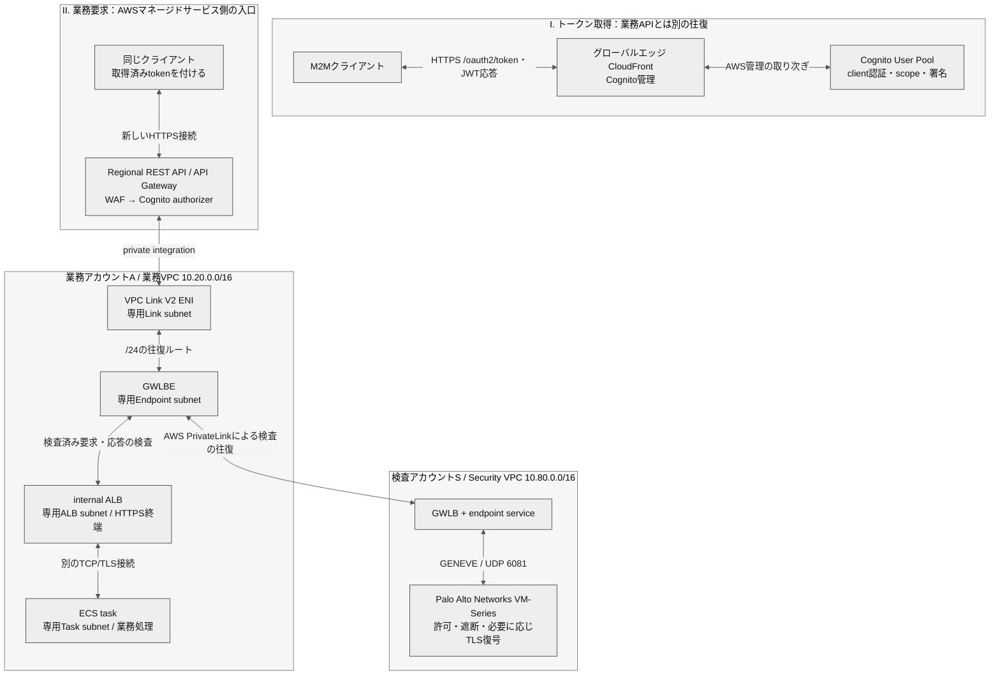
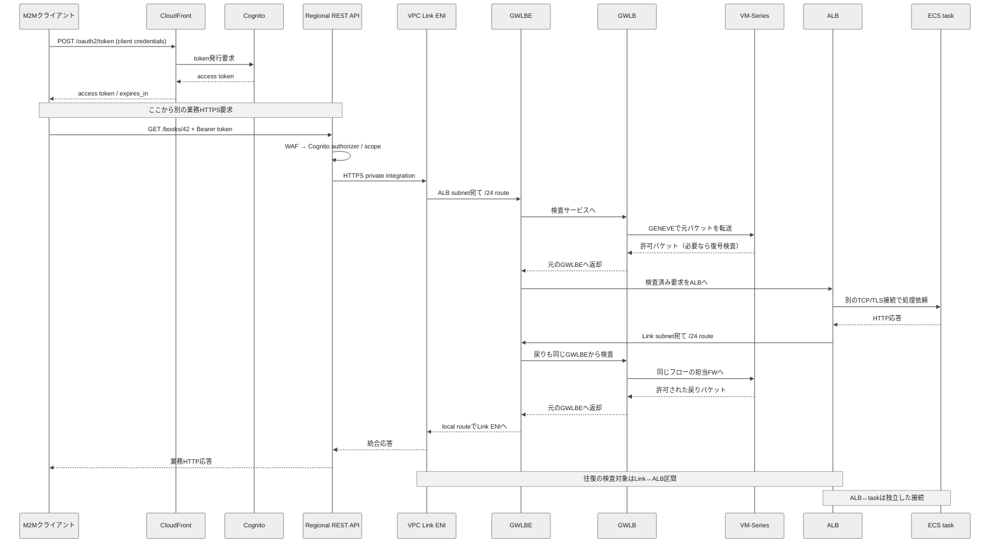

# CloudFront・Cognito M2M・Regional REST API・GWLBE・Palo Alto・ALB・ECSの通信を理解する

公式情報確認日：**2026-10-03**。AWS、Palo Alto Networks、RFC Editorの一次資料を確認した参照設計です。

**最初の結論：** token取得と業務APIは別の往復です。現在のREST APIはVPC Link V2でALBへ直接統合できます。公開API Gatewayへの着信を利用者VPCのIGW経由とする説明は正確ではありません。VPC LinkとALBの間へGWLBEを挿入するには、別subnet・往復の具体的なルート・FWの対称性が必要です。

根拠：[S01](https://aws.amazon.com/about-aws/whats-new/2025/11/api-gateway-rest-apis-integration-load-balancer/) [S02](https://docs.aws.amazon.com/apigateway/latest/developerguide/private-integration.html) [S13](https://docs.aws.amazon.com/apigateway/latest/developerguide/api-gateway-api-endpoint-types.html) [S14](https://docs.aws.amazon.com/vpc/latest/userguide/VPC_Internet_Gateway.html) [S15](https://docs.aws.amazon.com/vpc/latest/userguide/route-table-options.html) [S19](https://docs.aws.amazon.com/elasticloadbalancing/latest/gateway/edit-target-group-attributes.html)。

前提は東京リージョン、IPv4、2AZ、同一業務VPC、internal ALB、ECS awsvpcです。住所・IP・portは架空の設計例です。実際のAWS設定は取得しておらず、実通信、TLS復号、性能、障害の試験は未実施です。個別機能の確認と、組合せの設計上の推論を区別します。

推奨する読み順：04のたとえ → 02の全体図 → 06の認証 → 09/10の往復 → 14/15のルート → 16のTLS。Excelは全セルMeiryo UIとモノトーンで、同じ本文を章別のシートに収録しています。

## 目次

- [01 最初に押さえること](#chapter-01)
- [02 全体構成図](#chapter-02)
- [03 往復シーケンス](#chapter-03)
- [04 たとえと登場人物](#chapter-04)
- [05 構成と配置](#chapter-05)
- [06 認証の行き帰り](#chapter-06)
- [07 トークンの中身](#chapter-07)
- [08 API受付と認可](#chapter-08)
- [09 業務通信の行き](#chapter-09)
- [10 応答の戻り](#chapter-10)
- [11 VPCLinkV2詳細](#chapter-11)
- [12 GWLBとPaloAlto](#chapter-12)
- [13 サブネット設計](#chapter-13)
- [14 ルート表](#chapter-14)
- [15 ルート動作例](#chapter-15)
- [16 TLSと検査範囲](#chapter-16)
- [17 SGと許可設定](#chapter-17)
- [18 ALBとECS](#chapter-18)
- [19 可用性と性能](#chapter-19)
- [20 ログと障害調査](#chapter-20)
- [21 歴史と背景](#chapter-21)
- [22 よくある誤解](#chapter-22)
- [23 構築と検証手順](#chapter-23)
- [24 用語集](#chapter-24)
- [25 一次情報](#chapter-25)
- [26 HTTP例と設定対応](#chapter-26)

<a id="chapter-01"></a>

## 01 最初に押さえること

最初の結論：トークンをもらう通信と、そのトークンで業務APIを呼ぶ通信は別です。公開サービスの入口と、お客様のVPC内の通信を分けると全体が理解できます。

### 01.01 構成は条件付きで成立

**やさしく言うと：** ロボットが通行証をもらい、受付と検査所を通って図書室へ行くイメージです。

Regional REST API→VPC Link V2→internal ALBが現在の基本線です。そのVPC内区間に、別アカウントのGWLB/VM-SeriesをGWLBEとサブネットルートで挿入する設計例を示します。

**設定・確認：** 個々の機能は公式確認済み。組み合わせ全体は設計例であり、実環境での疎通・復号・障害試験は未実施です。

根拠・位置付け：[S01](https://aws.amazon.com/about-aws/whats-new/2025/11/api-gateway-rest-apis-integration-load-balancer/) [S02](https://docs.aws.amazon.com/apigateway/latest/developerguide/private-integration.html) [S15](https://docs.aws.amazon.com/vpc/latest/userguide/route-table-options.html) [S21](https://docs.paloaltonetworks.com/vm-series/deployment/public-cloud/set-up-the-vm-series-firewall-on-aws/vm-series-integration-with-gateway-load-balancer)

### 01.02 認証と業務は2往復

**やさしく言うと：** 通行証を受け取ってから、別の窓口へ本を頼みます。

①クライアント→CloudFront→Cognito→クライアント。②クライアント→Regional API→検査→ALB→ECS→クライアント。トークンがCognitoから自動的にECSへ転送されるわけではありません。

**設定・確認：** トークンは呼出側が受け取り、業務リクエストのAuthorizationヘッダーへ設定します。

根拠・位置付け：[S05](https://docs.aws.amazon.com/cognito/latest/developerguide/cognito-user-pools-add-custom-domain.html) [S06](https://docs.aws.amazon.com/cognito/latest/developerguide/token-endpoint.html) [S07](https://docs.aws.amazon.com/cognito/latest/developerguide/cognito-user-pools-define-resource-servers.html)

### 01.03 IGWの位置を修正

**やさしく言うと：** 学校の門は学校の敷地用です。町のすべての受付に共通の門ではありません。

Internet Gatewayは特定VPCにアタッチする部品です。インターネットから公開Regional API Gatewayへ到達するとき、お客様のVPCのIGWを必ず通るという構成にはなりません。

**設定・確認：** 主構成のAPI Gateway→VPC Link→ALBにIGWは不要。呼出元がVPC内なら、その外向き通信にIGW/NATが関わる場合があります。

根拠・位置付け：[S13](https://docs.aws.amazon.com/apigateway/latest/developerguide/api-gateway-api-endpoint-types.html) [S14](https://docs.aws.amazon.com/vpc/latest/userguide/VPC_Internet_Gateway.html)

### 01.04 RESTとV2は両立

**やさしく言うと：** 新しい連絡通路を、いつもの受付でも使えるようになりました。

2025-11-21にREST APIのALB直接プライベート統合が発表されました。VPC Link V2という名前からHTTP API専用と判断しないでください。

**設定・確認：** 古いREST→VPC Link V1→NLB→ALBの説明を、現在の新規構成にそのまま当てはめません。

根拠・位置付け：[S01](https://aws.amazon.com/about-aws/whats-new/2025/11/api-gateway-rest-apis-integration-load-balancer/) [S52](https://aws.amazon.com/about-aws/whats-new/2017/11/amazon-api-gateway-supports-endpoint-integrations-with-private-vpcs/)

### 01.05 GWLBとGWLBEの配置

**やさしく言うと：** 各学校に検査所へつながる出入口を置き、検査員を本部に集めます。

業務アカウントAのVPCにGWLBE、インターネット接続/検査アカウントSのVPCにGWLBとPalo Alto Networks VM-Seriesを置きます。両者はendpoint serviceで結びます。

**設定・確認：** アカウント名が『インターネット接続』でも、今回の検査の往復はPrivateLink経由です。TGWやIGWを自動的に通る意味ではありません。

根拠・位置付け：[S16](https://docs.aws.amazon.com/vpc/latest/privatelink/gateway-load-balancer-endpoints.html) [S17](https://docs.aws.amazon.com/elasticloadbalancing/latest/gateway/introduction.html) [S34](https://docs.aws.amazon.com/vpc/latest/privatelink/concepts.html)

### 01.06 帰り道も設計する

**やさしく言うと：** 検査した係員に、帰りの荷物も見てもらいます。

状態を持つFWは通信開始からの流れを覚えます。行きだけGWLBE、戻りはlocal直通という設計では検査が欠けます。両方向を同じGWLBEと同じFWフローへ通します。

**設定・確認：** ALBが別AZのノードでも成立するルート表を14・15章に記載しています。

根拠・位置付け：[S15](https://docs.aws.amazon.com/vpc/latest/userguide/route-table-options.html) [S19](https://docs.aws.amazon.com/elasticloadbalancing/latest/gateway/edit-target-group-attributes.html) [S21](https://docs.paloaltonetworks.com/vm-series/deployment/public-cloud/set-up-the-vm-series-firewall-on-aws/vm-series-integration-with-gateway-load-balancer)

### 01.07 HTTPSの見える範囲

**やさしく言うと：** 鍵付きの箱は、外の宛先は見えても中の文章は読めません。

GWLB/GENEVEが自動でTLSを復号することはありません。Palo Altoで本文を検査するには、適切なSSL Inbound Inspection、証明書・秘密鍵、対応バージョン等が必要です。

**設定・確認：** 『FWを通過した』と『HTTP本文を検査した』を別の検証項目にします。

根拠・位置付け：[S17](https://docs.aws.amazon.com/elasticloadbalancing/latest/gateway/introduction.html) [S21](https://docs.paloaltonetworks.com/vm-series/deployment/public-cloud/set-up-the-vm-series-firewall-on-aws/vm-series-integration-with-gateway-load-balancer) [S22](https://docs.paloaltonetworks.com/network-security/decryption/administration/enabling-decryption/configure-ssl-inbound-inspection)

### 01.08 検査対象の区間

**やさしく言うと：** 受付から案内係までの通路を検査します。図書室内の通路は別です。

挿入場所はVPC Link ENI↔ALBの区間です。ALB↔ECSはALBが作る別接続です。今回のルートだけでALB↔ECSやECSの外向き通信まで検査されるわけではありません。

**設定・確認：** APIキャッシュで後段へ行かない要求や、WAF/認可で拒否された要求もFWへ到達しません。

根拠・位置付け：[S03](https://docs.aws.amazon.com/apigateway/latest/developerguide/apigateway-vpc-links-v2.html) [S15](https://docs.aws.amazon.com/vpc/latest/userguide/route-table-options.html) [S64](https://docs.aws.amazon.com/elasticloadbalancing/latest/application/create-https-listener.html)

### 01.09 読むときの前提

**やさしく言うと：** 地図の住所は、しくみを学ぶための例です。

例は東京リージョン、IPv4、2AZ、単一業務VPC、internal ALB、ECS awsvpcです。CIDR、ドメイン、ポート、時刻は説明用で、実在するお客様の設定を示しません。

**設定・確認：** AS-IS設定を調べた監査報告ではありません。事実・設計上の選択・要実機確認を区別しています。

根拠・位置付け：設計前提

### 01.10 小学生向けの読み方

**やさしく言うと：** まずお話と地図を読み、そのあと通行証と道順を見ます。

04章のたとえ→02章の全体図→06章の認証→09・10章の行き帰り→14・15章のルート→16章の暗号化、の順に読みます。技術者は11〜23章を設計確認に使えます。

**設定・確認：** 各行は『やさしい説明』『仕組み』『設定と注意』『出典』の順です。たとえは理解用で、厳密な仕様は詳細欄を優先します。

根拠・位置付け：編集方針


<a id="chapter-02"></a>

## 02 全体構成図

CloudFrontは認証の入口。公開Regional APIは利用者VPCの外側にあるサービスの入口。VPC Linkから先で、別アカウントの検査サービスを往復します。



Mermaid非対応の表示環境でも、次の文字図と03章の順序表で経路を確認できます。

```text
認証：client ⇄ CloudFront ⇄ Cognito（tokenはclientへ戻る）
業務：client ⇄ Regional REST API［WAF → Cognito認可］ ⇄ VPC Link ENI
      ⇄ GWLBE ⇄ internal ALB ⇄ ECS task
検査：GWLBE → GWLB → VM-Series → GWLB → 同じGWLBE
      業務要求と業務応答の両方向に上記検査を適用。
```

### 02.01 図の読み方

**やさしく言うと：** 2つの往復を別々にたどります。

Iでtokenがクライアントへ戻った後、IIを開始します。検査の寄り道は必ずGWLBE→GWLB→FW→GWLB→元のGWLBEです。

**設定・確認：** 図の双方向矢印は到達関係。時間順序は03章を参照。AZ-Aの経路を代表表示し、Bにも同じ役割を配置します。

根拠・位置付け：[S02](https://docs.aws.amazon.com/apigateway/latest/developerguide/private-integration.html) [S05](https://docs.aws.amazon.com/cognito/latest/developerguide/cognito-user-pools-add-custom-domain.html) [S15](https://docs.aws.amazon.com/vpc/latest/userguide/route-table-options.html) [S17](https://docs.aws.amazon.com/elasticloadbalancing/latest/gateway/introduction.html)

### 02.02 IGWを置かない理由

**やさしく言うと：** 町の窓口への来客は、学校の門を通る必要がありません。

公開Regional API Gatewayへインターネットから入る位置に、利用者のIGWはありません。VPCへ入るのはprivate integrationのVPC Link側です。

**設定・確認：** ALBとECSの応答もVPC Link→API Gatewayへ戻ります。

根拠・位置付け：[S13](https://docs.aws.amazon.com/apigateway/latest/developerguide/api-gateway-api-endpoint-types.html) [S14](https://docs.aws.amazon.com/vpc/latest/userguide/VPC_Internet_Gateway.html)

### 02.03 設計例の確認範囲

**やさしく言うと：** 地図どおりの道を、現地で確かめる必要があります。

同一業務VPCでVPC Link ENIとALBを別subnetに置き、GWLBEをmore specific routingで挿入する、公式機能を組み合わせた参照設計です。

**設定・確認：** この特定の組合せのAWS/PAN-OS実機動作・性能・復号は未確認。14・23章を使って受入検証します。

根拠・位置付け：設計上の統合・[S03](https://docs.aws.amazon.com/apigateway/latest/developerguide/apigateway-vpc-links-v2.html) [S15](https://docs.aws.amazon.com/vpc/latest/userguide/route-table-options.html) [S21](https://docs.paloaltonetworks.com/vm-series/deployment/public-cloud/set-up-the-vm-series-firewall-on-aws/vm-series-integration-with-gateway-load-balancer)


<a id="chapter-03"></a>

## 03 往復シーケンス

T0=認証、T1=公開API、T2=API統合、T3=ALB→task。T0/T1/T2/T3は別の接続です。GENEVE外側の通信がT2を包むので、同じポートと勘違いしないようにします。



### 03.01 01 / T0

**やさしく言うと：** クライアント → CloudFront

POST /oauth2/token。client ID/secretと必要scopeを送ります。

**設定・確認：** TLS接続T0：secretを保護。

根拠・位置付け：[S05](https://docs.aws.amazon.com/cognito/latest/developerguide/cognito-user-pools-add-custom-domain.html) [S06](https://docs.aws.amazon.com/cognito/latest/developerguide/token-endpoint.html)

### 03.02 02 / T0

**やさしく言うと：** CloudFront → Cognito

Cognitoへtoken発行を取り次ぎます。

**設定・確認：** CloudFront自体がJWT発行者ではありません。

根拠・位置付け：[S05](https://docs.aws.amazon.com/cognito/latest/developerguide/cognito-user-pools-add-custom-domain.html) [S06](https://docs.aws.amazon.com/cognito/latest/developerguide/token-endpoint.html)

### 03.03 03 / T0

**やさしく言うと：** Cognito → CloudFront

client認証・scope確認後、署名済みaccess tokenを返します。

**設定・確認：** 通常のM2MにID/refresh tokenはありません。

根拠・位置付け：[S06](https://docs.aws.amazon.com/cognito/latest/developerguide/token-endpoint.html) [S09](https://docs.aws.amazon.com/cognito/latest/developerguide/amazon-cognito-user-pools-using-the-access-token.html)

### 03.04 04 / T0

**やさしく言うと：** CloudFront → クライアント

tokenを受け取り、安全に保持します。

**設定・確認：** 認証の往復はここで完了。

根拠・位置付け：[S05](https://docs.aws.amazon.com/cognito/latest/developerguide/cognito-user-pools-add-custom-domain.html) [S06](https://docs.aws.amazon.com/cognito/latest/developerguide/token-endpoint.html)

### 03.05 05 / T1

**やさしく言うと：** クライアント → Regional API

新しい要求へBearer tokenを設定します。

**設定・確認：** 業務用HTTPS接続。Cognito用CloudFrontとは別。

根拠・位置付け：[S11](https://docs.aws.amazon.com/apigateway/latest/developerguide/apigateway-enable-cognito-user-pool.html) [S13](https://docs.aws.amazon.com/apigateway/latest/developerguide/api-gateway-api-endpoint-types.html)

### 03.06 06 / 処理

**やさしく言うと：** API内：WAF → 認可

WAF、Cognito authorizerとscope条件を満たすか確認します。

**設定・確認：** 拒否ならここで応答。後段へ進みません。

根拠・位置付け：[S11](https://docs.aws.amazon.com/apigateway/latest/developerguide/apigateway-enable-cognito-user-pool.html) [S12](https://docs.aws.amazon.com/apigateway/latest/developerguide/apigateway-control-access-aws-waf.html)

### 03.07 07 / T2

**やさしく言うと：** API → VPC Link ENI

ALB向けprivate integrationの接続を作ります。

**設定・確認：** 外部client接続とは別の通信。

根拠・位置付け：[S03](https://docs.aws.amazon.com/apigateway/latest/developerguide/apigateway-vpc-links-v2.html) [S04](https://docs.aws.amazon.com/apigateway/latest/developerguide/set-up-private-integration.html)

### 03.08 08 / T2

**やさしく言うと：** Link ENI → GWLBE

ALB subnet /24へのルートを使います。

**設定・確認：** source例10.20.10.10。

根拠・位置付け：[S15](https://docs.aws.amazon.com/vpc/latest/userguide/route-table-options.html)

### 03.09 09 / 検査

**やさしく言うと：** GWLBE → GWLB

アカウントSの検査サービスへ送ります。

**設定・確認：** PrivateLinkの検査用往復。

根拠・位置付け：[S16](https://docs.aws.amazon.com/vpc/latest/privatelink/gateway-load-balancer-endpoints.html) [S17](https://docs.aws.amazon.com/elasticloadbalancing/latest/gateway/introduction.html)

### 03.10 10 / 外側

**やさしく言うと：** GWLB → VM-Series

GENEVEで包み、担当FWへ渡します。

**設定・確認：** 外側UDP6081／内側TCP443。

根拠・位置付け：[S63](https://docs.aws.amazon.com/elasticloadbalancing/latest/gateway/target-groups.html)

### 03.11 11 / 外側

**やさしく言うと：** VM-Series → GWLB

許可した要求パケットを返します。

**設定・確認：** FWの設定に従い検査・必要な復号。

根拠・位置付け：[S21](https://docs.paloaltonetworks.com/vm-series/deployment/public-cloud/set-up-the-vm-series-firewall-on-aws/vm-series-integration-with-gateway-load-balancer) [S22](https://docs.paloaltonetworks.com/network-security/decryption/administration/enabling-decryption/configure-ssl-inbound-inspection)

### 03.12 12 / 検査

**やさしく言うと：** GWLB → 元のGWLBE

検査済み要求を元の業務VPCへ返します。

**設定・確認：** FWからALBへ直接抜けません。

根拠・位置付け：[S17](https://docs.aws.amazon.com/elasticloadbalancing/latest/gateway/introduction.html) [S21](https://docs.paloaltonetworks.com/vm-series/deployment/public-cloud/set-up-the-vm-series-firewall-on-aws/vm-series-integration-with-gateway-load-balancer)

### 03.13 13 / T2

**やさしく言うと：** GWLBE → ALB

Endpoint subnetのlocal routeでALBへ届きます。

**設定・確認：** ALBでT2を終端。

根拠・位置付け：[S15](https://docs.aws.amazon.com/vpc/latest/userguide/route-table-options.html) [S64](https://docs.aws.amazon.com/elasticloadbalancing/latest/application/create-https-listener.html)

### 03.14 14 / T3

**やさしく言うと：** ALB → ECS task

別の接続でHTTP要求を渡します。

**設定・確認：** 本例HTTPS8443。今回のGWLBE区間外。

根拠・位置付け：[S24](https://docs.aws.amazon.com/AmazonECS/latest/developerguide/alb.html) [S25](https://docs.aws.amazon.com/elasticloadbalancing/latest/application/load-balancer-target-groups.html)

### 03.15 15 / T3

**やさしく言うと：** ECS task → ALB

業務結果を同じbackend接続で返します。

**設定・確認：** 外部clientへ直接応答しません。

根拠・位置付け：[S25](https://docs.aws.amazon.com/elasticloadbalancing/latest/application/load-balancer-target-groups.html) [S64](https://docs.aws.amazon.com/elasticloadbalancing/latest/application/create-https-listener.html)

### 03.16 16 / T2

**やさしく言うと：** ALB → GWLBE

Link subnet /24の戻りルートで送ります。

**設定・確認：** 往路と同じendpointを選択。

根拠・位置付け：[S15](https://docs.aws.amazon.com/vpc/latest/userguide/route-table-options.html) [S19](https://docs.aws.amazon.com/elasticloadbalancing/latest/gateway/edit-target-group-attributes.html)

### 03.17 17 / 検査

**やさしく言うと：** GWLBE → GWLB

応答も検査サービスへ送ります。

**設定・確認：** 往復対称性を維持。

根拠・位置付け：[S17](https://docs.aws.amazon.com/elasticloadbalancing/latest/gateway/introduction.html) [S19](https://docs.aws.amazon.com/elasticloadbalancing/latest/gateway/edit-target-group-attributes.html)

### 03.18 18 / 外側

**やさしく言うと：** GWLB → 同じVM-Series

同じフローの状態を持つFWへ送ります。

**設定・確認：** 通常のflow stickiness。障害時は別途考慮。

根拠・位置付け：[S19](https://docs.aws.amazon.com/elasticloadbalancing/latest/gateway/edit-target-group-attributes.html) [S20](https://docs.aws.amazon.com/elasticloadbalancing/latest/gateway/health-checks.html)

### 03.19 19 / 外側

**やさしく言うと：** VM-Series → GWLB

許可した応答パケットを返します。

**設定・確認：** 本文の可視範囲は復号設定によります。

根拠・位置付け：[S21](https://docs.paloaltonetworks.com/vm-series/deployment/public-cloud/set-up-the-vm-series-firewall-on-aws/vm-series-integration-with-gateway-load-balancer) [S22](https://docs.paloaltonetworks.com/network-security/decryption/administration/enabling-decryption/configure-ssl-inbound-inspection)

### 03.20 20 / 検査

**やさしく言うと：** GWLB → 元のGWLBE

応答を元のendpointへ戻します。

**設定・確認：** インターネットへ直接出ません。

根拠・位置付け：[S17](https://docs.aws.amazon.com/elasticloadbalancing/latest/gateway/introduction.html)

### 03.21 21 / T2

**やさしく言うと：** GWLBE → VPC Link ENI

Endpoint subnetのlocalでLink ENIへ届きます。

**設定・確認：** 例10.20.30.10:443→10.20.10.10:53000。

根拠・位置付け：[S03](https://docs.aws.amazon.com/apigateway/latest/developerguide/apigateway-vpc-links-v2.html) [S15](https://docs.aws.amazon.com/vpc/latest/userguide/route-table-options.html)

### 03.22 22 / 統合

**やさしく言うと：** VPC Link → API Gateway

統合接続上の応答をAPIが受け取ります。

**設定・確認：** 認証サービスへの再照会ではありません。

根拠・位置付け：[S02](https://docs.aws.amazon.com/apigateway/latest/developerguide/private-integration.html) [S03](https://docs.aws.amazon.com/apigateway/latest/developerguide/apigateway-vpc-links-v2.html)

### 03.23 23 / T1

**やさしく言うと：** API Gateway → クライアント

公開HTTPS接続上で業務結果を返します。

**設定・確認：** Cognito・認証用CloudFrontは通りません。

根拠・位置付け：[S13](https://docs.aws.amazon.com/apigateway/latest/developerguide/api-gateway-api-endpoint-types.html)


<a id="chapter-04"></a>

## 04 たとえと登場人物

ずかんを取り寄せるロボットの話で考えます。認証は『だれか』、認可は『何をしてよいか』、検査は『危険なものがないか』です。

### 04.01 呼出クライアント

**やさしく言うと：** 図書室へ本を頼むロボット。

定期バッチ、サーバー、他社システム等です。人のブラウザでログインする代わりに、自分のclient ID/secretで機械として認証します。

**設定・確認：** secretを安全に保持できるサーバー側のconfidential clientを使います。

根拠・位置付け：[S07](https://docs.aws.amazon.com/cognito/latest/developerguide/cognito-user-pools-define-resource-servers.html) [S08](https://docs.aws.amazon.com/cognito/latest/developerguide/user-pool-settings-client-apps.html)

### 04.02 CloudFront

**やさしく言うと：** 世界各地にある案内窓口。

利用者に近いエッジで接続を受けます。この資料ではCognitoカスタムドメインにCognitoが用意するCloudFrontを採用します。

**設定・確認：** 近い窓口でも、トークンを発行するCognitoの処理そのものが世界中で行われる意味ではありません。

根拠・位置付け：[S05](https://docs.aws.amazon.com/cognito/latest/developerguide/cognito-user-pools-add-custom-domain.html) [S43](https://aws.amazon.com/about-aws/whats-new/2008/11/18/whats-new-cloudfront/)

### 04.03 Cognito User Pool

**やさしく言うと：** 通行証を発行する事務室。

アプリクライアントと許可scopeを管理し、署名付きaccess tokenを発行します。M2Mでは人のユーザーがログインする必要はありません。

**設定・確認：** User Poolという名称でも、M2Mの主体はアプリです。IAM権限を渡すIdentity Poolとも別です。

根拠・位置付け：[S07](https://docs.aws.amazon.com/cognito/latest/developerguide/cognito-user-pools-define-resource-servers.html) [S09](https://docs.aws.amazon.com/cognito/latest/developerguide/amazon-cognito-user-pools-using-the-access-token.html) [S65](https://docs.aws.amazon.com/apigateway/latest/developerguide/apigateway-integrate-with-cognito.html)

### 04.04 client ID / secret

**やさしく言うと：** ロボットの登録番号と、本人だけが知る合言葉。

client IDは識別子、secretは認証に使う秘密です。業務APIにsecretを配らず、Cognitoが発行した短命のトークンを提示します。

**設定・確認：** IDとsecretを同じ意味にしません。secretやtokenをログ・URL・Excelへ実値で記録しません。

根拠・位置付け：[S08](https://docs.aws.amazon.com/cognito/latest/developerguide/user-pool-settings-client-apps.html) [S41](https://www.rfc-editor.org/rfc/rfc6749)

### 04.05 access token / scope

**やさしく言うと：** 期限と使える部屋が書かれた通行証。

JWTに期限やbooks-api/books.readのようなscopeが入ります。scopeは許可された操作の名前です。

**設定・確認：** 通行証を持っているだけで全操作が許されるわけではありません。

根拠・位置付け：[S07](https://docs.aws.amazon.com/cognito/latest/developerguide/cognito-user-pools-define-resource-servers.html) [S09](https://docs.aws.amazon.com/cognito/latest/developerguide/amazon-cognito-user-pools-using-the-access-token.html)

### 04.06 API Gateway / REST API

**やさしく言うと：** 本の注文を受ける受付と、受付で受け付ける注文メニュー。

API GatewayがREST APIを提供します。Regional API GatewayとRegional REST APIを別々のネットワーク装置2台と考える必要はありません。

**設定・確認：** GET /books/42等のメソッド・パスごとに認可と統合を設定します。

根拠・位置付け：[S11](https://docs.aws.amazon.com/apigateway/latest/developerguide/apigateway-enable-cognito-user-pool.html) [S13](https://docs.aws.amazon.com/apigateway/latest/developerguide/api-gateway-api-endpoint-types.html)

### 04.07 AWS WAF

**やさしく言うと：** 受付で注文用紙を調べる係。

HTTPリクエストのURI、ヘッダー、本文等をルールに照らして調べます。SQLインジェクション等への対策を構成できます。

**設定・確認：** APIステージに関連付ける処理です。独立した通過先IPとしてルート表へ書く装置ではありません。

根拠・位置付け：[S12](https://docs.aws.amazon.com/apigateway/latest/developerguide/apigateway-control-access-aws-waf.html) [S27](https://docs.aws.amazon.com/waf/latest/developerguide/web-acl-setting-body-inspection-limit.html)

### 04.08 Cognito authorizer

**やさしく言うと：** 通行証の印と有効期限、使える部屋を確認する係。

信頼したUser Poolのtokenを使ってRESTメソッドへのアクセスを判断します。M2Mではメソッドに必要なOAuth scopeを設定します。

**設定・確認：** HTTP APIのJWT authorizerの設定手順と混ぜません。

根拠・位置付け：[S11](https://docs.aws.amazon.com/apigateway/latest/developerguide/apigateway-enable-cognito-user-pool.html) [S28](https://docs.aws.amazon.com/apigateway/latest/developerguide/http-api-vs-rest.html)

### 04.09 VPC / subnet / AZ

**やさしく言うと：** 学校の敷地、敷地の区画、離れた校舎。

VPCは隔離されたネットワーク、subnetはそのIP範囲の区切り、AZはリージョン内の障害分離単位です。1つのsubnetは1つのAZに属します。

**設定・確認：** 物理的に隣かどうかを表す比喩ではなく、接続と障害の境界として読みます。

根拠・位置付け：[S03](https://docs.aws.amazon.com/apigateway/latest/developerguide/apigateway-vpc-links-v2.html) [S16](https://docs.aws.amazon.com/vpc/latest/privatelink/gateway-load-balancer-endpoints.html) [S44](https://aws.amazon.com/about-aws/whats-new/2009/08/26/introducing-amazon-virtual-private-cloud/)

### 04.10 Internet Gateway

**やさしく言うと：** 学校の敷地と公道をつなぐ門。

VPCとインターネットをつなぐ部品です。アカウントに属するすべてのマネージドサービスを囲う門ではありません。

**設定・確認：** 公開API Gatewayの手前へ利用者のIGWを描かないことが重要です。

根拠・位置付け：[S14](https://docs.aws.amazon.com/vpc/latest/userguide/VPC_Internet_Gateway.html)

### 04.11 VPC Link V2 / ENI

**やさしく言うと：** 外の受付から敷地内へ入る連絡通路と出口。

API Gatewayが選択サブネットへENIを作り、そこからVPC内のLBへ通信します。ENIは仮想ネットワークカードです。

**設定・確認：** ENIの所在サブネットのルートとSGが設計上の要点です。

根拠・位置付け：[S03](https://docs.aws.amazon.com/apigateway/latest/developerguide/apigateway-vpc-links-v2.html)

### 04.12 GWLBE

**やさしく言うと：** 検査本部へ荷物を送って、検査後に受け取る出入口。

Gateway Load Balancer endpointの略です。ルート表の次の送り先に指定します。HTTPの宛先URLではありません。

**設定・確認：** GWLBE自体が脅威判定をするわけではありません。

根拠・位置付け：[S16](https://docs.aws.amazon.com/vpc/latest/privatelink/gateway-load-balancer-endpoints.html) [S34](https://docs.aws.amazon.com/vpc/latest/privatelink/concepts.html)

### 04.13 GWLB / Palo Alto

**やさしく言うと：** 検査員へ仕事を振り分ける係と、実際の検査員。

GWLBはフローをVM-Seriesへ分配します。VM-Seriesがポリシー、App-ID、脅威防御等の設定に従って許可・遮断します。

**設定・確認：** GWLBとFWを同一機能として扱いません。必要な機能・ライセンス・性能はVM-Series構成に依存します。

根拠・位置付け：[S17](https://docs.aws.amazon.com/elasticloadbalancing/latest/gateway/introduction.html) [S21](https://docs.paloaltonetworks.com/vm-series/deployment/public-cloud/set-up-the-vm-series-firewall-on-aws/vm-series-integration-with-gateway-load-balancer)

### 04.14 GENEVE

**やさしく言うと：** 元の荷物を、検査用の送り状付き袋に入れる方法。

元のIPパケットを包み、GWLBとFWの間で運びます。FWが内側を検査し、所定の形式でGWLBへ返します。

**設定・確認：** 包装は暗号化そのものではありません。元のTLS暗号は別に残ります。

根拠・位置付け：[S17](https://docs.aws.amazon.com/elasticloadbalancing/latest/gateway/introduction.html) [S63](https://docs.aws.amazon.com/elasticloadbalancing/latest/gateway/target-groups.html)

### 04.15 ALB / ECS task

**やさしく言うと：** 注文を担当の机へ振り分ける案内係と、実際に本を探す担当者。

ALBはHTTPのHost/path等でターゲットへ振り分け、ECS task内のアプリが業務処理をします。ECS serviceはtaskの数と配置を管理します。

**設定・確認：** 通信が届くのはtaskのIP/portです。ECS管理APIを毎回経由するわけではありません。

根拠・位置付け：[S24](https://docs.aws.amazon.com/AmazonECS/latest/developerguide/alb.html) [S25](https://docs.aws.amazon.com/elasticloadbalancing/latest/application/load-balancer-target-groups.html)

### 04.16 ルート / SG / NACL

**やさしく言うと：** 道しるべ、部屋の入場規則、区画の出入り規則。

ルートはどこへ送るか、SGはENI等で通信を許すか、NACLはsubnet境界の通信を許すかを決めます。

**設定・確認：** 道があっても許可がなければ届かず、許可があっても道が違えば検査を通りません。

根拠・位置付け：[S15](https://docs.aws.amazon.com/vpc/latest/userguide/route-table-options.html) [S16](https://docs.aws.amazon.com/vpc/latest/privatelink/gateway-load-balancer-endpoints.html)


<a id="chapter-05"></a>

## 05 構成と配置

管理上のアカウント境界と、パケットが通るVPC境界を別々に示します。主構成では業務VPCに4種類のサブネットをAZごとに用意します。

### 05.01 アカウントA：業務

**やさしく言うと：** 図書室を運営する組織。

Regional REST API、regional WAF web ACL、VPC Link V2、業務VPC、internal ALB、ECSを所有します。例ではCognito User PoolもAに置きます。

**設定・確認：** API・VPC Link・統合先LBの同一アカウント制約と、Cognito poolの配置条件を混同しません。

根拠・位置付け：[S02](https://docs.aws.amazon.com/apigateway/latest/developerguide/private-integration.html) [S65](https://docs.aws.amazon.com/apigateway/latest/developerguide/apigateway-integrate-with-cognito.html)

### 05.02 アカウントS：検査

**やさしく言うと：** 複数の学校を担当する検査本部。

Security VPCにGWLB、GENEVE target group、VM-Series群、endpoint serviceを置きます。管理用通信やPanorama等は業務データ経路と分けます。

**設定・確認：** アカウントSのIGW/NATが存在しても、今回の検査データをそこへ送る必要はありません。

根拠・位置付け：[S17](https://docs.aws.amazon.com/elasticloadbalancing/latest/gateway/introduction.html) [S21](https://docs.paloaltonetworks.com/vm-series/deployment/public-cloud/set-up-the-vm-series-firewall-on-aws/vm-series-integration-with-gateway-load-balancer) [S32](https://docs.aws.amazon.com/vpc/latest/privatelink/configure-endpoint-service.html)

### 05.03 CloudFrontの所有

**やさしく言うと：** Cognitoが用意した案内窓口を使います。

Cognitoカスタムドメインを設定するとAWS管理のCloudFront distributionが作られます。Cognitoの論理リソースがアカウントAにあっても、distribution設定を利用者が自由変更できるものではありません。

**設定・確認：** 利用者独自のCloudFrontをもう1段置く構成は追加設計です。本資料の標準には含めません。

根拠・位置付け：[S05](https://docs.aws.amazon.com/cognito/latest/developerguide/cognito-user-pools-add-custom-domain.html)

### 05.04 独自CloudFrontを置く場合

**やさしく言うと：** 自分で案内窓口を追加するなら、取り次ぎ方も自分で決めます。

既存要件が利用者管理distributionを指すなら、Cognito originとのHTTPS、POST/body/Authorizationの転送、Host、cache policyを別途設計します。

**設定・確認：** token発行の共有cacheは使いません。Cognito管理distributionと同じ設定権限があると考えず、既存構成を確認します。

根拠・位置付け：[S05](https://docs.aws.amazon.com/cognito/latest/developerguide/cognito-user-pools-add-custom-domain.html) [S38](https://docs.aws.amazon.com/AmazonCloudFront/latest/DeveloperGuide/RequestAndResponseBehaviorCustomOrigin.html) [S39](https://docs.aws.amazon.com/AmazonCloudFront/latest/DeveloperGuide/http-401-unauthorized.html)

### 05.05 Cognito側WAFは別

**やさしく言うと：** 通行証窓口にも検査を置くなら、そちらにも規則を設定します。

API Gatewayのregional WAFは、別のCognito token endpointを自動的に保護しません。Cognito User Poolにweb ACLを関連付ける機能は別設定です。

**設定・確認：** M2Mが人用CAPTCHAを処理する前提にはしません。API用と認証用で許可・rate制御を設計します。

根拠・位置付け：[S12](https://docs.aws.amazon.com/apigateway/latest/developerguide/apigateway-control-access-aws-waf.html) [S40](https://docs.aws.amazon.com/cognito/latest/developerguide/user-pool-waf.html)

### 05.06 ドメインの分離

**やさしく言うと：** 通行証窓口と本の注文窓口を区別します。

auth.example.comはCognitoのtoken endpoint、api.example.comはRegional API、backend.example.comはALBとのTLS名/Hostの説明用です。

**設定・確認：** 同じAWSでも宛先・証明書・接続は別です。外部DNSからinternal ALBを公開入口にしません。

根拠・位置付け：[S04](https://docs.aws.amazon.com/apigateway/latest/developerguide/set-up-private-integration.html) [S05](https://docs.aws.amazon.com/cognito/latest/developerguide/cognito-user-pools-add-custom-domain.html) [S13](https://docs.aws.amazon.com/apigateway/latest/developerguide/api-gateway-api-endpoint-types.html)

### 05.07 リージョンとAZ

**やさしく言うと：** 同じ地域に2つの校舎を用意します。

例はap-northeast-1。A/Sで対応する物理AZにリソースを用意します。AZ-A/AZ-Bは説明用の呼称です。

**設定・確認：** アカウントごとのap-northeast-1a等の文字が同じでも同じ物理AZとは限りません。AZ IDで照合します。

根拠・位置付け：[S03](https://docs.aws.amazon.com/apigateway/latest/developerguide/apigateway-vpc-links-v2.html) [S16](https://docs.aws.amazon.com/vpc/latest/privatelink/gateway-load-balancer-endpoints.html)

### 05.08 業務VPC

**やさしく言うと：** ロボットの入口と案内係を別区画に置きます。

10.20.0.0/16内に、VPC Link ENI用、GWLBE用、ALB用、ECS用のサブネットを分けます。各役割を2AZに配置します。

**設定・確認：** VPC LinkとALBを同一subnetにすると、subnet間ルートによる検査挿入の前提を満たしません。

根拠・位置付け：[S15](https://docs.aws.amazon.com/vpc/latest/userguide/route-table-options.html) [S16](https://docs.aws.amazon.com/vpc/latest/privatelink/gateway-load-balancer-endpoints.html)

### 05.09 Security VPC

**やさしく言うと：** 検査だけを担当する敷地。

10.80.0.0/16を例に、GWLB用、FWデータ用、FW管理用を分けます。GWLBとFWを同一subnetに置くことも製品仕様上は可能ですが、本例では分離します。

**設定・確認：** FWから業務ALBへ直接出ていくルートは主経路にしません。検査後はGWLB/GWLBEへ戻します。

根拠・位置付け：[S17](https://docs.aws.amazon.com/elasticloadbalancing/latest/gateway/introduction.html) [S21](https://docs.paloaltonetworks.com/vm-series/deployment/public-cloud/set-up-the-vm-series-firewall-on-aws/vm-series-integration-with-gateway-load-balancer) [S33](https://docs.aws.amazon.com/elasticloadbalancing/latest/gateway/getting-started.html)

### 05.10 クロスアカウント接続

**やさしく言うと：** 本部が許した学校だけ専用の出入口を作れます。

SがAの必要なprincipalにendpoint service接続権限を付け、必要に応じて接続要求を承認します。Aが自VPCでAZごとにGWLBEを作ります。

**設定・確認：** GWLBはS、GWLBEはAです。VPC Linkが別アカウントのALBを直接選ぶ構成ではありません。

根拠・位置付け：[S02](https://docs.aws.amazon.com/apigateway/latest/developerguide/private-integration.html) [S16](https://docs.aws.amazon.com/vpc/latest/privatelink/gateway-load-balancer-endpoints.html) [S32](https://docs.aws.amazon.com/vpc/latest/privatelink/configure-endpoint-service.html)

### 05.11 TGWの位置付け

**やさしく言うと：** 学校同士の大きな交差点が必要な場合に追加します。

主構成は同一業務VPCのsubnet間をGWLBEへ向ける方式です。多数VPCをTGWで集約する検査パターンとは分けます。

**設定・確認：** TGWを採用する場合はattachmentのappliance mode、TGWルート、AZ対称性も設計します。GWLBがあるだけでTGWが必須とはしません。

根拠・位置付け：[S15](https://docs.aws.amazon.com/vpc/latest/userguide/route-table-options.html) [S19](https://docs.aws.amazon.com/elasticloadbalancing/latest/gateway/edit-target-group-attributes.html) [S21](https://docs.paloaltonetworks.com/vm-series/deployment/public-cloud/set-up-the-vm-series-firewall-on-aws/vm-series-integration-with-gateway-load-balancer) [S56](https://aws.amazon.com/blogs/networking-and-content-delivery/introducing-aws-gateway-load-balancer-supported-architecture-patterns/)

### 05.12 何が資料外か

**やさしく言うと：** 地図にない道路は、必要なら別に設計します。

ECSからDB、ECR、S3、CloudWatch、Secrets Manager等への接続、運用管理、DNS解決経路はこの業務要求とは別フローです。

**設定・確認：** task起動やログ転送に必要なVPC endpoint/NAT等は別途用意します。APIの応答経路と混ぜません。

根拠・位置付け：設計範囲


<a id="chapter-06"></a>

## 06 認証の行き帰り

人のログイン画面を開かず、機械が通行証をもらう12段階です。ここではCognitoのカスタムドメインを使ったclient_credentialsを説明します。

### 06.01 A01 事前登録

**やさしく言うと：** ロボット番号と合言葉、使ってよい部屋を登録します。

User Poolにsecret付きapp clientを作り、client_credentialsと必要なcustom scopeを許可します。例はbooks-api/books.read。

**設定・確認：** 同じapp clientで人向けauthorization code/implicit flowと混在させません。

根拠・位置付け：[S07](https://docs.aws.amazon.com/cognito/latest/developerguide/cognito-user-pools-define-resource-servers.html) [S08](https://docs.aws.amazon.com/cognito/latest/developerguide/user-pool-settings-client-apps.html) [S62](https://docs.aws.amazon.com/cognito/latest/developerguide/federation-endpoints-oauth-grants.html)

### 06.02 A02 DNSを調べる

**やさしく言うと：** auth.example.comの窓口の場所を調べます。

DNSレコードはCognitoが指定したCloudFront distributionのalias先へ向けます。クライアントは解決した入口へ接続します。

**設定・確認：** DNSは住所を知らせる仕組みです。tokenそのものを運んだり検査したりしません。

根拠・位置付け：[S05](https://docs.aws.amazon.com/cognito/latest/developerguide/cognito-user-pools-add-custom-domain.html)

### 06.03 A03 TLSで接続

**やさしく言うと：** 窓口との会話を鍵付きにします。

クライアントがauth.example.comの証明書を検証し、CloudFront側のエッジとHTTPS接続を確立します。

**設定・確認：** Cognitoカスタムドメイン用ACM証明書はUser Poolの場所にかかわらずus-east-1に用意します。

根拠・位置付け：[S05](https://docs.aws.amazon.com/cognito/latest/developerguide/cognito-user-pools-add-custom-domain.html)

### 06.04 A04 tokenを要求

**やさしく言うと：** 合言葉を示して『読む通行証をください』と頼みます。

POST /oauth2/token。Content-Typeはapplication/x-www-form-urlencoded。grant_type=client_credentialsとscopeを送り、client_secret_basic等でclientを認証します。

**設定・確認：** BasicのBase64は暗号ではありません。HTTPSを維持し、secretをURIクエリに入れません。

根拠・位置付け：[S06](https://docs.aws.amazon.com/cognito/latest/developerguide/token-endpoint.html) [S41](https://www.rfc-editor.org/rfc/rfc6749)

### 06.05 A05 エッジからCognito

**やさしく言うと：** 近くの窓口が事務室へ取り次ぎます。

Cognito管理のCloudFrontを通してtoken endpointに要求が届きます。エッジ自体がclient secretの正否を最終判定してJWTを発行するわけではありません。

**設定・確認：** 要求ごとに異なる秘密を含むtoken発行応答を共有CDNキャッシュで配る設計にはしません。

根拠・位置付け：[S05](https://docs.aws.amazon.com/cognito/latest/developerguide/cognito-user-pools-add-custom-domain.html) [S06](https://docs.aws.amazon.com/cognito/latest/developerguide/token-endpoint.html) [S39](https://docs.aws.amazon.com/AmazonCloudFront/latest/DeveloperGuide/http-401-unauthorized.html)

### 06.06 A06 機械を認証

**やさしく言うと：** 登録番号と合言葉の組合せを確認します。

Cognitoがapp client、secret、許可grantと要求scopeを確認します。M2MではユーザーパスワードやMFA入力を使う人の認証とは異なります。

**設定・確認：** 誤ったsecretや許可外scopeはtoken取得失敗として処理し、業務APIへ進めません。

根拠・位置付け：[S06](https://docs.aws.amazon.com/cognito/latest/developerguide/token-endpoint.html) [S08](https://docs.aws.amazon.com/cognito/latest/developerguide/user-pool-settings-client-apps.html)

### 06.07 A07 JWTを発行

**やさしく言うと：** 期限付きで、まねできない印を付けた通行証を作ります。

Cognitoはaccess tokenのclaimを作り、User Poolの署名鍵で署名します。機械のclient_id、token_use、scope、exp等が重要です。

**設定・確認：** 通常のclient_credentials応答はaccess tokenであり、ID token/refresh tokenは発行しません。

根拠・位置付け：[S06](https://docs.aws.amazon.com/cognito/latest/developerguide/token-endpoint.html) [S09](https://docs.aws.amazon.com/cognito/latest/developerguide/amazon-cognito-user-pools-using-the-access-token.html)

### 06.08 A08 応答が戻る

**やさしく言うと：** 事務室→案内窓口→ロボットの順に通行証が戻ります。

Cognitoのtoken応答がCloudFrontを経由してクライアントへ戻ります。JSONにはaccess_token、token_type、expires_in等が含まれます。

**設定・確認：** この応答はALB/ECSへ向かいません。認証の往復はここで完了します。

根拠・位置付け：[S05](https://docs.aws.amazon.com/cognito/latest/developerguide/cognito-user-pools-add-custom-domain.html) [S06](https://docs.aws.amazon.com/cognito/latest/developerguide/token-endpoint.html)

### 06.09 A09 安全に保管

**やさしく言うと：** 通行証を外へ見せず、期限内は使い回します。

呼出側がtokenをメモリ等で保持し、対象scopeと期限を管理します。実装例として期限の少し前に再取得し、複数処理の同時更新を1回へまとめます。

**設定・確認：** 業務API1回につきtoken発行1回は必須ではありません。再利用と短い有効期限のバランスを取ります。

根拠・位置付け：[S07](https://docs.aws.amazon.com/cognito/latest/developerguide/cognito-user-pools-define-resource-servers.html) [S09](https://docs.aws.amazon.com/cognito/latest/developerguide/amazon-cognito-user-pools-using-the-access-token.html)

### 06.10 A10 期限と再取得

**やさしく言うと：** 期限切れの通行証は新しくもらいます。

M2Mにはrefresh tokenがないため、同じclient_credentialsでaccess tokenを取り直します。時計ずれや一時的な取得失敗も考慮します。

**設定・確認：** 401を見て無限に再取得せず、原因判別・回数上限・待ち時間を設けます。

根拠・位置付け：[S06](https://docs.aws.amazon.com/cognito/latest/developerguide/token-endpoint.html) [S09](https://docs.aws.amazon.com/cognito/latest/developerguide/amazon-cognito-user-pools-using-the-access-token.html)

### 06.11 A11 secretを更新

**やさしく言うと：** 新しい合言葉へ、止めずに切り替えます。

現在は同じapp clientに最大2個のsecretを保持できます。新secret追加→呼出側切替→確認→旧secret削除、という運用が可能です。

**設定・確認：** 旧secret削除と発行済みtoken失効は別です。緊急停止はtoken期限や追加拒否制御も考えます。

根拠・位置付け：[S08](https://docs.aws.amazon.com/cognito/latest/developerguide/user-pool-settings-client-apps.html) [S57](https://docs.aws.amazon.com/cognito/latest/developerguide/cognito-document-history.html) [S66](https://docs.aws.amazon.com/solutions/latest/distributed-load-testing-on-aws/mcp-server-integration.html)

### 06.12 A12 新しい別方式

**やさしく言うと：** 最近は別の通行証窓口もあります。

最新文書にはドメイン不要のGetClientToken APIもあります。client ID/secretでM2M tokenを得ますが、本資料のCloudFront経由/oauth2/tokenとは別経路です。

**設定・確認：** 『すべてのM2Mにドメイン必須』とは一般化しません。ユーザー指定の主経路は変えず、比較事項として扱います。

根拠・位置付け：[S07](https://docs.aws.amazon.com/cognito/latest/developerguide/cognito-user-pools-define-resource-servers.html) [S31](https://docs.aws.amazon.com/cognito-user-identity-pools/latest/APIReference/API_GetClientToken.html)


<a id="chapter-07"></a>

## 07 トークンの中身

JWTは『内容を読める通行証に、改ざんを見破る署名が付いたもの』です。読めることと、信用できることは別です。

### 07.01 3つの部分

**やさしく言うと：** 表紙・説明文・本物の印。

典型的な署名付きJWTはheader.payload.signatureという3部分です。headerにはalg/kid、payloadにはclaim、signatureには改ざん検出用の値があります。

**設定・確認：** 文字列をBase64URLデコードしただけでは検証完了ではありません。

根拠・位置付け：[S09](https://docs.aws.amazon.com/cognito/latest/developerguide/amazon-cognito-user-pools-using-the-access-token.html) [S10](https://docs.aws.amazon.com/cognito/latest/developerguide/amazon-cognito-user-pools-using-tokens-verifying-a-jwt.html) [S42](https://www.rfc-editor.org/rfc/rfc7519)

### 07.02 iss：発行者

**やさしく言うと：** どの事務室が作ったか。

CognitoのissuerはUser Poolに対応するURLです。カスタムドメインのauth.example.comとtokenのissが必ず同じ文字列になるわけではありません。

**設定・確認：** 信頼したpoolのissuerだけを受け入れます。入力tokenが指定する任意URLへ鍵を取りに行く設計は避けます。

根拠・位置付け：[S10](https://docs.aws.amazon.com/cognito/latest/developerguide/amazon-cognito-user-pools-using-tokens-verifying-a-jwt.html)

### 07.03 kidとJWKS

**やさしく言うと：** 印を見分けるための見本番号と見本帳。

公開鍵集合JWKSからkidに対応した公開鍵を選んで署名を検証します。秘密の署名鍵はCognito側にあり、検証側は公開鍵で確かめます。

**設定・確認：** 鍵は変わり得ます。自作検証では信頼先固定、公開鍵キャッシュ、未知kid時の制御された再取得を設計します。

根拠・位置付け：[S10](https://docs.aws.amazon.com/cognito/latest/developerguide/amazon-cognito-user-pools-using-tokens-verifying-a-jwt.html)

### 07.04 client_id / sub

**やさしく言うと：** どのロボットの通行証か。

M2M access tokenのclient_idはapp clientのIDです。現行文書ではsubも同じapp client IDとなり、人のユーザーIDではありません。

**設定・確認：** M2M tokenにusernameやcognito:groups等の人向けclaimが必ずあると仮定しません。

根拠・位置付け：[S09](https://docs.aws.amazon.com/cognito/latest/developerguide/amazon-cognito-user-pools-using-the-access-token.html)

### 07.05 token_use

**やさしく言うと：** これはどの種類の通行証か。

access tokenではtoken_use=access。ID tokenは人の属性を伝える目的で、access tokenはAPIの操作を許可する目的です。

**設定・確認：** M2MのメソッドにはOAuth scopeを設定してaccess tokenによる認可を使います。

根拠・位置付け：[S09](https://docs.aws.amazon.com/cognito/latest/developerguide/amazon-cognito-user-pools-using-the-access-token.html) [S11](https://docs.aws.amazon.com/apigateway/latest/developerguide/apigateway-enable-cognito-user-pool.html)

### 07.06 scope

**やさしく言うと：** 図書室で『読む』ことだけ許す印。

例はbooks-api/books.read。resource server identifierとscope名を/でつなぎます。複数scopeは通常スペースで区切られます。

**設定・確認：** books.readとbooks-api/books.readは別文字列です。完全なscope名を一致させます。

根拠・位置付け：[S07](https://docs.aws.amazon.com/cognito/latest/developerguide/cognito-user-pools-define-resource-servers.html) [S11](https://docs.aws.amazon.com/apigateway/latest/developerguide/apigateway-enable-cognito-user-pool.html)

### 07.07 exp / iat

**やさしく言うと：** いつ作られ、いつ期限が切れるか。

expは有効期限、iatは発行時刻を表す時刻claimです。token検証は現在時刻との比較を含みます。

**設定・確認：** サーバー時刻を同期し、呼出側は期限ぎりぎりまで待たず再取得します。例示の有効期間は設計値です。

根拠・位置付け：[S09](https://docs.aws.amazon.com/cognito/latest/developerguide/amazon-cognito-user-pools-using-the-access-token.html) [S10](https://docs.aws.amazon.com/cognito/latest/developerguide/amazon-cognito-user-pools-using-tokens-verifying-a-jwt.html)

### 07.08 audの取り違え

**やさしく言うと：** 通行証の種類ごとに、書かれる欄が違います。

通常のCognito M2M tokenをID tokenのaud前提で扱いません。現行Cognitoのresource bindingはユーザー向けで、client_credentialsには適用されません。

**設定・確認：** REST Cognito authorizerのID token用aud正規表現をM2Mへ安易に設定しません。HTTP APIのaud/client_id規則とも区別します。

根拠・位置付け：[S07](https://docs.aws.amazon.com/cognito/latest/developerguide/cognito-user-pools-define-resource-servers.html) [S10](https://docs.aws.amazon.com/cognito/latest/developerguide/amazon-cognito-user-pools-using-tokens-verifying-a-jwt.html) [S11](https://docs.aws.amazon.com/apigateway/latest/developerguide/apigateway-enable-cognito-user-pool.html)

### 07.09 毎回Cognitoへ照会？

**やさしく言うと：** 印の見本があれば、その場で本物か調べられます。

JWTは署名とclaimにより検証できる形式です。業務APIの呼出しごとに/oauth2/tokenへtokenを返して許可を聞く構造ではありません。

**設定・確認：** 公開鍵取得などの制御用通信はあり得ますが、業務のデータ経路とは分けて考えます。

根拠・位置付け：[S10](https://docs.aws.amazon.com/cognito/latest/developerguide/amazon-cognito-user-pools-using-tokens-verifying-a-jwt.html) [S42](https://www.rfc-editor.org/rfc/rfc7519)

### 07.10 Bearerの性質

**やさしく言うと：** 持っている人が使える通行証です。

一般的なBearer tokenは盗まれると、期限や権限の範囲で悪用され得ます。JWTの署名は盗難を防ぐ暗号化ではありません。

**設定・確認：** TLS、秘密保管、ログの秘匿、最小scope、短命化を組み合わせます。

根拠・位置付け：[S06](https://docs.aws.amazon.com/cognito/latest/developerguide/token-endpoint.html) [S41](https://www.rfc-editor.org/rfc/rfc6749) [S42](https://www.rfc-editor.org/rfc/rfc7519)

### 07.11 追加の業務権限

**やさしく言うと：** 図書室へ入れても、他の人の貸出記録を読んでよいとは限りません。

scopeでメソッドを許可した後も、ECSアプリが対象データ、テナント、操作条件等を判断します。必要ならclient_idの許可リスト等も追加します。

**設定・確認：** 標準Cognito authorizerが任意claimの業務条件をすべて検証するとは扱いません。Lambda authorizerやアプリで補います。

根拠・位置付け：[S07](https://docs.aws.amazon.com/cognito/latest/developerguide/cognito-user-pools-define-resource-servers.html) [S11](https://docs.aws.amazon.com/apigateway/latest/developerguide/apigateway-enable-cognito-user-pool.html)

### 07.12 失効の限界

**やさしく言うと：** 新しい通行証の発行を止めても、配った通行証は手元に残ります。

secret更新や削除は今後のtoken取得を制御します。すでに発行されたM2M JWTをローカルに検証する経路では、期限まで受け入れられることを前提に運用します。

**設定・確認：** 緊急遮断が必要なら追加の拒否リスト等を設計し、反映時間を実測します。

根拠・位置付け：[S09](https://docs.aws.amazon.com/cognito/latest/developerguide/amazon-cognito-user-pools-using-the-access-token.html) [S66](https://docs.aws.amazon.com/solutions/latest/distributed-load-testing-on-aws/mcp-server-integration.html)


<a id="chapter-08"></a>

## 08 API受付と認可

公開Regional REST APIの入口で何が起きるかを整理します。WAFとCognito authorizerは目的が異なり、両方を通った要求だけが後段へ進みます。

### 08.01 B01 新しいHTTPS要求

**やさしく言うと：** 通行証を持って、本の注文窓口へ行きます。

クライアントはapi.example.comへ別のHTTPS接続を作り、GET /books/42とAuthorization: Bearer <access_token>を送ります。

**設定・確認：** 認証に使ったCloudFrontを、この業務要求も必ず通るわけではありません。主構成はRegional APIへ直接です。

根拠・位置付け：[S06](https://docs.aws.amazon.com/cognito/latest/developerguide/token-endpoint.html) [S13](https://docs.aws.amazon.com/apigateway/latest/developerguide/api-gateway-api-endpoint-types.html)

### 08.02 B02 WAFの判定

**やさしく言うと：** 注文用紙に危険な書き方がないか見ます。

REST APIのstageに関連付けたregional web ACLが評価されます。WAFはresource policyやCognito authorizer等より先に適用されます。

**設定・確認：** WAFでBlockなら後段のVPC LinkやFWへ要求を流さず拒否します。

根拠・位置付け：[S12](https://docs.aws.amazon.com/apigateway/latest/developerguide/apigateway-control-access-aws-waf.html)

### 08.03 本文サイズの限界

**やさしく言うと：** 大きな書類を、何ページまで調べるか決めます。

API Gateway向けWAFのbody検査は既定16KB、設定で最大64KBです。検査上限を超える本文はoversize handlingに従います。

**設定・確認：** 『WAFが通ればすべての本文を検査済み』とは言えません。許容本文サイズ・超過拒否・後段検査を組み合わせます。

根拠・位置付け：[S27](https://docs.aws.amazon.com/waf/latest/developerguide/web-acl-setting-body-inspection-limit.html)

### 08.04 B03 APIのアクセス条件

**やさしく言うと：** この入口を使ってよい場所や方法か確かめます。

resource policy等を用いる場合は、その条件も要求に適用されます。WAF以外の全機能を固定の単純な直列装置として説明しません。

**設定・確認：** IP制限、カスタムドメイン、default endpointの扱いを意図に合わせて設定します。

根拠・位置付け：[S12](https://docs.aws.amazon.com/apigateway/latest/developerguide/apigateway-control-access-aws-waf.html) [S13](https://docs.aws.amazon.com/apigateway/latest/developerguide/api-gateway-api-endpoint-types.html)

### 08.05 B04 Cognito認可

**やさしく言うと：** 印・期限・『読む権利』を確かめます。

RESTのCOGNITO_USER_POOLS authorizerをメソッドへ関連付け、OAuth scopeを設定します。scope未設定ではID tokenを使う動作となるため、M2Mの意図を設定に反映します。

**設定・確認：** authorizerを作るだけで全メソッドが保護されるわけではありません。各メソッドへの関連付けが必要です。

根拠・位置付け：[S11](https://docs.aws.amazon.com/apigateway/latest/developerguide/apigateway-enable-cognito-user-pool.html)

### 08.06 scopeはOR条件

**やさしく言うと：** この入口は『どれか1つの許可』があれば通れます。

RESTメソッドに複数scopeを指定した場合、token内scopeのいずれかとの一致で許可されます。すべてのscopeを要求するAND条件ではありません。

**設定・確認：** readとadminを両方必要にしたい場合、列挙だけでは不足です。追加の認可ロジックを設計します。

根拠・位置付け：[S11](https://docs.aws.amazon.com/apigateway/latest/developerguide/apigateway-enable-cognito-user-pool.html)

### 08.07 失敗を分ける

**やさしく言うと：** 通行証の問題と、道が壊れた問題を区別します。

無効tokenやscope不一致は認可失敗、WAF拒否はWAF、後段の疎通やTLS失敗は統合の問題です。HTTPコードだけで発生箇所を決めつけません。

**設定・確認：** エラー応答はカスタマイズで変わるため、request ID、WAFログ、APIログを突き合わせます。

根拠・位置付け：[S11](https://docs.aws.amazon.com/apigateway/latest/developerguide/apigateway-enable-cognito-user-pool.html) [S12](https://docs.aws.amazon.com/apigateway/latest/developerguide/apigateway-control-access-aws-waf.html) [S35](https://docs.aws.amazon.com/apigateway/latest/developerguide/set-up-logging.html)

### 08.08 認証テスト画面の注意

**やさしく言うと：** 練習窓口と実際の入口で、確認できることが違います。

Cognito authorizerのコンソールtest invokeはID token向けで、access tokenを使う実メソッドのscope検証の代用になりません。

**設定・確認：** M2Mはデプロイ済みstageの実URLにaccess tokenを付けて検証します。

根拠・位置付け：[S11](https://docs.aws.amazon.com/apigateway/latest/developerguide/apigateway-enable-cognito-user-pool.html) [S61](https://docs.aws.amazon.com/apigateway/latest/developerguide/how-to-deploy-api.html)

### 08.09 B05 統合へ渡す

**やさしく言うと：** 合格した注文を敷地内の案内係へ送ります。

API GatewayはHTTP_PROXYのprivate integrationへ要求を渡します。APIメソッドのパス/ヘッダーとALBへ渡すHost/pathの設計を合わせます。

**設定・確認：** secretは業務APIに渡しません。token/信頼済みclaimの後段転送方針は明示します。

根拠・位置付け：[S02](https://docs.aws.amazon.com/apigateway/latest/developerguide/private-integration.html) [S04](https://docs.aws.amazon.com/apigateway/latest/developerguide/set-up-private-integration.html)

### 08.10 キャッシュと検査

**やさしく言うと：** 受付が控えの答えを返したら、図書室へは行きません。

後段レスポンスをAPI Gateway等でキャッシュする設計では、cache hit時にVPC Link/ALB/FWへ進まない場合があります。

**設定・確認：** 今回の各呼出しをFWで検査する例は業務応答キャッシュ無効を前提にします。キャッシュ採用時は認可単位の分離も設計します。

根拠・位置付け：[S39](https://docs.aws.amazon.com/AmazonCloudFront/latest/DeveloperGuide/http-401-unauthorized.html) [S60](https://docs.aws.amazon.com/apigateway/latest/developerguide/response-transfer-mode.html)

### 08.11 WAFは応答スキャナー？

**やさしく言うと：** 注文用紙を調べる係が、返す本の全ページも読むわけではありません。

このWAF配置は受信HTTP要求の検査です。ECSが返す全応答本文をWAFが同じようにスキャンするというモデルではありません。

**設定・確認：** 戻りのネットワーク/本文検査はFWの対応機能・復号・ポリシーとアプリのデータ制御で考えます。

根拠・位置付け：[S12](https://docs.aws.amazon.com/apigateway/latest/developerguide/apigateway-control-access-aws-waf.html) [S27](https://docs.aws.amazon.com/waf/latest/developerguide/web-acl-setting-body-inspection-limit.html) [S21](https://docs.paloaltonetworks.com/vm-series/deployment/public-cloud/set-up-the-vm-series-firewall-on-aws/vm-series-integration-with-gateway-load-balancer)


<a id="chapter-09"></a>

## 09 業務通信の行き

検査を通って本を取りに行く順路です。VPC Link側のENIがAZ-A、ALBもAZ-Aの基本例を示し、クロスAZは15章で展開します。

### 09.01 F01 公開APIまで

**やさしく言うと：** ロボットが通行証付き注文を受付へ渡します。

インターネット上のクライアントからRegional APIの公開入口へHTTPSで送ります。WAF→Cognito scope認可を通過します。

**設定・確認：** これは利用者VPC内のIGW経由ではありません。拒否された要求はここで止まります。

根拠・位置付け：[S11](https://docs.aws.amazon.com/apigateway/latest/developerguide/apigateway-enable-cognito-user-pool.html) [S12](https://docs.aws.amazon.com/apigateway/latest/developerguide/apigateway-control-access-aws-waf.html) [S13](https://docs.aws.amazon.com/apigateway/latest/developerguide/api-gateway-api-endpoint-types.html) [S14](https://docs.aws.amazon.com/vpc/latest/userguide/VPC_Internet_Gateway.html)

### 09.02 F02 VPC Linkから送信

**やさしく言うと：** 受付が敷地内の出口から注文を出します。

API GatewayはVPC Link V2を使い、選択サブネットのENIからinternal ALBへ統合接続を作ります。例：10.20.10.10:53000→10.20.30.10:443。

**設定・確認：** IP/portは説明用。実際のENI/ALBアドレスは変動し得ます。sourceは外部クライアントIPそのものではありません。

根拠・位置付け：[S03](https://docs.aws.amazon.com/apigateway/latest/developerguide/apigateway-vpc-links-v2.html) [S04](https://docs.aws.amazon.com/apigateway/latest/developerguide/set-up-private-integration.html)

### 09.03 F03 ルートを選択

**やさしく言うと：** 『ALB区画へ行くなら検査口へ』という道しるべを見ます。

Link-Aのルート表でALB-A subnet 10.20.30.0/24→GWLBE-Aを選びます。VPC全体の10.20.0.0/16→localより具体的な宛先が優先です。

**設定・確認：** 0.0.0.0/0だけをGWLBEへ向けても、より具体的なlocalが勝ち、この通信は検査を迂回します。

根拠・位置付け：[S15](https://docs.aws.amazon.com/vpc/latest/userguide/route-table-options.html)

### 09.04 F04 GWLBEに入る

**やさしく言うと：** 検査本部へ送る出入口を通ります。

業務VPC内のGWLBE-Aが、アカウントSのGWLB endpoint serviceへ通信を運びます。業務パケットの最終宛先は引き続きALBです。

**設定・確認：** アプリのHTTPS宛先をGWLBEのIPやURLへ置き換える方式ではありません。

根拠・位置付け：[S16](https://docs.aws.amazon.com/vpc/latest/privatelink/gateway-load-balancer-endpoints.html) [S34](https://docs.aws.amazon.com/vpc/latest/privatelink/concepts.html)

### 09.05 F05 GWLBがFWを選ぶ

**やさしく言うと：** 係が今回の検査担当を決めます。

GWLBはフローの情報に基づいてVM-Seriesターゲットを選びます。通常は5-tupleのフロー固定が働き、同一通信を担当FWに継続して送ります。

**設定・確認：** HTTPリクエストごとに必ず別FWへ分散するわけではありません。接続再利用の影響があります。

根拠・位置付け：[S17](https://docs.aws.amazon.com/elasticloadbalancing/latest/gateway/introduction.html) [S19](https://docs.aws.amazon.com/elasticloadbalancing/latest/gateway/edit-target-group-attributes.html)

### 09.06 F06 GENEVEで運ぶ

**やさしく言うと：** 元の注文を検査用の袋に入れます。

GWLB↔FWでは元のIPパケットをGENEVE/UDP 6081で包みます。外側はGWLB/FW間、内側はLink ENI/ALB間のアドレスです。

**設定・確認：** ALBの443とFWの6081は別の層のポートです。SG/NACLで取り違えないようにします。

根拠・位置付け：[S17](https://docs.aws.amazon.com/elasticloadbalancing/latest/gateway/introduction.html) [S63](https://docs.aws.amazon.com/elasticloadbalancing/latest/gateway/target-groups.html)

### 09.07 F07 FWが検査

**やさしく言うと：** 検査員が危険な荷物か確かめます。

VM-Seriesが内側の通信を取り出し、設定されたsecurity policyや脅威防御を適用します。TLS本文を調べる場合は16章の復号が別途必要です。

**設定・確認：** 拒否時はdrop/reset等の設定に従います。HTTPの分かりやすい403が必ず返るとは限りません。

根拠・位置付け：[S21](https://docs.paloaltonetworks.com/vm-series/deployment/public-cloud/set-up-the-vm-series-firewall-on-aws/vm-series-integration-with-gateway-load-balancer) [S22](https://docs.paloaltonetworks.com/network-security/decryption/administration/enabling-decryption/configure-ssl-inbound-inspection)

### 09.08 F08 同じ出入口へ戻る

**やさしく言うと：** 検査後、元の学校の出入口へ返します。

FW→GWLB→GWLBE-Aと戻ります。主例は元パケットのアドレスを維持する透過検査で、FWのSNATで業務経路を作り替えません。

**設定・確認：** FWからTGWやIGWへ抜けてALBを直接目指す方式とは混在させません。

根拠・位置付け：[S17](https://docs.aws.amazon.com/elasticloadbalancing/latest/gateway/introduction.html) [S21](https://docs.paloaltonetworks.com/vm-series/deployment/public-cloud/set-up-the-vm-series-firewall-on-aws/vm-series-integration-with-gateway-load-balancer)

### 09.09 F09 ALBへ配送

**やさしく言うと：** 検査済みの注文を案内係へ届けます。

GWLBE-A subnetのルート表は業務VPC宛てをlocalとし、元の宛先ALBへ送ります。ALB側SGもLink subnetからの443を許可します。

**設定・確認：** GWLBE subnetからALB宛てを再び同じGWLBEへ向けると循環します。

根拠・位置付け：[S15](https://docs.aws.amazon.com/vpc/latest/userguide/route-table-options.html) [S16](https://docs.aws.amazon.com/vpc/latest/privatelink/gateway-load-balancer-endpoints.html)

### 09.10 F10 ALBで受信

**やさしく言うと：** 案内係が注文用紙を開いて担当を選びます。

HTTPS listenerのALBがTLSを終端し、Host/pathのlistener ruleでtarget groupを選びます。必要なら独立したJWT検証も追加できます。

**設定・確認：** GWLBではなくALBがHTTPを見て業務サービスへ振り分けます。

根拠・位置付け：[S25](https://docs.aws.amazon.com/elasticloadbalancing/latest/application/load-balancer-target-groups.html) [S29](https://docs.aws.amazon.com/elasticloadbalancing/latest/application/listener-verify-jwt.html) [S64](https://docs.aws.amazon.com/elasticloadbalancing/latest/application/create-https-listener.html)

### 09.11 F11 taskへ接続

**やさしく言うと：** 案内係が図書室の担当者に注文を伝えます。

ALBはECS taskのIP:portへ新しい接続を作ります。例：ALBのbackend側→10.20.40.50:8443。awsvpc taskはip targetとして登録します。

**設定・確認：** このALB↔task区間は、主例ではlocal経路であり今回のGWLBE検査区間外です。

根拠・位置付け：[S24](https://docs.aws.amazon.com/AmazonECS/latest/developerguide/alb.html) [S25](https://docs.aws.amazon.com/elasticloadbalancing/latest/application/load-balancer-target-groups.html)

### 09.12 F12 アプリが処理

**やさしく言うと：** 担当者が本を探し、結果を作ります。

task内のアプリが入力検証、データごとの認可、業務処理を実施し、HTTP status/bodyを生成します。

**設定・確認：** ネットワーク検査合格は業務データへの全権限を意味しません。アプリの認可と安全な実装も必要です。

根拠・位置付け：[S07](https://docs.aws.amazon.com/cognito/latest/developerguide/cognito-user-pools-define-resource-servers.html) [S24](https://docs.aws.amazon.com/AmazonECS/latest/developerguide/alb.html)


<a id="chapter-10"></a>

## 10 応答の戻り

『来た線を逆にたどる』だけでなく、接続ごとに分けて考えます。ECSの応答はいったんALBへ戻り、ALBがVPC Link側の接続へ返します。

### 10.01 R01 task→ALB

**やさしく言うと：** 図書室の担当者が案内係へ本を渡します。

taskはALBが開始したbackend接続上でHTTP応答を返します。taskが外部クライアントへ直接送信するのではありません。

**設定・確認：** task subnetの0.0.0.0/0がNAT向きでも、ALBのプライベートIP宛て応答はより具体的なlocal経路です。

根拠・位置付け：[S15](https://docs.aws.amazon.com/vpc/latest/userguide/route-table-options.html) [S25](https://docs.aws.amazon.com/elasticloadbalancing/latest/application/load-balancer-target-groups.html) [S64](https://docs.aws.amazon.com/elasticloadbalancing/latest/application/create-https-listener.html)

### 10.02 R02 ALBが応答を中継

**やさしく言うと：** 案内係が受付へ返す荷物に載せ替えます。

ALBはfrontend接続であるLink ENI↔ALBへ応答を出します。例：10.20.30.10:443→10.20.10.10:53000。

**設定・確認：** ALB↔taskの5-tupleと、ALB↔Link ENIの5-tupleは別です。

根拠・位置付け：[S25](https://docs.aws.amazon.com/elasticloadbalancing/latest/application/load-balancer-target-groups.html) [S64](https://docs.aws.amazon.com/elasticloadbalancing/latest/application/create-https-listener.html)

### 10.03 R03 戻りルートを選択

**やさしく言うと：** 『受付の出口へ戻すなら同じ検査口へ』を選びます。

ALB subnetのルート表で10.20.10.0/24→GWLBE-Aを選びます。Link-B宛てならGWLBE-Bを選ぶ別ルートを設けます。

**設定・確認：** ALB自身のAZだけでGWLBEを選ぶと、クロスAZの応答が往路と異なるendpointへ流れます。

根拠・位置付け：[S15](https://docs.aws.amazon.com/vpc/latest/userguide/route-table-options.html) [S16](https://docs.aws.amazon.com/vpc/latest/privatelink/gateway-load-balancer-endpoints.html) [S19](https://docs.aws.amazon.com/elasticloadbalancing/latest/gateway/edit-target-group-attributes.html)

### 10.04 R04 GWLBE→GWLB

**やさしく言うと：** 学校から検査本部へ、戻す荷物を渡します。

戻りパケットも同じGWLBE-Aを経由します。GWLBは反対方向の通信を同じフローとして扱い、担当VM-Seriesへ送ります。

**設定・確認：** ルートで同じendpointを通すことと、GWLBのflow stickinessが両方必要です。

根拠・位置付け：[S17](https://docs.aws.amazon.com/elasticloadbalancing/latest/gateway/introduction.html) [S19](https://docs.aws.amazon.com/elasticloadbalancing/latest/gateway/edit-target-group-attributes.html) [S21](https://docs.paloaltonetworks.com/vm-series/deployment/public-cloud/set-up-the-vm-series-firewall-on-aws/vm-series-integration-with-gateway-load-balancer)

### 10.05 R05 FWが応答を検査

**やさしく言うと：** 行きの注文を覚えた係員が、返す本を確認します。

FWは既存セッションの戻りとして確認し、設定に応じて脅威や内容も検査します。TLSが未復号なら暗号化本文の内容までは見えません。

**設定・確認：** allowログだけで復号成功と判断せず、decryptionやthreatの証跡と照合します。

根拠・位置付け：[S21](https://docs.paloaltonetworks.com/vm-series/deployment/public-cloud/set-up-the-vm-series-firewall-on-aws/vm-series-integration-with-gateway-load-balancer) [S22](https://docs.paloaltonetworks.com/network-security/decryption/administration/enabling-decryption/configure-ssl-inbound-inspection)

### 10.06 R06 FW→GWLB→GWLBE

**やさしく言うと：** 検査を終え、同じ学校へ返します。

許可された応答はGENEVEでGWLBへ戻り、GWLBE-Aから業務VPCへ再投入されます。

**設定・確認：** 検査アカウントからインターネットへ直接クライアントに返す構成ではありません。

根拠・位置付け：[S17](https://docs.aws.amazon.com/elasticloadbalancing/latest/gateway/introduction.html) [S21](https://docs.paloaltonetworks.com/vm-series/deployment/public-cloud/set-up-the-vm-series-firewall-on-aws/vm-series-integration-with-gateway-load-balancer)

### 10.07 R07 Link ENIへ配送

**やさしく言うと：** 受付につながる出口へ返します。

GWLBE subnetのlocal routeで10.20.10.10へ届きます。API GatewayはVPC Linkの統合応答として受け取ります。

**設定・確認：** 戻りにもNACLの許可が必要です。SGのstatefulな応答許可とNACLのstatelessな規則を区別します。

根拠・位置付け：[S03](https://docs.aws.amazon.com/apigateway/latest/developerguide/apigateway-vpc-links-v2.html) [S15](https://docs.aws.amazon.com/vpc/latest/userguide/route-table-options.html) [S16](https://docs.aws.amazon.com/vpc/latest/privatelink/gateway-load-balancer-endpoints.html)

### 10.08 R08 公開接続へ応答

**やさしく言うと：** 受付がロボットへ答えを返します。

API GatewayがクライアントとのHTTPS接続上で結果を返します。主構成ではCognito用CloudFrontやCognitoを経由しません。

**設定・確認：** この戻りに新しいaccess tokenが発行されるわけでもありません。

根拠・位置付け：[S06](https://docs.aws.amazon.com/cognito/latest/developerguide/token-endpoint.html) [S13](https://docs.aws.amazon.com/apigateway/latest/developerguide/api-gateway-api-endpoint-types.html)

### 10.09 R09 途中の拒否

**やさしく言うと：** 入口で止めたら、奥の係員は何も受け取りません。

WAF/authorizerで止まった場合はその地点からエラーが返り、後段通信は作られません。FWがdropした場合はAPI側のtimeout等として見える可能性があります。

**設定・確認：** ALB/taskログがないことが、その層の障害を意味するとは限りません。最終到達地点を探します。

根拠・位置付け：[S12](https://docs.aws.amazon.com/apigateway/latest/developerguide/apigateway-control-access-aws-waf.html) [S35](https://docs.aws.amazon.com/apigateway/latest/developerguide/set-up-logging.html) [S37](https://docs.aws.amazon.com/elasticloadbalancing/latest/application/load-balancer-troubleshooting.html)

### 10.10 R10 返す順序と再試行

**やさしく言うと：** 返事が遅くても、本の注文が失敗したとは限りません。

アプリが処理を完了した直後に応答経路が失敗すると、呼出側は失敗、アプリは成功という状態になります。

**設定・確認：** 更新APIには業務上の冪等キー等を用意し、timeout時の無条件な二重実行を防ぎます。

根拠・位置付け：設計上の考慮


<a id="chapter-11"></a>

## 11 VPCLinkV2詳細

VPC LinkはAPI Gatewayの外向き統合接続です。APIの入口をprivateにするInterface endpoint、検査用GWLBEとは役割が異なります。

### 11.01 V1とV2

**やさしく言うと：** 古い通路と新しい通路で、つなげる受付が違います。

V1はRESTの従来方式でNLB対象。V2はALB/NLBを対象にでき、現在はRESTでも使用できます。

**設定・確認：** HTTP APIで以前からALBを使えた事実と、RESTへの2025年拡張を分けて理解します。

根拠・位置付け：[S01](https://aws.amazon.com/about-aws/whats-new/2025/11/api-gateway-rest-apis-integration-load-balancer/) [S02](https://docs.aws.amazon.com/apigateway/latest/developerguide/private-integration.html) [S52](https://aws.amazon.com/about-aws/whats-new/2017/11/amazon-api-gateway-supports-endpoint-integrations-with-private-vpcs/) [S55](https://aws.amazon.com/blogs/compute/building-better-apis-http-apis-now-generally-available/)

### 11.02 ENIの作成

**やさしく言うと：** 敷地の指定区画に出口を作ります。

V2作成時にsubnetとSGを指定すると、API Gatewayが利用者アカウントにENIを作成・管理します。状態がAVAILABLEになって利用します。

**設定・確認：** IP残数不足や対応AZを確認します。ENIを手動変更・固定する前提では設計しません。

根拠・位置付け：[S03](https://docs.aws.amazon.com/apigateway/latest/developerguide/apigateway-vpc-links-v2.html)

### 11.03 配置を変える場合

**やさしく言うと：** 通路の出口の場所を変えるなら、新しい通路を用意します。

作成後のV2はsubnetや関連付けるSGの一覧を変更できません。変更が必要なら新VPC Linkを作って統合を切り替えます。

**設定・確認：** SGそのもののルール更新と、VPC Linkに関連付けるSG ID一覧の変更は別です。

根拠・位置付け：[S03](https://docs.aws.amazon.com/apigateway/latest/developerguide/apigateway-vpc-links-v2.html)

### 11.04 対象ARNの違い

**やさしく言うと：** 『どの案内係へ送るか』と『どの名前で話すか』は別欄です。

現行RESTのprivate integrationではintegration-targetにALB自体のARNを指定します。URIはHTTPS/port/pathとHost・証明書名の検証に関わります。

**設定・確認：** HTTP APIで使うlistener ARNの例をRESTへそのまま移植しません。

根拠・位置付け：[S04](https://docs.aws.amazon.com/apigateway/latest/developerguide/set-up-private-integration.html)

### 11.05 HTTPSを明示

**やさしく言うと：** 敷地内でも鍵付きの会話を選びます。

REST private integrationの既定はHTTPです。本設計の例はhttps://backend.example.com:443/...を使用し、ALBの証明書名と整合させます。

**設定・確認：** HTTPSという名前だけで設定済みと考えず、URI、listener、TLS名検証の結果を確認します。

根拠・位置付け：[S02](https://docs.aws.amazon.com/apigateway/latest/developerguide/private-integration.html) [S04](https://docs.aws.amazon.com/apigateway/latest/developerguide/set-up-private-integration.html)

### 11.06 ステージ名の付加

**やさしく言うと：** 受付が付けた区分名が、注文先へも付くことがあります。

private integrationではAPIのstage部分が後段パスに含まれます。/prod/books/42を想定せず/books/42だけ待つアプリとは不一致になり得ます。

**設定・確認：** ALB/app側で受けるか、RESTのrequest override等で変換するか決め、実際のHost/pathをログで検証します。

根拠・位置付け：[S02](https://docs.aws.amazon.com/apigateway/latest/developerguide/private-integration.html) [S04](https://docs.aws.amazon.com/apigateway/latest/developerguide/set-up-private-integration.html)

### 11.07 同一アカウント条件

**やさしく言うと：** 通路と案内係は業務側がそろえて管理します。

直接の統合先LB、VPC Link、REST APIは同一AWSアカウントで所有します。検査サービスを別アカウントへ分離することはGWLBE側で実現します。

**設定・確認：** 同一アカウント制約がないかのように、別アカウントALBのARNをそのまま指定しません。

根拠・位置付け：[S02](https://docs.aws.amazon.com/apigateway/latest/developerguide/private-integration.html) [S32](https://docs.aws.amazon.com/vpc/latest/privatelink/configure-endpoint-service.html)

### 11.08 60日の非稼働

**やさしく言うと：** 長く使わなかった通路は再準備に時間がかかります。

60日間trafficがないVPC LinkはINACTIVEとなりENIが削除されます。再アクセス時に再作成されるまで数分、依存するAPI要求が失敗することがあります。

**設定・確認：** DR環境・低頻度バッチでは状態監視と復帰時間を試験します。

根拠・位置付け：[S03](https://docs.aws.amazon.com/apigateway/latest/developerguide/apigateway-vpc-links-v2.html)

### 11.09 Private APIとの違い

**やさしく言うと：** 外から受付へ入る通路と、受付から図書室へ入る通路は別です。

Private APIはクライアント→API Gatewayの入口をInterface endpointで非公開化します。private integrationはAPI Gateway→backendを非公開化します。

**設定・確認：** 公開Regional API＋private integrationは矛盾しません。今回はこちらです。

根拠・位置付け：[S02](https://docs.aws.amazon.com/apigateway/latest/developerguide/private-integration.html) [S13](https://docs.aws.amazon.com/apigateway/latest/developerguide/api-gateway-api-endpoint-types.html) [S58](https://docs.aws.amazon.com/apigateway/latest/developerguide/apigateway-private-apis.html)

### 11.10 適用範囲の確認

**やさしく言うと：** 新しい通路にも使える場所と相手の決まりがあります。

VPC Link V2の対応Region/AZを公式一覧で確認します。RESTのprivate integrationでCloud Mapを直接使えるとは扱いません。

**設定・確認：** CLIにapigatewayv2と出てきてもREST APIをHTTP APIへ変更したわけではありません。

根拠・位置付け：[S02](https://docs.aws.amazon.com/apigateway/latest/developerguide/private-integration.html) [S03](https://docs.aws.amazon.com/apigateway/latest/developerguide/apigateway-vpc-links-v2.html)


<a id="chapter-12"></a>

## 12 GWLBとPaloAlto

検査の往復は『GWLBE→GWLB→FW→GWLB→同じGWLBE』です。FWは道の途中に透明に挿入され、元のパケットを検査して戻します。

### 12.01 L3で透明に挿入

**やさしく言うと：** 荷物の宛先を書き換えず、検査所に寄り道させます。

GWLBはIPパケットを扱うL3のサービスです。ALBのようにHTTP URLから業務ターゲットを選ぶのではなく、セキュリティアプライアンスへ分配します。

**設定・確認：** 名前にLoad BalancerがあってもALB/NLBとは役割が異なります。

根拠・位置付け：[S17](https://docs.aws.amazon.com/elasticloadbalancing/latest/gateway/introduction.html)

### 12.02 内側と外側

**やさしく言うと：** 学校宛ての封筒を、本部宛ての大きな袋に入れます。

内側例は10.20.10.10→10.20.30.10、TCP 443。外側はGWLBノード↔FWデータIFで、GENEVE/UDP 6081です。

**設定・確認：** FWログのoriginal sourceと、AWS SGが扱う外側通信を分けて追います。

根拠・位置付け：[S17](https://docs.aws.amazon.com/elasticloadbalancing/latest/gateway/introduction.html) [S63](https://docs.aws.amazon.com/elasticloadbalancing/latest/gateway/target-groups.html)

### 12.03 送り状の役割

**やさしく言うと：** どの学校の入口へ返すかを送り状で覚えます。

GENEVEにはGWLB連携のメタデータがあり、アプライアンスは対応した処理で戻します。単にUDP6081を開けた一般サーバーでは検査FWになりません。

**設定・確認：** VM-SeriesのGWLB連携、plugin/PAN-OSの対応、health checkを製品手順でそろえます。

根拠・位置付け：[S21](https://docs.paloaltonetworks.com/vm-series/deployment/public-cloud/set-up-the-vm-series-firewall-on-aws/vm-series-integration-with-gateway-load-balancer) [S63](https://docs.aws.amazon.com/elasticloadbalancing/latest/gateway/target-groups.html)

### 12.04 5-tuple

**やさしく言うと：** 差出人・差出窓口・宛先・宛先窓口・運び方で荷物を区別します。

source IP、source port、destination IP、destination port、protocolが5要素です。GWLBは通常この単位で担当FWを固定します。

**設定・確認：** 同じtokenでも別TCP接続なら別フローです。1本のkeep-alive接続に複数のHTTP要求が乗る場合もあります。

根拠・位置付け：[S19](https://docs.aws.amazon.com/elasticloadbalancing/latest/gateway/edit-target-group-attributes.html)

### 12.05 セッション状態

**やさしく言うと：** 検査員は『この返事はさっきの注文の返事』と覚えています。

VM-SeriesはTCPの開始・継続等を踏まえてセッションを管理します。経路が別FWへ変わると、そこに必要な状態がない場合があります。

**設定・確認：** GWLBを使うだけでFW間のセッション同期や無停止引継ぎが自動保証されるわけではありません。

根拠・位置付け：[S19](https://docs.aws.amazon.com/elasticloadbalancing/latest/gateway/edit-target-group-attributes.html) [S20](https://docs.aws.amazon.com/elasticloadbalancing/latest/gateway/health-checks.html) [S21](https://docs.paloaltonetworks.com/vm-series/deployment/public-cloud/set-up-the-vm-series-firewall-on-aws/vm-series-integration-with-gateway-load-balancer)

### 12.06 SNATしない前提

**やさしく言うと：** 検査員の名前に差出人を書き換えない運用です。

本例の透過経路は内側のLink/ALBアドレスを維持します。NAT、overlay routing、別出口を使うFW構成は別の設計です。

**設定・確認：** 既存VM-SeriesにNAT等がある場合は、そのまま本例のルートだけ追加して成立すると判断しません。

根拠・位置付け：[S15](https://docs.aws.amazon.com/vpc/latest/userguide/route-table-options.html) [S21](https://docs.paloaltonetworks.com/vm-series/deployment/public-cloud/set-up-the-vm-series-firewall-on-aws/vm-series-integration-with-gateway-load-balancer)

### 12.07 クロスアカウント

**やさしく言うと：** 検査員が別の組織にいても、専用口で荷物を往復できます。

GWLBEはPrivateLinkのendpoint serviceへ接続します。業務VPC全体を検査VPCにピアリングして広く到達可能にすることを必須にしません。

**設定・確認：** ただし複合構成のネットワークとFWのサポート条件は実際の製品バージョンで確認します。

根拠・位置付け：[S16](https://docs.aws.amazon.com/vpc/latest/privatelink/gateway-load-balancer-endpoints.html) [S34](https://docs.aws.amazon.com/vpc/latest/privatelink/concepts.html)

### 12.08 AZとcross-zone

**やさしく言うと：** 普段は同じ校舎側の検査員へ渡します。

GWLBのcross-zoneは既定で無効です。本例もAZごとにFWを配置する考え方です。有効化すると他AZのFWが選ばれ得ます。

**設定・確認：** cross-zone設定は処理分散の話、同じGWLBEへ戻すルートは対称性の話です。片方で他方を代替しません。

根拠・位置付け：[S18](https://docs.aws.amazon.com/elasticloadbalancing/latest/gateway/gateway-load-balancers.html) [S19](https://docs.aws.amazon.com/elasticloadbalancing/latest/gateway/edit-target-group-attributes.html)

### 12.09 全FW異常時

**やさしく言うと：** 全員が体調不良でも、勝手に検査所の横道を開くわけではありません。

GWLBは全targetがunhealthyのとき、unhealthy targetへ新規フローを送る場合があります。FWを飛ばしてALBへ直接通す意味ではありません。

**設定・確認：** 『fail openだから検査なしで成功する』と解釈しません。実際のFWが転送できなければ通信は失敗します。

根拠・位置付け：[S20](https://docs.aws.amazon.com/elasticloadbalancing/latest/gateway/health-checks.html)

### 12.10 failoverの限界

**やさしく言うと：** 別の検査員に変わると、途中の注文はやり直しになることがあります。

既存フローの既定はno_rebalanceです。rebalanceへ変更すると異常targetから振り直せますが、新FWの状態不足で接続が切れる可能性は残ります。

**設定・確認：** 新規通信の回復と、既存通信の無停止継続を別々に試験します。

根拠・位置付け：[S19](https://docs.aws.amazon.com/elasticloadbalancing/latest/gateway/edit-target-group-attributes.html) [S20](https://docs.aws.amazon.com/elasticloadbalancing/latest/gateway/health-checks.html)

### 12.11 MTUと包装分

**やさしく言うと：** 袋を追加した分、大きな荷物が通路に入らないことがあります。

現行GWLB文書ではinterface MTUは8,500 bytes、GENEVE追加分は68 bytesです。最大サイズを扱うFWは少なくとも8,568 bytesを受けられる必要があります。

**設定・確認：** GWLBのIP fragmentation/PMTUD制約を確認し、大きい通信を試験します。HTTP本文サイズとIPパケットサイズは同じではありません。

根拠・位置付け：[S18](https://docs.aws.amazon.com/elasticloadbalancing/latest/gateway/gateway-load-balancers.html)

### 12.12 検査範囲の証明

**やさしく言うと：** 検査所の通行記録と検査内容の記録を照合します。

正常応答だけではFW通過を証明できません。FW session/traffic logとVPC側の通信情報を突き合わせ、許可・拒否・復号の各テストを分けます。

**設定・確認：** 暗号化状態やpolicy次第でApp-ID/脅威検知の範囲が変わります。『全攻撃を検知』という説明にはしません。

根拠・位置付け：[S21](https://docs.paloaltonetworks.com/vm-series/deployment/public-cloud/set-up-the-vm-series-firewall-on-aws/vm-series-integration-with-gateway-load-balancer) [S22](https://docs.paloaltonetworks.com/network-security/decryption/administration/enabling-decryption/configure-ssl-inbound-inspection) [S35](https://docs.aws.amazon.com/apigateway/latest/developerguide/set-up-logging.html)


<a id="chapter-13"></a>

## 13 サブネット設計

すべて説明用IPv4 CIDRです。業務VPCは10.20.0.0/16、検査VPCは10.80.0.0/16。実際には既存CIDR・接続先との重複を確認して置き換えます。

### 13.01 Link-A

**やさしく言うと：** AZ-AにあるVPC Link ENI専用の区画。

CIDR：10.20.10.0/24  
関連付け：RT-Link-A  
業務アカウントA／業務VPC内。

**設定・確認：** 同一subnet内の迂回を避けるため、Link・Endpoint・ALB・Taskを役割ごとに分離します。

根拠・位置付け：設計例・[S15](https://docs.aws.amazon.com/vpc/latest/userguide/route-table-options.html) [S16](https://docs.aws.amazon.com/vpc/latest/privatelink/gateway-load-balancer-endpoints.html)

### 13.02 Link-B

**やさしく言うと：** AZ-BにあるVPC Link ENI専用の区画。

CIDR：10.20.11.0/24  
関連付け：RT-Link-B  
業務アカウントA／業務VPC内。

**設定・確認：** 同一subnet内の迂回を避けるため、Link・Endpoint・ALB・Taskを役割ごとに分離します。

根拠・位置付け：設計例・[S15](https://docs.aws.amazon.com/vpc/latest/userguide/route-table-options.html) [S16](https://docs.aws.amazon.com/vpc/latest/privatelink/gateway-load-balancer-endpoints.html)

### 13.03 Endpoint-A

**やさしく言うと：** AZ-AにあるGWLBE-A専用の区画。

CIDR：10.20.20.0/24  
関連付け：RT-Endpoint-A  
業務アカウントA／業務VPC内。

**設定・確認：** 同一subnet内の迂回を避けるため、Link・Endpoint・ALB・Taskを役割ごとに分離します。

根拠・位置付け：設計例・[S15](https://docs.aws.amazon.com/vpc/latest/userguide/route-table-options.html) [S16](https://docs.aws.amazon.com/vpc/latest/privatelink/gateway-load-balancer-endpoints.html)

### 13.04 Endpoint-B

**やさしく言うと：** AZ-BにあるGWLBE-B専用の区画。

CIDR：10.20.21.0/24  
関連付け：RT-Endpoint-B  
業務アカウントA／業務VPC内。

**設定・確認：** 同一subnet内の迂回を避けるため、Link・Endpoint・ALB・Taskを役割ごとに分離します。

根拠・位置付け：設計例・[S15](https://docs.aws.amazon.com/vpc/latest/userguide/route-table-options.html) [S16](https://docs.aws.amazon.com/vpc/latest/privatelink/gateway-load-balancer-endpoints.html)

### 13.05 ALB-A

**やさしく言うと：** AZ-Aにあるinternal ALB専用の区画。

CIDR：10.20.30.0/24  
関連付け：RT-ALB-A  
業務アカウントA／業務VPC内。

**設定・確認：** 同一subnet内の迂回を避けるため、Link・Endpoint・ALB・Taskを役割ごとに分離します。

根拠・位置付け：設計例・[S15](https://docs.aws.amazon.com/vpc/latest/userguide/route-table-options.html) [S16](https://docs.aws.amazon.com/vpc/latest/privatelink/gateway-load-balancer-endpoints.html)

### 13.06 ALB-B

**やさしく言うと：** AZ-Bにあるinternal ALB専用の区画。

CIDR：10.20.31.0/24  
関連付け：RT-ALB-B  
業務アカウントA／業務VPC内。

**設定・確認：** 同一subnet内の迂回を避けるため、Link・Endpoint・ALB・Taskを役割ごとに分離します。

根拠・位置付け：設計例・[S15](https://docs.aws.amazon.com/vpc/latest/userguide/route-table-options.html) [S16](https://docs.aws.amazon.com/vpc/latest/privatelink/gateway-load-balancer-endpoints.html)

### 13.07 Task-A

**やさしく言うと：** AZ-AにあるECS task専用の区画。

CIDR：10.20.40.0/24  
関連付け：RT-Task-A  
業務アカウントA／業務VPC内。

**設定・確認：** 同一subnet内の迂回を避けるため、Link・Endpoint・ALB・Taskを役割ごとに分離します。

根拠・位置付け：設計例・[S15](https://docs.aws.amazon.com/vpc/latest/userguide/route-table-options.html) [S16](https://docs.aws.amazon.com/vpc/latest/privatelink/gateway-load-balancer-endpoints.html)

### 13.08 Task-B

**やさしく言うと：** AZ-BにあるECS task専用の区画。

CIDR：10.20.41.0/24  
関連付け：RT-Task-B  
業務アカウントA／業務VPC内。

**設定・確認：** 同一subnet内の迂回を避けるため、Link・Endpoint・ALB・Taskを役割ごとに分離します。

根拠・位置付け：設計例・[S15](https://docs.aws.amazon.com/vpc/latest/userguide/route-table-options.html) [S16](https://docs.aws.amazon.com/vpc/latest/privatelink/gateway-load-balancer-endpoints.html)

### 13.09 検査VPCの区画

**やさしく言うと：** 本部の配分係と検査員の場所。

GWLB：10.80.10.0/24(A)、10.80.11.0/24(B)。FWデータ：10.80.20.0/24(A)、10.80.21.0/24(B)。管理用の区画はさらに分けます。

**設定・確認：** FW→GWLBのGENEVE復路を成立させます。業務10.20.0.0/16への直接TGWルートは本例には不要です。

根拠・位置付け：設計例・[S17](https://docs.aws.amazon.com/elasticloadbalancing/latest/gateway/introduction.html) [S33](https://docs.aws.amazon.com/elasticloadbalancing/latest/gateway/getting-started.html)

### 13.10 専用subnetの理由

**やさしく言うと：** 同じ部屋の中の受け渡しには、廊下の道しるべが効きません。

同一subnetの相手へ直接届く経路を、subnet間のmore specific routeで途中検査へ寄り道させることはできません。

**設定・確認：** ALBとLinkを分け、endpoint用RTを別にすることが、この挿入方式の成立条件です。

根拠・位置付け：[S15](https://docs.aws.amazon.com/vpc/latest/userguide/route-table-options.html)


<a id="chapter-14"></a>

## 14 ルート表

この表は挿入対象の業務通信に必要な経路だけを示します。GWLBE-A/Bは実際には各vpce-IDへ置き換えます。実環境の既存ルートを削除する手順ではありません。

### 14.01 RT-Link-A

**やさしく言うと：** 宛先 10.20.0.0/16

次の送り先：local  
VPC内の基本経路。下記の/24があればそちらが優先。

**設定・確認：** EndpointのRTにALB/Link宛てのGWLBE再送ルートを追加しないでください。管理用・外向き通信は別途設計。

根拠・位置付け：設計例・[S15](https://docs.aws.amazon.com/vpc/latest/userguide/route-table-options.html) [S16](https://docs.aws.amazon.com/vpc/latest/privatelink/gateway-load-balancer-endpoints.html)

### 14.02 RT-Link-B

**やさしく言うと：** 宛先 10.20.0.0/16

次の送り先：local  
VPC内の基本経路。下記の/24があればそちらが優先。

**設定・確認：** EndpointのRTにALB/Link宛てのGWLBE再送ルートを追加しないでください。管理用・外向き通信は別途設計。

根拠・位置付け：設計例・[S15](https://docs.aws.amazon.com/vpc/latest/userguide/route-table-options.html) [S16](https://docs.aws.amazon.com/vpc/latest/privatelink/gateway-load-balancer-endpoints.html)

### 14.03 RT-ALB-A

**やさしく言うと：** 宛先 10.20.0.0/16

次の送り先：local  
VPC内の基本経路。下記の/24があればそちらが優先。

**設定・確認：** EndpointのRTにALB/Link宛てのGWLBE再送ルートを追加しないでください。管理用・外向き通信は別途設計。

根拠・位置付け：設計例・[S15](https://docs.aws.amazon.com/vpc/latest/userguide/route-table-options.html) [S16](https://docs.aws.amazon.com/vpc/latest/privatelink/gateway-load-balancer-endpoints.html)

### 14.04 RT-ALB-B

**やさしく言うと：** 宛先 10.20.0.0/16

次の送り先：local  
VPC内の基本経路。下記の/24があればそちらが優先。

**設定・確認：** EndpointのRTにALB/Link宛てのGWLBE再送ルートを追加しないでください。管理用・外向き通信は別途設計。

根拠・位置付け：設計例・[S15](https://docs.aws.amazon.com/vpc/latest/userguide/route-table-options.html) [S16](https://docs.aws.amazon.com/vpc/latest/privatelink/gateway-load-balancer-endpoints.html)

### 14.05 RT-Endpoint-A

**やさしく言うと：** 宛先 10.20.0.0/16

次の送り先：local  
VPC内の基本経路。下記の/24があればそちらが優先。

**設定・確認：** EndpointのRTにALB/Link宛てのGWLBE再送ルートを追加しないでください。管理用・外向き通信は別途設計。

根拠・位置付け：設計例・[S15](https://docs.aws.amazon.com/vpc/latest/userguide/route-table-options.html) [S16](https://docs.aws.amazon.com/vpc/latest/privatelink/gateway-load-balancer-endpoints.html)

### 14.06 RT-Endpoint-B

**やさしく言うと：** 宛先 10.20.0.0/16

次の送り先：local  
VPC内の基本経路。下記の/24があればそちらが優先。

**設定・確認：** EndpointのRTにALB/Link宛てのGWLBE再送ルートを追加しないでください。管理用・外向き通信は別途設計。

根拠・位置付け：設計例・[S15](https://docs.aws.amazon.com/vpc/latest/userguide/route-table-options.html) [S16](https://docs.aws.amazon.com/vpc/latest/privatelink/gateway-load-balancer-endpoints.html)

### 14.07 RT-Task-A

**やさしく言うと：** 宛先 10.20.0.0/16

次の送り先：local  
VPC内の基本経路。下記の/24があればそちらが優先。

**設定・確認：** EndpointのRTにALB/Link宛てのGWLBE再送ルートを追加しないでください。管理用・外向き通信は別途設計。

根拠・位置付け：設計例・[S15](https://docs.aws.amazon.com/vpc/latest/userguide/route-table-options.html) [S16](https://docs.aws.amazon.com/vpc/latest/privatelink/gateway-load-balancer-endpoints.html)

### 14.08 RT-Task-B

**やさしく言うと：** 宛先 10.20.0.0/16

次の送り先：local  
VPC内の基本経路。下記の/24があればそちらが優先。

**設定・確認：** EndpointのRTにALB/Link宛てのGWLBE再送ルートを追加しないでください。管理用・外向き通信は別途設計。

根拠・位置付け：設計例・[S15](https://docs.aws.amazon.com/vpc/latest/userguide/route-table-options.html) [S16](https://docs.aws.amazon.com/vpc/latest/privatelink/gateway-load-balancer-endpoints.html)

### 14.09 RT-Link-A

**やさしく言うと：** 宛先 10.20.30.0/24

次の送り先：GWLBE-A  
Link-A始点のALB向け要求は、ALBのAZに関係なく同じendpointへ。

**設定・確認：** targetがGWLBEの場合は同じ業務VPC内のendpoint IDを指定します。localからのより具体的な転送先は相手subnet全体です。

根拠・位置付け：設計例・[S15](https://docs.aws.amazon.com/vpc/latest/userguide/route-table-options.html) [S16](https://docs.aws.amazon.com/vpc/latest/privatelink/gateway-load-balancer-endpoints.html)

### 14.10 RT-Link-A

**やさしく言うと：** 宛先 10.20.31.0/24

次の送り先：GWLBE-A  
Link-A始点のALB向け要求は、ALBのAZに関係なく同じendpointへ。

**設定・確認：** targetがGWLBEの場合は同じ業務VPC内のendpoint IDを指定します。localからのより具体的な転送先は相手subnet全体です。

根拠・位置付け：設計例・[S15](https://docs.aws.amazon.com/vpc/latest/userguide/route-table-options.html) [S16](https://docs.aws.amazon.com/vpc/latest/privatelink/gateway-load-balancer-endpoints.html)

### 14.11 RT-ALB-A

**やさしく言うと：** 宛先 10.20.10.0/24

次の送り先：GWLBE-A  
Link-A宛ての応答を、往路と同じendpointへ。

**設定・確認：** targetがGWLBEの場合は同じ業務VPC内のendpoint IDを指定します。localからのより具体的な転送先は相手subnet全体です。

根拠・位置付け：設計例・[S15](https://docs.aws.amazon.com/vpc/latest/userguide/route-table-options.html) [S16](https://docs.aws.amazon.com/vpc/latest/privatelink/gateway-load-balancer-endpoints.html)

### 14.12 RT-ALB-A

**やさしく言うと：** 宛先 10.20.11.0/24

次の送り先：GWLBE-B  
Link-B宛ての応答を、往路と同じendpointへ。

**設定・確認：** targetがGWLBEの場合は同じ業務VPC内のendpoint IDを指定します。localからのより具体的な転送先は相手subnet全体です。

根拠・位置付け：設計例・[S15](https://docs.aws.amazon.com/vpc/latest/userguide/route-table-options.html) [S16](https://docs.aws.amazon.com/vpc/latest/privatelink/gateway-load-balancer-endpoints.html)

### 14.13 RT-Link-B

**やさしく言うと：** 宛先 10.20.30.0/24

次の送り先：GWLBE-B  
Link-B始点のALB向け要求は、ALBのAZに関係なく同じendpointへ。

**設定・確認：** targetがGWLBEの場合は同じ業務VPC内のendpoint IDを指定します。localからのより具体的な転送先は相手subnet全体です。

根拠・位置付け：設計例・[S15](https://docs.aws.amazon.com/vpc/latest/userguide/route-table-options.html) [S16](https://docs.aws.amazon.com/vpc/latest/privatelink/gateway-load-balancer-endpoints.html)

### 14.14 RT-Link-B

**やさしく言うと：** 宛先 10.20.31.0/24

次の送り先：GWLBE-B  
Link-B始点のALB向け要求は、ALBのAZに関係なく同じendpointへ。

**設定・確認：** targetがGWLBEの場合は同じ業務VPC内のendpoint IDを指定します。localからのより具体的な転送先は相手subnet全体です。

根拠・位置付け：設計例・[S15](https://docs.aws.amazon.com/vpc/latest/userguide/route-table-options.html) [S16](https://docs.aws.amazon.com/vpc/latest/privatelink/gateway-load-balancer-endpoints.html)

### 14.15 RT-ALB-B

**やさしく言うと：** 宛先 10.20.10.0/24

次の送り先：GWLBE-A  
Link-A宛ての応答を、往路と同じendpointへ。

**設定・確認：** targetがGWLBEの場合は同じ業務VPC内のendpoint IDを指定します。localからのより具体的な転送先は相手subnet全体です。

根拠・位置付け：設計例・[S15](https://docs.aws.amazon.com/vpc/latest/userguide/route-table-options.html) [S16](https://docs.aws.amazon.com/vpc/latest/privatelink/gateway-load-balancer-endpoints.html)

### 14.16 RT-ALB-B

**やさしく言うと：** 宛先 10.20.11.0/24

次の送り先：GWLBE-B  
Link-B宛ての応答を、往路と同じendpointへ。

**設定・確認：** targetがGWLBEの場合は同じ業務VPC内のendpoint IDを指定します。localからのより具体的な転送先は相手subnet全体です。

根拠・位置付け：設計例・[S15](https://docs.aws.amazon.com/vpc/latest/userguide/route-table-options.html) [S16](https://docs.aws.amazon.com/vpc/latest/privatelink/gateway-load-balancer-endpoints.html)

### 14.17 /24が/16より優先

**やさしく言うと：** 宛名が詳しい道しるべを使います。

10.20.30.10は10.20.0.0/16にも10.20.30.0/24にも該当します。より長いprefixである/24を選ぶため、local直行からGWLBEへの寄り道へ変わります。

**設定・確認：** ALBの1個の動的IPに/32を設定する案ではなく、subnet全体の/24を使用します。

根拠・位置付け：[S15](https://docs.aws.amazon.com/vpc/latest/userguide/route-table-options.html)

### 14.18 管理通信を混ぜない

**やさしく言うと：** 本の配送路と、職員の出勤路は別です。

本表に0.0.0.0/0がないのは対象通信に不要だからです。ECS起動・更新・監視の通信やFW管理通信には追加の経路が必要になり得ます。

**設定・確認：** 既存route tableへ適用する際は差分と影響を評価します。この表はそのまま全置換するテンプレートではありません。

根拠・位置付け：設計上の考慮


<a id="chapter-15"></a>

## 15 ルート動作例

4通りのAZ組合せを確認します。endpointの選択を『VPC Linkの送信元subnet』にそろえると、ALBノードが別AZでも往復を同じ検査口にできます。

### 15.01 Case 1：A→A

**やさしく言うと：** 同じ校舎側で往復します。

行き：Link-A→E-A→検査→E-A→ALB-A。  
戻り：ALB-A→E-A→検査→E-A→Link-A。

**設定・確認：** Link-AのALB-A宛て/24、ALB-AのLink-A宛て/24はともにE-Aです。E-AはGWLBE-Aの略です。

根拠・位置付け：設計例・[S15](https://docs.aws.amazon.com/vpc/latest/userguide/route-table-options.html) [S19](https://docs.aws.amazon.com/elasticloadbalancing/latest/gateway/edit-target-group-attributes.html)

### 15.02 Case 2：A→B

**やさしく言うと：** 別校舎へ届けても、同じ検査口へ戻します。

行き：Link-A→E-A→検査→E-A→ALB-B。  
戻り：ALB-B→E-A→検査→E-A→Link-A。

**設定・確認：** ALB-Bが近くのE-Bを選ぶのではなく、宛先Link-AのsubnetによりE-Aを選びます。AZをまたぐ費用・遅延を考慮します。

根拠・位置付け：設計例・[S15](https://docs.aws.amazon.com/vpc/latest/userguide/route-table-options.html) [S16](https://docs.aws.amazon.com/vpc/latest/privatelink/gateway-load-balancer-endpoints.html) [S19](https://docs.aws.amazon.com/elasticloadbalancing/latest/gateway/edit-target-group-attributes.html)

### 15.03 Case 3：B→A

**やさしく言うと：** 反対側から始まった注文は、反対側の検査口にそろえます。

行き：Link-B→E-B→検査→E-B→ALB-A。  
戻り：ALB-A→E-B→検査→E-B→Link-B。

**設定・確認：** ALB-A/Bの両方にLink-B宛て→E-Bのルートが必要です。

根拠・位置付け：設計例・[S15](https://docs.aws.amazon.com/vpc/latest/userguide/route-table-options.html) [S19](https://docs.aws.amazon.com/elasticloadbalancing/latest/gateway/edit-target-group-attributes.html)

### 15.04 Case 4：B→B

**やさしく言うと：** B側の校舎だけでも同じルールです。

行き：Link-B→E-B→検査→E-B→ALB-B。  
戻り：ALB-B→E-B→検査→E-B→Link-B。

**設定・確認：** 構成要素を2AZに置くだけでなく、両側のルートを同じ規則でそろえます。

根拠・位置付け：設計例・[S15](https://docs.aws.amazon.com/vpc/latest/userguide/route-table-options.html) [S19](https://docs.aws.amazon.com/elasticloadbalancing/latest/gateway/edit-target-group-attributes.html)

### 15.05 誤り1：行きだけ検査

**やさしく言うと：** 出発時は検査して、帰りは裏道を使ってしまいます。

Link→ALBの/24だけ追加し、ALB→Linkの/24を忘れると、戻りはlocalへ流れます。成功する場合でも要求した往復検査にはなりません。

**設定・確認：** 片方向しかログがない場合は、FW設定だけでなく両subnetのRTを確認します。

根拠・位置付け：[S15](https://docs.aws.amazon.com/vpc/latest/userguide/route-table-options.html) [S18](https://docs.aws.amazon.com/elasticloadbalancing/latest/gateway/gateway-load-balancers.html) [S21](https://docs.paloaltonetworks.com/vm-series/deployment/public-cloud/set-up-the-vm-series-firewall-on-aws/vm-series-integration-with-gateway-load-balancer)

### 15.06 誤り2：各AZの最寄り

**やさしく言うと：** 行きと帰りで別の検査員になってしまいます。

A→ALB-Bの要求がE-A、ALB-B→Aの応答がE-Bとなる例です。FW状態やendpointの選択が一致しないリスクがあります。

**設定・確認：** 『戻りは必ずALBと同じAZのGWLBE』という単純ルールは採用しません。

根拠・位置付け：設計上の推論・[S16](https://docs.aws.amazon.com/vpc/latest/privatelink/gateway-load-balancer-endpoints.html) [S19](https://docs.aws.amazon.com/elasticloadbalancing/latest/gateway/edit-target-group-attributes.html)

### 15.07 誤り3：循環

**やさしく言うと：** 検査を終えても、また検査口へ戻されます。

Endpoint-AのRTにもALB宛て→E-Aを追加すると、戻ってきた検査済みパケットの配送を妨げます。

**設定・確認：** 送り出すLink/ALBのRTと、検査後に届けるEndpointのRTを分けます。

根拠・位置付け：設計上の推論・[S15](https://docs.aws.amazon.com/vpc/latest/userguide/route-table-options.html)

### 15.08 障害時の読み方

**やさしく言うと：** 道が壊れたら、前の荷物が必ず無傷で届くわけではありません。

E-A/AZ-Aの障害時、A始点の既存フローは影響を受けます。新規要求が健全なB側で作られればBの経路を使えますが、切替タイミングや再接続は要試験です。

**設定・確認：** 本表は対称性を説明する静的設計です。AZ障害の自動復旧時間を保証する表ではありません。

根拠・位置付け：[S03](https://docs.aws.amazon.com/apigateway/latest/developerguide/apigateway-vpc-links-v2.html) [S19](https://docs.aws.amazon.com/elasticloadbalancing/latest/gateway/edit-target-group-attributes.html) [S20](https://docs.aws.amazon.com/elasticloadbalancing/latest/gateway/health-checks.html)


<a id="chapter-16"></a>

## 16 TLSと検査範囲

HTTPSは区間ごとの鍵付き通信です。『CloudFrontで暗号化した同じ箱がECSまで届く』という1本のTLS接続ではありません。どこで開けて、どこで再び鍵を掛けるかを整理します。

### 16.01 区間T0：認証

**やさしく言うと：** ロボットと通行証窓口の間の鍵。

クライアント↔CloudFrontがTLS接続です。CloudFrontからCognito側の処理はAWS管理です。利用者がCognito用distributionのorigin設定を自由に変えるモデルではありません。

**設定・確認：** 認証のsecretを保護する区間です。業務APIのTLSやGWLBE内の検査とは別です。

根拠・位置付け：[S05](https://docs.aws.amazon.com/cognito/latest/developerguide/cognito-user-pools-add-custom-domain.html) [S06](https://docs.aws.amazon.com/cognito/latest/developerguide/token-endpoint.html)

### 16.02 区間T1：公開API

**やさしく言うと：** ロボットと業務受付の間の鍵。

クライアント↔Regional API GatewayでTLSを終端します。WAFがサービスからHTTP要求を受けて検査できるのは、この境界でHTTP内容を処理できるためです。

**設定・確認：** WAFをTLSパケットの途中へIPルーティングで挿入する構造とは異なります。

根拠・位置付け：[S12](https://docs.aws.amazon.com/apigateway/latest/developerguide/apigateway-control-access-aws-waf.html) [S13](https://docs.aws.amazon.com/apigateway/latest/developerguide/api-gateway-api-endpoint-types.html)

### 16.03 区間T2：統合

**やさしく言うと：** 受付からALBへの新しい鍵。

API Gateway↔VPC Link↔ALBをHTTPSで設定します。GWLBE/GWLB/FWはそのIP経路上に入ります。TLS未復号なら本文とAuthorizationは暗号化されています。

**設定・確認：** GWLBEを通ること自体は暗号化解除の条件になりません。

根拠・位置付け：[S02](https://docs.aws.amazon.com/apigateway/latest/developerguide/private-integration.html) [S04](https://docs.aws.amazon.com/apigateway/latest/developerguide/set-up-private-integration.html) [S17](https://docs.aws.amazon.com/elasticloadbalancing/latest/gateway/introduction.html)

### 16.04 区間T3：task

**やさしく言うと：** ALBから実際の担当者への、さらに別の鍵。

ALBでT2が終わり、ALB↔ECSへHTTPまたはHTTPSの独立した接続を作ります。本資料の例はHTTPS 8443を採用し、task側の証明書も準備する前提です。

**設定・確認：** ALBのHTTPS target接続はtarget証明書を検証しない仕様です。暗号化と相手証明書の検証を同一視しません。

根拠・位置付け：[S25](https://docs.aws.amazon.com/elasticloadbalancing/latest/application/load-balancer-target-groups.html) [S64](https://docs.aws.amazon.com/elasticloadbalancing/latest/application/create-https-listener.html)

### 16.05 案A：TLSを通過

**やさしく言うと：** 鍵付きのまま、宛先や荷物の流れを調べます。

FWはIP/port、セッションの状態、暗号化されていないTLS情報など取得可能な情報で制御します。HTTP本文、tokenの中身、暗号化されたURLは読めません。

**設定・確認：** 『本文まで脅威検査』が必須なら、この案だけでは要件不足です。見える情報はTLS仕様や設定にも依存します。

根拠・位置付け：[S21](https://docs.paloaltonetworks.com/vm-series/deployment/public-cloud/set-up-the-vm-series-firewall-on-aws/vm-series-integration-with-gateway-load-balancer) [S22](https://docs.paloaltonetworks.com/network-security/decryption/administration/enabling-decryption/configure-ssl-inbound-inspection)

### 16.06 案B：Inbound復号

**やさしく言うと：** 検査所で箱を開け、調べた後に再び鍵を掛けます。

FWに対象サーバーの証明書と秘密鍵を用意し、SSL Inbound Inspectionとsecurity profileを設定します。API Gatewayが接続先の証明書名・信頼を確認できることが必要です。

**設定・確認：** 本番採用候補として、TLS版、cipher、PAN-OS/plugin、証明書更新、負荷、例外通信を実機で検証します。

根拠・位置付け：[S04](https://docs.aws.amazon.com/apigateway/latest/developerguide/set-up-private-integration.html) [S21](https://docs.paloaltonetworks.com/vm-series/deployment/public-cloud/set-up-the-vm-series-firewall-on-aws/vm-series-integration-with-gateway-load-balancer) [S22](https://docs.paloaltonetworks.com/network-security/decryption/administration/enabling-decryption/configure-ssl-inbound-inspection)

### 16.07 証明書の入手

**やさしく言うと：** 検査員が正しい鍵を持てるかを先に確認します。

ACM public certificateにはexportableとして発行する選択肢があります。2025-06-17以前の証明書や非exportable設定を、当然に取り出せるとは扱いません。

**設定・確認：** 新規exportable証明書または適切なimport証明書等を選び、FWへの鍵配布と更新を設計します。秘密鍵は資料へ記載しません。

根拠・位置付け：[S23](https://docs.aws.amazon.com/acm/latest/userguide/acm-public-certificates.html) [S67](https://docs.aws.amazon.com/acm/latest/userguide/export-public-certificate.html)

### 16.08 Forward Proxyとの違い

**やさしく言うと：** 検査員が別の名札を作る方式とは、必要な準備が違います。

SSL Forward Proxyは検査側CAをクライアントに信頼させる方式が基本です。API Gatewayのmanaged integrationでその信頼関係が成立するかを別途確認する必要があります。

**設定・確認：** 独自CAを使い、TLS検証を無効化して通すことを解決策にしません。ここではInbound方式を検討の中心にします。

根拠・位置付け：[S04](https://docs.aws.amazon.com/apigateway/latest/developerguide/set-up-private-integration.html) [S22](https://docs.paloaltonetworks.com/network-security/decryption/administration/enabling-decryption/configure-ssl-inbound-inspection)

### 16.09 案C：統合をHTTP化

**やさしく言うと：** 鍵を掛けずに送れば検査所は本文を読めます。

API Gateway→ALBがHTTPならFWで本文を扱いやすくなりますが、tokenや本文がその区間で平文になるという設計変更です。

**設定・確認：** PrivateLinkやGENEVEという名前だけでアプリの平文を暗号化済みと説明しません。機密性要件に照らして判断します。

根拠・位置付け：[S02](https://docs.aws.amazon.com/apigateway/latest/developerguide/private-integration.html) [S17](https://docs.aws.amazon.com/elasticloadbalancing/latest/gateway/introduction.html)

### 16.10 token検証と復号

**やさしく言うと：** 箱を開けられることと、通行証が本物か判断することは別です。

復号でtoken文字列が見えても、FWが自動的にCognitoのscope認可を代替するわけではありません。API Gatewayの認可、FWの脅威検査、ECSの業務権限を分けます。

**設定・確認：** 復号ログやpacket captureへsecret/token/個人情報を残さないように制御します。

根拠・位置付け：[S11](https://docs.aws.amazon.com/apigateway/latest/developerguide/apigateway-enable-cognito-user-pool.html) [S21](https://docs.paloaltonetworks.com/vm-series/deployment/public-cloud/set-up-the-vm-series-firewall-on-aws/vm-series-integration-with-gateway-load-balancer) [S22](https://docs.paloaltonetworks.com/network-security/decryption/administration/enabling-decryption/configure-ssl-inbound-inspection) [S36](https://docs.aws.amazon.com/apigateway/latest/developerguide/rest-api-execution-logging.html)

### 16.11 ALBの追加JWT検証

**やさしく言うと：** 案内係でも通行証をもう一度確認できます。

現在のALBにはHTTPS listenerでJWTを検証する機能があります。iss/exp/署名、必要な追加claimを検証でき、Cognito M2Mとの二重チェックを構成可能です。

**設定・確認：** authenticate-cognitoの対話型ログインとは別機能です。RS256、公開JWKS等の制約を確認します。本例では任意の追加防御です。

根拠・位置付け：[S29](https://docs.aws.amazon.com/elasticloadbalancing/latest/application/listener-verify-jwt.html) [S30](https://aws.amazon.com/about-aws/whats-new/2025/11/application-load-balancer-jwt-verification/)

### 16.12 復号の完了条件

**やさしく言うと：** 箱を開けた証拠と、危険な荷物を止めた証拠の両方を確認します。

許可された検証用通信に対し、FWの復号結果、適用rule、復号失敗の原因、脅威テストの期待動作を照合します。HTTPS成功だけでは本文検査成功を証明しません。

**設定・確認：** 証明書更新後・スケール後・AZ切替後も確認します。結果は未実施/成功/失敗を分けて記録します。

根拠・位置付け：設計上の検証・[S21](https://docs.paloaltonetworks.com/vm-series/deployment/public-cloud/set-up-the-vm-series-firewall-on-aws/vm-series-integration-with-gateway-load-balancer) [S22](https://docs.paloaltonetworks.com/network-security/decryption/administration/enabling-decryption/configure-ssl-inbound-inspection)


<a id="chapter-17"></a>

## 17 SGと許可設定

次はIPv4・HTTPS統合・SNATなしという設計例です。厳密なルールは実CIDR、ポート、FW構成に合わせます。ルート、SG、NACL、FWポリシーはそれぞれ別に必要です。

### 17.01 Link側SGの送信

**やさしく言うと：** 受付の出口は、ALBの区画へだけ送り出します。

VPC Link ENIのSG outboundでALB-A/B subnet 10.20.30.0/24、10.20.31.0/24へのTCP443を許可する例です。

**設定・確認：** ALBの動的IP1個に固定せず専用subnet単位で管理します。不要な全宛先許可を初期値のまま残しません。

根拠・位置付け：設計例・[S03](https://docs.aws.amazon.com/apigateway/latest/developerguide/apigateway-vpc-links-v2.html) [S15](https://docs.aws.amazon.com/vpc/latest/userguide/route-table-options.html)

### 17.02 ALB側SGの受信

**やさしく言うと：** 案内係は受付の出口から来た注文を受けます。

ALB SG inboundはLink-A/B subnet 10.20.10.0/24、10.20.11.0/24からのTCP443を許可する例です。

**設定・確認：** middlebox経由の通信では対向SG参照が期待どおり機能しない制約があります。本例はCIDRで明示します。

根拠・位置付け：[S15](https://docs.aws.amazon.com/vpc/latest/userguide/route-table-options.html)

### 17.03 SGだけでは検査保証不可

**やさしく言うと：** 名札が合っていても、どの道を通ったかは別です。

透過FWは内側の送信元IPを保つため、ALBのCIDR許可だけでは『必ず検査済み』を証明できません。経路の制御と変更権限の管理が必要です。

**設定・確認：** 専用Link subnetに別の送信元を勝手に作らせない運用、route変更監視、迂回テストを組み合わせます。

根拠・位置付け：設計上の推論・[S15](https://docs.aws.amazon.com/vpc/latest/userguide/route-table-options.html) [S21](https://docs.paloaltonetworks.com/vm-series/deployment/public-cloud/set-up-the-vm-series-firewall-on-aws/vm-series-integration-with-gateway-load-balancer)

### 17.04 ALB→ECSのSG

**やさしく言うと：** 図書室の担当者は案内係からだけ注文を受けます。

本例の直接ALB→task区間ではtask SG inboundをALB SGからのTCP8443に限定できます。ALB outboundとhealth checkも整合させます。

**設定・確認：** 将来この区間にもmiddleboxを入れる場合は、SG参照の扱いを再検討します。

根拠・位置付け：[S15](https://docs.aws.amazon.com/vpc/latest/userguide/route-table-options.html) [S24](https://docs.aws.amazon.com/AmazonECS/latest/developerguide/alb.html) [S25](https://docs.aws.amazon.com/elasticloadbalancing/latest/application/load-balancer-target-groups.html)

### 17.05 GWLBにはSGを付けない

**やさしく言うと：** 配分係ではなく、検査員の入口を制限します。

GWLB自体に関連付けるSGではなく、FWのデータENI側SGでGENEVEの受信と応答、health checkを許可します。

**設定・確認：** GWLBノードのsubnet/IP範囲を送信元にします。ALBのようにGWLB SG参照を作る前提にしません。

根拠・位置付け：[S33](https://docs.aws.amazon.com/elasticloadbalancing/latest/gateway/getting-started.html) [S68](https://docs.aws.amazon.com/elasticloadbalancing/latest/gateway/target-group-register-targets.html)

### 17.06 FWのGENEVE許可

**やさしく言うと：** 検査用の袋を受け取る専用窓口。

例ではGWLB subnet 10.80.10.0/24、10.80.11.0/24とのUDP6081をFW側で扱います。検査後のGENEVE応答と設定済みhealth portも必要です。

**設定・確認：** 実際のsource/destination、FW interface、health check portは採用テンプレートと機種設定で確認します。

根拠・位置付け：[S21](https://docs.paloaltonetworks.com/vm-series/deployment/public-cloud/set-up-the-vm-series-firewall-on-aws/vm-series-integration-with-gateway-load-balancer) [S33](https://docs.aws.amazon.com/elasticloadbalancing/latest/gateway/getting-started.html) [S63](https://docs.aws.amazon.com/elasticloadbalancing/latest/gateway/target-groups.html)

### 17.07 GWLBEの制御

**やさしく言うと：** 検査所への出入口を誰が接続できるか決めます。

GWLBEはInterface endpointと同じSG設定画面を使う前提にしません。endpoint service権限・接続承認、subnet経路/NACL、送受信ENIのSGで制御します。

**設定・確認：** S3/DynamoDB向けGateway endpointのpolicyを、そのまま検査用GWLBEへ当てはめません。

根拠・位置付け：[S16](https://docs.aws.amazon.com/vpc/latest/privatelink/gateway-load-balancer-endpoints.html) [S32](https://docs.aws.amazon.com/vpc/latest/privatelink/configure-endpoint-service.html) [S34](https://docs.aws.amazon.com/vpc/latest/privatelink/concepts.html)

### 17.08 NACLの往復

**やさしく言うと：** 行きと帰りの門番へ、両方の通行条件を伝えます。

NACLはstateを持たないため、TCP443/8443の要求だけでなく戻りのephemeral port等も許可します。FW subnetは外側GENEVEを扱います。

**設定・確認：** 全subnetで6081だけを開ければよいわけではありません。元通信とカプセル化通信の場所を区別します。

根拠・位置付け：[S16](https://docs.aws.amazon.com/vpc/latest/privatelink/gateway-load-balancer-endpoints.html) [S18](https://docs.aws.amazon.com/elasticloadbalancing/latest/gateway/gateway-load-balancers.html) [S33](https://docs.aws.amazon.com/elasticloadbalancing/latest/gateway/getting-started.html)

### 17.09 FWポリシー

**やさしく言うと：** 本当に何を許すかは検査員の規則で決めます。

Link→ALBの必要サービス、zone、source/destination、復号、security profile、ログ設定を定義します。管理通信は業務データの許可と分離します。

**設定・確認：** UDP6081をAWS SGで許しても、内側のHTTPSや業務アプリがFWで許可されたことにはなりません。

根拠・位置付け：[S21](https://docs.paloaltonetworks.com/vm-series/deployment/public-cloud/set-up-the-vm-series-firewall-on-aws/vm-series-integration-with-gateway-load-balancer) [S22](https://docs.paloaltonetworks.com/network-security/decryption/administration/enabling-decryption/configure-ssl-inbound-inspection) [S63](https://docs.aws.amazon.com/elasticloadbalancing/latest/gateway/target-groups.html)

### 17.10 secretと変更権限

**やさしく言うと：** 合言葉を管理する人と、道を書き換える人を制限します。

client secret、証明書秘密鍵、FW管理権限、route変更権限を必要な担当へ限定します。endpoint serviceの接続許可は対象principalを絞ります。

**設定・確認：** 機密値をExcelやMarkdownへ実値で埋め込みません。資料は名称・参照方法・責任者を記載する場です。

根拠・位置付け：[S08](https://docs.aws.amazon.com/cognito/latest/developerguide/user-pool-settings-client-apps.html) [S22](https://docs.paloaltonetworks.com/network-security/decryption/administration/enabling-decryption/configure-ssl-inbound-inspection) [S32](https://docs.aws.amazon.com/vpc/latest/privatelink/configure-endpoint-service.html)


<a id="chapter-18"></a>

## 18 ALBとECS

ALBは通信をそのまま1本の管でECSへ通すのではなく、HTTPを受けて担当taskへ別接続で届けます。そのためIP、TLS、戻り道の理解が変わります。

### 18.01 internal ALB

**やさしく言うと：** 学校の中にだけいる案内係。

schemeはinternalとし、インターネットからALBへ直接来る入口は主構成に置きません。VPC Linkからの到達を設計します。

**設定・確認：** DNS名が分かることと、インターネットから接続できることは別です。

根拠・位置付け：[S02](https://docs.aws.amazon.com/apigateway/latest/developerguide/private-integration.html) [S04](https://docs.aws.amazon.com/apigateway/latest/developerguide/set-up-private-integration.html)

### 18.02 Hostとpath

**やさしく言うと：** 注文の宛先名と種類を見て机を選びます。

API Gatewayの統合URI、ALB listenerのHost/path条件、ECSアプリのURLを一致させます。stage付加やHost変更も含めて設計します。

**設定・確認：** TLS成功後の404はnetwork障害ではなく、rule/pathの不一致である可能性があります。

根拠・位置付け：[S02](https://docs.aws.amazon.com/apigateway/latest/developerguide/private-integration.html) [S04](https://docs.aws.amazon.com/apigateway/latest/developerguide/set-up-private-integration.html) [S25](https://docs.aws.amazon.com/elasticloadbalancing/latest/application/load-balancer-target-groups.html)

### 18.03 taskの登録

**やさしく言うと：** 勤務中の担当者の名簿を自動更新します。

ECS serviceが起動/終了するtaskをALB target groupへ登録・解除します。awsvpcではtask ENIのIPをtargetに使います。

**設定・確認：** ip target typeを選び、task IPを手作業で固定登録する運用に依存しません。

根拠・位置付け：[S24](https://docs.aws.amazon.com/AmazonECS/latest/developerguide/alb.html)

### 18.04 health check

**やさしく言うと：** 担当者が仕事を受けられるか、定期的に確認します。

ALBはtaskへhealth checkを行います。これはVPC Link→ALBとは別通信です。今回のFW挿入を経由するとは限りません。

**設定・確認：** 正常なhealth checkは、外部API→認可→FW→ALB全経路の正常性を証明しません。

根拠・位置付け：[S24](https://docs.aws.amazon.com/AmazonECS/latest/developerguide/alb.html) [S25](https://docs.aws.amazon.com/elasticloadbalancing/latest/application/load-balancer-target-groups.html)

### 18.05 task起動とreadiness

**やさしく言うと：** 担当者が席に着くまで待ってから仕事を渡します。

アプリ起動、health endpoint、ECSのgrace period、ALB target状態の設計を合わせます。更新時は終了中taskへの接続も考慮します。

**設定・確認：** FWのhealthyとALB targetのhealthyは別指標です。

根拠・位置付け：[S24](https://docs.aws.amazon.com/AmazonECS/latest/developerguide/alb.html) [S37](https://docs.aws.amazon.com/elasticloadbalancing/latest/application/load-balancer-troubleshooting.html)

### 18.06 taskから見えるsource

**やさしく言うと：** 担当者が直接話している相手は案内係です。

taskのTCP相手はALBです。外部クライアントIPをネットワークsourceだけから取り出せるとは限りません。HTTP転送ヘッダーを別途扱います。

**設定・確認：** Palo Altoが見るT2のsourceはVPC Link側。『元IP維持』はAPI Gatewayより外側までさかのぼる意味ではありません。

根拠・位置付け：[S03](https://docs.aws.amazon.com/apigateway/latest/developerguide/apigateway-vpc-links-v2.html) [S26](https://docs.aws.amazon.com/elasticloadbalancing/latest/application/x-forwarded-headers.html) [S64](https://docs.aws.amazon.com/elasticloadbalancing/latest/application/create-https-listener.html)

### 18.07 X-Forwarded-For

**やさしく言うと：** 注文用紙に前の窓口の情報が追記されます。

ALBは設定に従ってX-Forwarded-For等を処理します。外部クライアントが任意に指定した値も混ざり得るため、無条件で先頭値を本人のIPと信じません。

**設定・確認：** 信頼するproxy段数・上書き方針を定義し、API GatewayのsourceIp等の信頼済み情報との対応を確認します。

根拠・位置付け：[S26](https://docs.aws.amazon.com/elasticloadbalancing/latest/application/x-forwarded-headers.html) [S35](https://docs.aws.amazon.com/apigateway/latest/developerguide/set-up-logging.html)

### 18.08 業務認可の場所

**やさしく言うと：** どの本を誰へ渡してよいかは図書室でも判断します。

API Gatewayのscopeで入口を許可し、アプリで対象リソースの権限やテナント分離を確認します。必要に応じてJWTを独立に再検証します。

**設定・確認：** clientが自作できるヘッダーだけを、検証済みidentityとして信頼しません。

根拠・位置付け：[S07](https://docs.aws.amazon.com/cognito/latest/developerguide/cognito-user-pools-define-resource-servers.html) [S10](https://docs.aws.amazon.com/cognito/latest/developerguide/amazon-cognito-user-pools-using-tokens-verifying-a-jwt.html) [S11](https://docs.aws.amazon.com/apigateway/latest/developerguide/apigateway-enable-cognito-user-pool.html)

### 18.09 ALBのJWT再確認

**やさしく言うと：** 案内係にも確認を任せる選択肢があります。

verify JWT機能を追加するなら、issuer、公開JWKS、必須claim、追加claimの条件をAPI認可と一致させます。

**設定・確認：** 追加しただけで自動的に同じポリシーになるわけではありません。二重設定のずれもテストします。

根拠・位置付け：[S29](https://docs.aws.amazon.com/elasticloadbalancing/latest/application/listener-verify-jwt.html)


<a id="chapter-19"></a>

## 19 可用性と性能

部品が複数あると、遅延・コスト・障害点も増えます。必要な保護を維持しながら、どの区間で何を測るかを決めます。

### 19.01 2AZの意味

**やさしく言うと：** 校舎が1つ使えなくても、別の校舎で新しい仕事を受けます。

Link ENI、GWLBE、ALB、ECS、GWLB/FWを対応する2AZへ配置します。各AZで必要なFW容量を確保します。

**設定・確認：** 冗長配置だけで既存TCP接続が無停止で移るとは言えません。復旧は新規要求と既存要求を分けて測ります。

根拠・位置付け：[S03](https://docs.aws.amazon.com/apigateway/latest/developerguide/apigateway-vpc-links-v2.html) [S16](https://docs.aws.amazon.com/vpc/latest/privatelink/gateway-load-balancer-endpoints.html) [S19](https://docs.aws.amazon.com/elasticloadbalancing/latest/gateway/edit-target-group-attributes.html) [S24](https://docs.aws.amazon.com/AmazonECS/latest/developerguide/alb.html)

### 19.02 FWの能力

**やさしく言うと：** 検査員の数だけでなく、荷物の難しさでも処理量が変わります。

帯域、同時session数、新規接続数、TLS復号、脅威防御、ログ出力がFW負荷へ影響します。

**設定・確認：** 『ネットワーク帯域だけ十分』では不足です。実際のTLS/本文サイズ/接続再利用を再現して試験します。

根拠・位置付け：[S18](https://docs.aws.amazon.com/elasticloadbalancing/latest/gateway/gateway-load-balancers.html) [S21](https://docs.paloaltonetworks.com/vm-series/deployment/public-cloud/set-up-the-vm-series-firewall-on-aws/vm-series-integration-with-gateway-load-balancer) [S22](https://docs.paloaltonetworks.com/network-security/decryption/administration/enabling-decryption/configure-ssl-inbound-inspection)

### 19.03 GWLBとFWの増加

**やさしく言うと：** 配分係が増えても、検査員が自動で増えるとは限りません。

GWLBのサービス側スケールと、VM-Series EC2群のスケールは別の管理事項です。新規FWの起動・設定・health check・licenseが整ってから利用します。

**設定・確認：** スケール時間と急増時の余裕を見積もります。

根拠・位置付け：[S17](https://docs.aws.amazon.com/elasticloadbalancing/latest/gateway/introduction.html) [S20](https://docs.aws.amazon.com/elasticloadbalancing/latest/gateway/health-checks.html) [S21](https://docs.paloaltonetworks.com/vm-series/deployment/public-cloud/set-up-the-vm-series-firewall-on-aws/vm-series-integration-with-gateway-load-balancer)

### 19.04 遅延を分ける

**やさしく言うと：** 通行証の取得時間と、本を探す時間を分けて測ります。

認証の往復はtoken再取得時、通常APIはWAF/認可＋private integration＋検査＋ALB＋アプリの時間を含みます。

**設定・確認：** 毎回tokenを取得して測ると、API自体の応答時間との比較ができません。p50/p95/p99等で区分します。

根拠・位置付け：設計上の測定・[S07](https://docs.aws.amazon.com/cognito/latest/developerguide/cognito-user-pools-define-resource-servers.html) [S35](https://docs.aws.amazon.com/apigateway/latest/developerguide/set-up-logging.html)

### 19.05 跨AZの代償

**やさしく言うと：** 遠い校舎へ往復すると時間と運賃が増えます。

Link-A→ALB-Bのような接続を許す設計ではAZ間転送を含みます。同じendpointへ戻す対称性を優先した上で、実トラフィックと費用を評価します。

**設定・確認：** 『同じAZのALBに必ず接続される』という未確認の前提でルートを省略しません。

根拠・位置付け：設計上の推論・[S16](https://docs.aws.amazon.com/vpc/latest/privatelink/gateway-load-balancer-endpoints.html) [S18](https://docs.aws.amazon.com/elasticloadbalancing/latest/gateway/gateway-load-balancers.html)

### 19.06 timeoutの整合

**やさしく言うと：** 受付、案内係、担当者で待てる時間を合わせます。

client、API統合、ALB、FW/TCP session、アプリの各timeoutとkeep-aliveを確認します。短い側から接続が切れ、再利用時の失敗につながる場合があります。

**設定・確認：** 古い『API Gatewayは常に29秒で固定』等を一般化せず、endpoint種別・quota・転送modeを確認します。

根拠・位置付け：[S18](https://docs.aws.amazon.com/elasticloadbalancing/latest/gateway/gateway-load-balancers.html) [S19](https://docs.aws.amazon.com/elasticloadbalancing/latest/gateway/edit-target-group-attributes.html) [S60](https://docs.aws.amazon.com/apigateway/latest/developerguide/response-transfer-mode.html)

### 19.07 BUFFEREDとSTREAM

**やさしく言うと：** 全部そろえてから渡すか、できた分から渡すか。

主説明は通常のBUFFERED応答です。現在のRESTはHTTP_PROXY private integrationでresponse streamingも利用可能です。

**設定・確認：** STREAMはcache/変換等の対応範囲が異なります。長い応答に採用するならtimeout、FW、ALB、clientを別に試験します。

根拠・位置付け：[S60](https://docs.aws.amazon.com/apigateway/latest/developerguide/response-transfer-mode.html)

### 19.08 tokenの再利用

**やさしく言うと：** 同じ期限内の通行証を大切に使います。

client_credentialsの取得回数を必要範囲へ抑えると、token発行の負荷と待ち時間を削減できます。

**設定・確認：** 更新の集中を避け、期限前の少しずれた再取得と上限付きretryを設計します。

根拠・位置付け：[S07](https://docs.aws.amazon.com/cognito/latest/developerguide/cognito-user-pools-define-resource-servers.html)

### 19.09 費用の主な要素

**やさしく言うと：** 窓口代、通路代、検査員代、荷物の運賃を分けます。

CognitoのM2M利用、API Gateway要求、WAF、ALB、GWLB/GWLBE、VM-Series/EC2、転送、ログ等を項目別に見積もります。単価と適用条件は契約・Region・最新料金で再確認します。

**設定・確認：** 本資料は料金見積書ではありません。要求数、token発行数、bytes、AZ経路、常時台数を入力条件にします。

根拠・位置付け：設計上の見積項目・[S07](https://docs.aws.amazon.com/cognito/latest/developerguide/cognito-user-pools-define-resource-servers.html) [S16](https://docs.aws.amazon.com/vpc/latest/privatelink/gateway-load-balancer-endpoints.html) [S27](https://docs.aws.amazon.com/waf/latest/developerguide/web-acl-setting-body-inspection-limit.html)

### 19.10 検査の共有と影響範囲

**やさしく言うと：** 本部に検査を集めると統一しやすい一方、多くの学校が本部に依存します。

複数アカウントでFWのpolicy/監視を集約できますが、設定ミスや容量不足の影響が広がり得ます。

**設定・確認：** アカウント/用途ごとのpolicy分離、段階的更新、容量監視、復旧手順を準備します。

根拠・位置付け：[S21](https://docs.paloaltonetworks.com/vm-series/deployment/public-cloud/set-up-the-vm-series-firewall-on-aws/vm-series-integration-with-gateway-load-balancer) [S32](https://docs.aws.amazon.com/vpc/latest/privatelink/configure-endpoint-service.html) [S56](https://aws.amazon.com/blogs/networking-and-content-delivery/introducing-aws-gateway-load-balancer-supported-architecture-patterns/)

### 19.11 IPv6を使う場合

**やさしく言うと：** 別の住所の書き方にも道しるべを用意します。

本表のIPv4 /24ルートだけではIPv6経路を規定しません。API、Link、ALB、GWLBE、FWの対応範囲とIPv6ルート・許可をそろえます。

**設定・確認：** IPv4だけ検査しIPv6が別経路を通る状態を避けます。GWLBEとegress-only IGWの制約も確認します。

根拠・位置付け：[S03](https://docs.aws.amazon.com/apigateway/latest/developerguide/apigateway-vpc-links-v2.html) [S15](https://docs.aws.amazon.com/vpc/latest/userguide/route-table-options.html) [S16](https://docs.aws.amazon.com/vpc/latest/privatelink/gateway-load-balancer-endpoints.html)


<a id="chapter-20"></a>

## 20 ログと障害調査

『最後に成功した場所』と『最初に届かなかった場所』を探します。HTTPコードだけでなく、複数のログを同じ時刻と識別子で照合します。

### 20.01 相関させる情報

**やさしく言うと：** 注文番号と時刻を各窓口で記録します。

UTC時刻、API request ID、method/path、許可された識別情報、status、処理時間をそろえます。FWは5-tuple/session ID、ALBはtarget/status等で補完します。

**設定・確認：** 1つのIDがすべての装置へ自動伝播するとは限りません。アプリへの信頼できる相関ID伝播を設計します。

根拠・位置付け：[S35](https://docs.aws.amazon.com/apigateway/latest/developerguide/set-up-logging.html) [S36](https://docs.aws.amazon.com/apigateway/latest/developerguide/rest-api-execution-logging.html) [S37](https://docs.aws.amazon.com/elasticloadbalancing/latest/application/load-balancer-troubleshooting.html)

### 20.02 token取得失敗

**やさしく言うと：** 通行証が出なければ、図書室の道を調べる前に窓口を調べます。

DNS/TLS、client ID/secret、grant、scope、Cognito側のWAF等を確認します。secret値そのものをログへ出さず、エラー分類を記録します。

**設定・確認：** token取得失敗時にALBやGWLBEを変更しても原因が解決しない場合があります。

根拠・位置付け：[S06](https://docs.aws.amazon.com/cognito/latest/developerguide/token-endpoint.html) [S08](https://docs.aws.amazon.com/cognito/latest/developerguide/user-pool-settings-client-apps.html) [S40](https://docs.aws.amazon.com/cognito/latest/developerguide/user-pool-waf.html)

### 20.03 WAFで拒否

**やさしく言うと：** 受付で注文が止まっています。

WAFログのterminating ruleやactionと、対象stage/web ACLを確認します。例外ルールを広げる前に誤検知か意図した拒否かを調べます。

**設定・確認：** 正しいtokenがあることはWAF許可の条件を代替しません。

根拠・位置付け：[S12](https://docs.aws.amazon.com/apigateway/latest/developerguide/apigateway-control-access-aws-waf.html) [S27](https://docs.aws.amazon.com/waf/latest/developerguide/web-acl-setting-body-inspection-limit.html)

### 20.04 認可で拒否

**やさしく言うと：** 通行証の期限か、使える部屋が違います。

issuer、token種別、期限、要求scope、メソッドauthorizer関連付け、stageへのデプロイを確認します。

**設定・確認：** 外部のJWT解析サイトへ本番tokenを貼り付けません。安全なローカル手段で必要claimのみ確認します。

根拠・位置付け：[S09](https://docs.aws.amazon.com/cognito/latest/developerguide/amazon-cognito-user-pools-using-the-access-token.html) [S10](https://docs.aws.amazon.com/cognito/latest/developerguide/amazon-cognito-user-pools-using-tokens-verifying-a-jwt.html) [S11](https://docs.aws.amazon.com/apigateway/latest/developerguide/apigateway-enable-cognito-user-pool.html) [S61](https://docs.aws.amazon.com/apigateway/latest/developerguide/how-to-deploy-api.html)

### 20.05 API 5xx / timeout

**やさしく言うと：** 受付から奥へのどこかで返事が途絶えています。

統合ログ、VPC Link状態、ENIの空きIP、ALB listener/TLS、往復ルート、SG/NACL、FWのdropを順に切り分けます。

**設定・確認：** 5xxをすべてECSの障害と判断しません。FW dropはtimeoutとして現れることもあります。

根拠・位置付け：[S03](https://docs.aws.amazon.com/apigateway/latest/developerguide/apigateway-vpc-links-v2.html) [S04](https://docs.aws.amazon.com/apigateway/latest/developerguide/set-up-private-integration.html) [S35](https://docs.aws.amazon.com/apigateway/latest/developerguide/set-up-logging.html) [S37](https://docs.aws.amazon.com/elasticloadbalancing/latest/application/load-balancer-troubleshooting.html)

### 20.06 一部AZだけ失敗

**やさしく言うと：** 片方の校舎の道しるべが欠けているかもしれません。

4組合せのLink/ALB subnetルート、endpoint状態、物理AZ ID、FW target状態を比較します。

**設定・確認：** APIのDNS結果やALBノードが変わっても検査が成立することを確認します。

根拠・位置付け：[S15](https://docs.aws.amazon.com/vpc/latest/userguide/route-table-options.html) [S16](https://docs.aws.amazon.com/vpc/latest/privatelink/gateway-load-balancer-endpoints.html) [S20](https://docs.aws.amazon.com/elasticloadbalancing/latest/gateway/health-checks.html)

### 20.07 FWに行きしかない

**やさしく言うと：** 帰りの荷物が同じ検査所へ来ていません。

ALB→Link CIDRルートの欠落、別endpoint選択、FW stateやNAT、戻りNACLを調べます。

**設定・確認：** 最初からFWの許可を広げず、対称性を先に確認します。

根拠・位置付け：[S15](https://docs.aws.amazon.com/vpc/latest/userguide/route-table-options.html) [S19](https://docs.aws.amazon.com/elasticloadbalancing/latest/gateway/edit-target-group-attributes.html) [S21](https://docs.paloaltonetworks.com/vm-series/deployment/public-cloud/set-up-the-vm-series-firewall-on-aws/vm-series-integration-with-gateway-load-balancer)

### 20.08 FWに通信がない

**やさしく言うと：** 検査所に立ち寄っていないか、そこまで届いていません。

API/WAF/authorizerでの拒否、キャッシュ、Link→ALBのlocal直行、endpointの未承認等を順に確認します。

**設定・確認：** 正常応答があるのにFW記録がない場合も『検査正常』とは報告しません。

根拠・位置付け：[S12](https://docs.aws.amazon.com/apigateway/latest/developerguide/apigateway-control-access-aws-waf.html) [S15](https://docs.aws.amazon.com/vpc/latest/userguide/route-table-options.html) [S16](https://docs.aws.amazon.com/vpc/latest/privatelink/gateway-load-balancer-endpoints.html) [S39](https://docs.aws.amazon.com/AmazonCloudFront/latest/DeveloperGuide/http-401-unauthorized.html)

### 20.09 ALBには届くが404

**やさしく言うと：** 道は合っていても、注文の机が違うかもしれません。

統合URIのHost、stage付加、ALBのpath/host rule、ECSアプリのrouteを照合します。

**設定・確認：** ALB固定応答とtaskの404をALBログで区別します。

根拠・位置付け：[S02](https://docs.aws.amazon.com/apigateway/latest/developerguide/private-integration.html) [S04](https://docs.aws.amazon.com/apigateway/latest/developerguide/set-up-private-integration.html) [S37](https://docs.aws.amazon.com/elasticloadbalancing/latest/application/load-balancer-troubleshooting.html)

### 20.10 taskがunhealthy

**やさしく言うと：** 担当者がまだ準備中か、検査用の質問に答えられていません。

target type、container port、health path、SG/NACL、起動時間、taskログを確認します。

**設定・確認：** ALB health checkはAPI Gateway/Cognitoを通らないため、認可済み業務APIだけでhealthを定義しないよう配慮します。

根拠・位置付け：[S24](https://docs.aws.amazon.com/AmazonECS/latest/developerguide/alb.html) [S25](https://docs.aws.amazon.com/elasticloadbalancing/latest/application/load-balancer-target-groups.html) [S37](https://docs.aws.amazon.com/elasticloadbalancing/latest/application/load-balancer-troubleshooting.html)

### 20.11 復号失敗

**やさしく言うと：** 検査所が箱の鍵を開けられていません。

対象証明書と秘密鍵、更新済み証明書の配布、SNI/Host、TLS版/cipher、PAN-OS/plugin、FW復号policyを確認します。

**設定・確認：** 『通過したので復号済み』と判定せず、復号失敗時に許可/遮断のどちらになるかも確認します。

根拠・位置付け：[S04](https://docs.aws.amazon.com/apigateway/latest/developerguide/set-up-private-integration.html) [S21](https://docs.paloaltonetworks.com/vm-series/deployment/public-cloud/set-up-the-vm-series-firewall-on-aws/vm-series-integration-with-gateway-load-balancer) [S22](https://docs.paloaltonetworks.com/network-security/decryption/administration/enabling-decryption/configure-ssl-inbound-inspection) [S23](https://docs.aws.amazon.com/acm/latest/userguide/acm-public-certificates.html)

### 20.12 VPC Flow Logsの限界

**やさしく言うと：** 交通量の記録は、荷物の中身の検査記録ではありません。

Flow Logsは通信のメタデータや許可/拒否等の調査に使います。APIのscope判定や本文脅威検査の代わりにはなりません。

**設定・確認：** FW通過はFWログ、HTTP結果はAPI/ALB/アプリログと組み合わせます。取得対象や記録されない通信も確認します。

根拠・位置付け：設計上の観測・[S21](https://docs.paloaltonetworks.com/vm-series/deployment/public-cloud/set-up-the-vm-series-firewall-on-aws/vm-series-integration-with-gateway-load-balancer) [S35](https://docs.aws.amazon.com/apigateway/latest/developerguide/set-up-logging.html)

### 20.13 秘匿したログ

**やさしく言うと：** 注文の記録を残しても、合言葉を掲示板に貼りません。

Authorization、client secret、token応答、復号本文、個人情報の保存を最小化します。API execution loggingでもdata tracingは機密情報を含み得ます。

**設定・確認：** 保持期間、閲覧権限、マスク、暗号化、調査用captureの扱いを運用設計へ含めます。

根拠・位置付け：[S36](https://docs.aws.amazon.com/apigateway/latest/developerguide/rest-api-execution-logging.html)


<a id="chapter-21"></a>

## 21 歴史と背景

いまの構成は、1つの製品が一度に生まれたものではありません。『遠い・認証が大変・内部へ安全に接続したい・FWを増やしたい』という別々の課題への対応が積み重なっています。背景欄は機能の位置付けを説明する整理です。

### 21.01 2008-11-18 CloudFront

**やさしく言うと：** 遠くの人にも、近くに案内窓口を置きたい。

CloudFrontがpublic betaとして登場しました。配信拠点を自前で世界中に置く負担を減らす方向のサービスです。

**設定・確認：** 今回もグローバルな入口を担いますが、token発行処理はCognitoの役割です。

根拠・位置付け：[S43](https://aws.amazon.com/about-aws/whats-new/2008/11/18/whats-new-cloudfront/)

### 21.02 2009-08 VPC

**やさしく言うと：** 会社専用の敷地をクラウドにも作りたい。

VPCにより、隔離したアドレス空間や既存ネットワークとの接続を構成する道が整いました。What's Newは8月26日付です。

**設定・確認：** AWSアカウントとVPCの境界が異なることを理解する出発点です。

根拠・位置付け：[S44](https://aws.amazon.com/about-aws/whats-new/2009/08/26/introducing-amazon-virtual-private-cloud/)

### 21.03 2012-10 OAuth 2.0

**やさしく言うと：** 合言葉をあちこちへ配らず、用途を限定した通行証を渡したい。

RFC 6749がOAuth 2.0の枠組みを標準化しました。client credentialsは機械自身が権限を得るためのgrantです。

**設定・確認：** 機械に人間のログイン画面を操作させる必要を減らします。

根拠・位置付け：[S41](https://www.rfc-editor.org/rfc/rfc6749)

### 21.04 2015-04-09 ECS GA

**やさしく言うと：** たくさんの担当者を起動・配置・回復させたい。

ECSがGAとなり、複数ホストへコンテナを配置する管理をサービス化しました。アプリを包むだけでなく、維持・増減する仕組みが必要でした。

**設定・確認：** 今回の最終処理先はECSが管理するtaskです。

根拠・位置付け：[S45](https://aws.amazon.com/blogs/compute/amazon-ec2-container-service-is-now-generally-available/)

### 21.05 2015-05 JWT標準

**やさしく言うと：** 事務室へ毎回電話せず、本物の通行証を確認したい。

RFC 7519がJWTの形式を定義しました。claimを署名等で保護して伝えるための枠組みです。

**設定・確認：** JWTという形式だけで安全が完成せず、信頼する発行者、署名、期限、権限を検証します。

根拠・位置付け：[S42](https://www.rfc-editor.org/rfc/rfc7519)

### 21.06 2015-07-09 API Gateway

**やさしく言うと：** アプリごとに受付を作るのは大変。

API GatewayがAPI公開・認可・トラフィック管理等を共通のサービスとして提供し始めました。

**設定・確認：** アプリは業務処理に集中し、入口の共通処理を分担できます。

根拠・位置付け：[S46](https://aws.amazon.com/blogs/aws/amazon-api-gateway-build-and-run-scalable-application-backends/)

### 21.07 2015-10-06 WAF

**やさしく言うと：** ポートを開くだけでは、危険な注文用紙を防げない。

AWS WAFが登場しました。HTTPの内容を使ったルールでWeb向け攻撃に対応する層です。

**設定・確認：** ネットワークの到達許可、本人確認、HTTP内容検査を分ける理由につながります。

根拠・位置付け：[S47](https://aws.amazon.com/blogs/aws/new-aws-waf/)

### 21.08 2016-07-28 User Pools GA

**やさしく言うと：** ユーザーの登録と認証を毎回作り直したくない。

Cognito User PoolsがGAとなりました。人のユーザー管理が出発点ですが、現在のM2Mはアプリを主体として利用します。

**設定・確認：** User Pools登場日とclient_credentials対応日を同じものとして扱いません。

根拠・位置付け：[S48](https://aws.amazon.com/blogs/aws/amazon-cognito-your-user-pools-now-generally-available/)

### 21.09 2016-08-11 ALB

**やさしく言うと：** 注文の種類を見て、担当机を変えたい。

ALBがL7の負荷分散として登場しました。URLやHTTPを扱うアプリ、コンテナの普及と相性のよい分担です。

**設定・確認：** 今回のGWLBは検査員の分散、ALBは業務担当の分散という別の役割です。

根拠・位置付け：[S49](https://aws.amazon.com/blogs/aws/new-aws-application-load-balancer/)

### 21.10 2017-08-10 Cognito M2M

**やさしく言うと：** 人が操作しないシステムにも通行証を出したい。

CognitoのOAuth 2.0機能拡張にclient credentials、custom scopes、resource serversが含まれました。

**設定・確認：** 本資料のtoken取得とscope認可の直接の背景です。

根拠・位置付け：[S50](https://aws.amazon.com/about-aws/whats-new/2017/08/amazon-cognito-launches-general-availability-of-a-built-in-customizable-user-experience-for-sign-in-oauth-2-0-support-and-federation-with-facebook-login-with-amazon-google-and-saml-providers-for-user-pools/)

### 21.11 2017-11 PrivateLink

**やさしく言うと：** 敷地全部をつながず、必要なサービスだけ使いたい。

AWS PrivateLinkが発表され、公開インターネットを介さずサービス単位で接続する方式が広がりました。

**設定・確認：** GWLB endpoint serviceとGWLBEの別アカウント接続も、この系統の技術です。

根拠・位置付け：[S51](https://aws.amazon.com/blogs/aws/new-aws-privatelink-endpoints-kinesis-ec2-systems-manager-and-elb-apis-in-your-vpc/) [S34](https://docs.aws.amazon.com/vpc/latest/privatelink/concepts.html)

### 21.12 2017-11-30 REST VPC Link

**やさしく言うと：** 外の受付から、非公開の業務システムへつなぎたい。

API Gatewayのprivate VPC integrationが登場しました。当時の構成ではNLBを利用するVPC Linkが基本でした。

**設定・確認：** 古い記事にRESTはNLB必須と書かれる理由です。

根拠・位置付け：[S52](https://aws.amazon.com/about-aws/whats-new/2017/11/amazon-api-gateway-supports-endpoint-integrations-with-private-vpcs/)

### 21.13 2020 HTTP APIのALB連携

**やさしく言うと：** 別種の軽量APIでも、内部サービスへつなぎたい。

HTTP APIではALB等へのprivate integrationが提供されてきました。RESTとHTTP APIの機能差が、似た説明の混同を生みやすい点です。

**設定・確認：** VPC Link V2の名前だけでAPI種別を判断しません。

根拠・位置付け：[S55](https://aws.amazon.com/blogs/compute/building-better-apis-http-apis-now-generally-available/) [S28](https://docs.aws.amazon.com/apigateway/latest/developerguide/http-api-vs-rest.html)

### 21.14 2020-11-10 GWLB

**やさしく言うと：** FWを1台の固定の道にせず、増やして運用したい。

GWLBが登場し、透過的な通過点とアプライアンスへの負荷分散を組み合わせました。GWLBEで検査サービスを差し込む方式です。

**設定・確認：** 中央で検査を管理しながら各業務VPCへ出入口を置く背景です。

根拠・位置付け：[S53](https://aws.amazon.com/blogs/aws/introducing-aws-gateway-load-balancer-easy-deployment-scalability-and-high-availability-for-partner-appliances/) [S56](https://aws.amazon.com/blogs/networking-and-content-delivery/introducing-aws-gateway-load-balancer-supported-architecture-patterns/)

### 21.15 2021-08-30 VPC経路拡張

**やさしく言うと：** 学校の外門だけでなく、区画同士の通路も検査したい。

localより具体的なルートによるsubnet間の検査挿入が可能になりました。以前の制約を記した資料との読み分けが必要です。

**設定・確認：** 今回のVPC Link subnet↔ALB subnetでGWLBEを使う設計の重要な前提です。

根拠・位置付け：[S54](https://aws.amazon.com/blogs/aws/inspect-subnet-to-subnet-traffic-with-amazon-vpc-more-specific-routing/) [S15](https://docs.aws.amazon.com/vpc/latest/userguide/route-table-options.html)

### 21.16 2025-06 ACM exportable

**やさしく言うと：** 検査所にもサーバーの証明書を安全に用意したい。

ACM public certificateをexportableとして発行する選択肢が現在提供されています。2025-06-17以前の証明書はexportできません。

**設定・確認：** 『ACMの公開証明書の秘密鍵は全部export不可』という古い説明を一般化しません。

根拠・位置付け：[S23](https://docs.aws.amazon.com/acm/latest/userguide/acm-public-certificates.html) [S67](https://docs.aws.amazon.com/acm/latest/userguide/export-public-certificate.html)

### 21.17 2025-11-12 ALB JWT発表

**やさしく言うと：** 案内係自身にも機械用の通行証を確認させたい。

ALBのJWT検証機能が発表され、M2M/S2S tokenを検証する選択肢が加わりました。

**設定・確認：** ALBの認証を対話型Cognitoログインだけと説明しないよう更新が必要です。

根拠・位置付け：[S30](https://aws.amazon.com/about-aws/whats-new/2025/11/application-load-balancer-jwt-verification/) [S29](https://docs.aws.amazon.com/elasticloadbalancing/latest/application/listener-verify-jwt.html)

### 21.18 2025-11-21 REST→ALB

**やさしく言うと：** 間のNLBを減らして、ALBへ直接つなぎたい。

REST APIでVPC Link V2によるALB直接private integrationが利用可能になりました。

**設定・確認：** ユーザー指定のREST＋V2＋ALBを成立させる、今回もっとも重要な更新です。

根拠・位置付け：[S01](https://aws.amazon.com/about-aws/whats-new/2025/11/api-gateway-rest-apis-integration-load-balancer/) [S02](https://docs.aws.amazon.com/apigateway/latest/developerguide/private-integration.html)

### 21.19 2026-01-30 secret rotation

**やさしく言うと：** 合言葉を止めずに入れ替えたい。

Cognitoの履歴に、app clientあたり最大2個のsecretを使うrotation機能が記載されています。

**設定・確認：** 旧clientを必ず作り直す前提ではなく、現在の追加・切替・削除方式を検討できます。

根拠・位置付け：[S57](https://docs.aws.amazon.com/cognito/latest/developerguide/cognito-document-history.html) [S08](https://docs.aws.amazon.com/cognito/latest/developerguide/user-pool-settings-client-apps.html)

### 21.20 確認時点：2026-10-03

**やさしく言うと：** 新しい窓口や機能を、選択肢として理解します。

現行公式文書にはGetClientTokenによるdomainless M2Mや、RESTのresponse streamingもあります。主構成は指定どおりCloudFront経由token取得＋通常のREST応答です。

**設定・確認：** 機能の存在を確認した日と、その機能の公開日を混同しません。公開日未確認の機能へ日付を推測して付けていません。

根拠・位置付け：[S31](https://docs.aws.amazon.com/cognito-user-identity-pools/latest/APIReference/API_GetClientToken.html) [S60](https://docs.aws.amazon.com/apigateway/latest/developerguide/response-transfer-mode.html)


<a id="chapter-22"></a>

## 22 よくある誤解

似た名前と古い仕様から生じる誤解をまとめます。右側の条件を確認して、構成図と実設定を一致させてください。

### 22.01 CloudFrontがJWTを発行？

**やさしく言うと：** 発行するのは事務室です。

CloudFrontは入口/配送、Cognitoは発行と署名を担います。エッジが近いことと、発行者の所在は別です。

**設定・確認：** tokenのissuerをCloudFrontのドメインと思い込まないようにします。

根拠・位置付け：[S05](https://docs.aws.amazon.com/cognito/latest/developerguide/cognito-user-pools-add-custom-domain.html) [S06](https://docs.aws.amazon.com/cognito/latest/developerguide/token-endpoint.html) [S10](https://docs.aws.amazon.com/cognito/latest/developerguide/amazon-cognito-user-pools-using-tokens-verifying-a-jwt.html)

### 22.02 CognitoがECSへtokenを送る？

**やさしく言うと：** 一度ロボットの手元へ戻ります。

tokenを取得する呼出しと、それを添えて業務APIを呼ぶ処理は呼出側が行う別動作です。

**設定・確認：** 戻り経路も認証用と業務用を分けます。

根拠・位置付け：[S06](https://docs.aws.amazon.com/cognito/latest/developerguide/token-endpoint.html) [S07](https://docs.aws.amazon.com/cognito/latest/developerguide/cognito-user-pools-define-resource-servers.html)

### 22.03 API→WAF→別REST装置？

**やさしく言うと：** 同じ受付の中に、複数の確認があるイメージです。

Regional REST APIはAPI GatewayのAPI種別/公開方式です。WAFはstageへの関連付けでHTTP要求を検査します。

**設定・確認：** 全体図の箱は機能を示しており、必ずしも別IPのネットワークhopを示しません。

根拠・位置付け：[S12](https://docs.aws.amazon.com/apigateway/latest/developerguide/apigateway-control-access-aws-waf.html) [S13](https://docs.aws.amazon.com/apigateway/latest/developerguide/api-gateway-api-endpoint-types.html)

### 22.04 IGWで全AWS入口を検査？

**やさしく言うと：** 自分の学校の門では、町の別窓口の来客を捕まえられません。

公開API Gatewayへの着信を、自分のVPCのIGW edge routeへ強制することはできません。

**設定・確認：** もし『公開APIの手前で必ず自社FWを通す』要件なら、入口設計から別途見直します。

根拠・位置付け：[S13](https://docs.aws.amazon.com/apigateway/latest/developerguide/api-gateway-api-endpoint-types.html) [S14](https://docs.aws.amazon.com/vpc/latest/userguide/VPC_Internet_Gateway.html) [S59](https://docs.aws.amazon.com/vpc/latest/userguide/gateway-route-tables.html)

### 22.05 GWLBEへ0/0だけ追加？

**やさしく言うと：** 広い案内より、近所の詳しい案内が優先されます。

Link→ALBが同じVPC内ならlocal /16が0/0より優先します。ALB subnet /24へのルートが必要です。

**設定・確認：** デフォルトルートだけ変えて検査できたと判断しません。

根拠・位置付け：[S15](https://docs.aws.amazon.com/vpc/latest/userguide/route-table-options.html)

### 22.06 FWを通せば本文が読める？

**やさしく言うと：** 鍵のない検査員は箱を開けられません。

TLSのままでは本文やBearer tokenは暗号化されています。GENEVEは包む機能で、復号機能ではありません。

**設定・確認：** 復号の要否をセキュリティ要件に明記します。

根拠・位置付け：[S17](https://docs.aws.amazon.com/elasticloadbalancing/latest/gateway/introduction.html) [S21](https://docs.paloaltonetworks.com/vm-series/deployment/public-cloud/set-up-the-vm-series-firewall-on-aws/vm-series-integration-with-gateway-load-balancer) [S22](https://docs.paloaltonetworks.com/network-security/decryption/administration/enabling-decryption/configure-ssl-inbound-inspection)

### 22.07 GWLBが侵入を検知？

**やさしく言うと：** 配分係と検査員は別です。

GWLBは対象アプライアンスへ振り分けます。脅威判定はVM-Seriesの機能・設定に依存します。

**設定・確認：** GWLB healthyだけで脅威防御の有効化を確認したことにはなりません。

根拠・位置付け：[S17](https://docs.aws.amazon.com/elasticloadbalancing/latest/gateway/introduction.html) [S20](https://docs.aws.amazon.com/elasticloadbalancing/latest/gateway/health-checks.html) [S21](https://docs.paloaltonetworks.com/vm-series/deployment/public-cloud/set-up-the-vm-series-firewall-on-aws/vm-series-integration-with-gateway-load-balancer)

### 22.08 ALB→ECSも同じ接続？

**やさしく言うと：** 案内係で会話が一度切り替わります。

ALB frontendとbackendは別接続です。ECSの返事はALBへ戻り、そこからVPC Linkへ返ります。

**設定・確認：** taskの外向きNATを、通常のAPI応答経路として描きません。

根拠・位置付け：[S25](https://docs.aws.amazon.com/elasticloadbalancing/latest/application/load-balancer-target-groups.html) [S64](https://docs.aws.amazon.com/elasticloadbalancing/latest/application/create-https-listener.html)

### 22.09 同じAZ名なら同じ場所？

**やさしく言うと：** 組織ごとに呼び方が違うことがあります。

別アカウントでAZ名と物理AZの対応が異なる場合があります。

**設定・確認：** providerとconsumerの対応はAZ IDで確認します。

根拠・位置付け：[S16](https://docs.aws.amazon.com/vpc/latest/privatelink/gateway-load-balancer-endpoints.html)

### 22.10 RESTではNLBが必須？

**やさしく言うと：** その説明は古い通路の話かもしれません。

現行RESTはVPC Link V2でALBへ直接統合できます。V1の制約とは区別します。

**設定・確認：** AWS公式の更新日と対象API種別を確認します。

根拠・位置付け：[S01](https://aws.amazon.com/about-aws/whats-new/2025/11/api-gateway-rest-apis-integration-load-balancer/) [S02](https://docs.aws.amazon.com/apigateway/latest/developerguide/private-integration.html) [S52](https://aws.amazon.com/about-aws/whats-new/2017/11/amazon-api-gateway-supports-endpoint-integrations-with-private-vpcs/)

### 22.11 本当にIGWが必要なら？

**やさしく言うと：** 公道から学校の門へ来る別の入口を使う場合です。

例としてinternet-facing ALBへの着信ならIGW edge route→GWLBE→検査→ALBという方式があります。ただし今回の公開API Gateway＋VPC Linkの前段と同じものではありません。

**設定・確認：** API入口をPrivate API＋Interface endpointへ変える案も、接続方法が変わる別設計です。要求に応じて比較します。

根拠・位置付け：[S58](https://docs.aws.amazon.com/apigateway/latest/developerguide/apigateway-private-apis.html) [S59](https://docs.aws.amazon.com/vpc/latest/userguide/gateway-route-tables.html)

### 22.12 ALBはM2M tokenを確認できない？

**やさしく言うと：** いまは追加の確認機能があります。

現行ALBのJWT検証を利用できます。API Gatewayでの確認は主構成、ALBでの確認は任意の追加層です。

**設定・確認：** 古いauthenticate-cognitoだけの説明と区別します。

根拠・位置付け：[S29](https://docs.aws.amazon.com/elasticloadbalancing/latest/application/listener-verify-jwt.html) [S30](https://aws.amazon.com/about-aws/whats-new/2025/11/application-load-balancer-jwt-verification/)

### 22.13 NLB/TGWを追加すれば必ず安全？

**やさしく言うと：** 通路を増やすだけでは、道しるべの誤りは直りません。

必要な機能に応じて追加するもので、往復対称性、FW状態、TLS検査、認可が正しく設定されていることが重要です。

**設定・確認：** 要件に不要な中継を増やさず、経路と検査結果を証跡で確認します。

根拠・位置付け：設計上の判断・[S15](https://docs.aws.amazon.com/vpc/latest/userguide/route-table-options.html) [S19](https://docs.aws.amazon.com/elasticloadbalancing/latest/gateway/edit-target-group-attributes.html)


<a id="chapter-23"></a>

## 23 構築と検証手順

この章は実環境で行う受入確認の案です。AWSリソースは作成・変更しておらず、以下のAWS疎通試験はすべて未実施です。文書生成の検証とは分けて扱います。

### 23.01 01 要件を固定

**やさしく言うと：** どの通路で、何を検査するかを決めます。

IPv4/IPv6、Region、Accounts、API種別、scope、対象データ、TLS本文検査、許容停止、ログ、負荷を明文化します。

**設定・確認：** 完了の証拠：設計前提・責任分界・許容値が承認済み。実環境確認：未実施。

根拠・位置付け：設計手順

### 23.02 02 既存設定を確認

**やさしく言うと：** いまの地図を見てから新しい道を引きます。

subnet/RT/SG/NACL、VPC Link version、ALB listener、FW構成、AZ ID、CIDR重複、既存NAT/TGWを読み取ります。

**設定・確認：** 完了の証拠：AS-IS一覧と変更差分。既存通信の影響を確認。実環境確認：未実施。

根拠・位置付け：[S02](https://docs.aws.amazon.com/apigateway/latest/developerguide/private-integration.html) [S03](https://docs.aws.amazon.com/apigateway/latest/developerguide/apigateway-vpc-links-v2.html) [S15](https://docs.aws.amazon.com/vpc/latest/userguide/route-table-options.html) [S16](https://docs.aws.amazon.com/vpc/latest/privatelink/gateway-load-balancer-endpoints.html)

### 23.03 03 検査サービスを準備

**やさしく言うと：** 検査所を先に動ける状態にします。

VM-Series設定、GWLB target group、health check、endpoint serviceの権限と接続承認を整えます。

**設定・確認：** 完了の証拠：対象AZでFW healthy、GWLBE available、GENEVE双方向。実環境確認：未実施。

根拠・位置付け：[S16](https://docs.aws.amazon.com/vpc/latest/privatelink/gateway-load-balancer-endpoints.html) [S20](https://docs.aws.amazon.com/elasticloadbalancing/latest/gateway/health-checks.html) [S21](https://docs.paloaltonetworks.com/vm-series/deployment/public-cloud/set-up-the-vm-series-firewall-on-aws/vm-series-integration-with-gateway-load-balancer) [S32](https://docs.aws.amazon.com/vpc/latest/privatelink/configure-endpoint-service.html)

### 23.04 04 ALB/ECSを準備

**やさしく言うと：** 図書室の担当者が働けることを確認します。

internal ALB、HTTPS listener、task/target group、health endpoint、SG、証明書をそろえます。

**設定・確認：** 完了の証拠：target healthy、意図したHost/pathで業務応答。実環境確認：未実施。

根拠・位置付け：[S24](https://docs.aws.amazon.com/AmazonECS/latest/developerguide/alb.html) [S25](https://docs.aws.amazon.com/elasticloadbalancing/latest/application/load-balancer-target-groups.html) [S64](https://docs.aws.amazon.com/elasticloadbalancing/latest/application/create-https-listener.html)

### 23.05 05 Linkと往復経路

**やさしく言うと：** 行き帰り両方の道しるべを設置します。

分離したsubnetでV2を作り、14章のルートと17章の許可を実値に合わせます。GWLBE subnetは検査後の配送を担当します。

**設定・確認：** 完了の証拠：4組合せの往復対称性とFW session。実環境確認：未実施。

根拠・位置付け：[S03](https://docs.aws.amazon.com/apigateway/latest/developerguide/apigateway-vpc-links-v2.html) [S15](https://docs.aws.amazon.com/vpc/latest/userguide/route-table-options.html) [S19](https://docs.aws.amazon.com/elasticloadbalancing/latest/gateway/edit-target-group-attributes.html)

### 23.06 06 認証とAPIを設定

**やさしく言うと：** 通行証と入口の規則を対応させます。

M2M client/scope、Cognito authorizer、メソッドscope、regional WAF、HTTP_PROXY integration-target/URIを設定しstageへdeployします。

**設定・確認：** 完了の証拠：実URLで正しいtokenが成功。実環境確認：未実施。

根拠・位置付け：[S04](https://docs.aws.amazon.com/apigateway/latest/developerguide/set-up-private-integration.html) [S06](https://docs.aws.amazon.com/cognito/latest/developerguide/token-endpoint.html) [S11](https://docs.aws.amazon.com/apigateway/latest/developerguide/apigateway-enable-cognito-user-pool.html) [S12](https://docs.aws.amazon.com/apigateway/latest/developerguide/apigateway-control-access-aws-waf.html) [S61](https://docs.aws.amazon.com/apigateway/latest/developerguide/how-to-deploy-api.html)

### 23.07 07 認可の異常試験

**やさしく言うと：** 偽物や期限切れの通行証が通れないか調べます。

tokenなし、改ざんtoken、期限切れ、別pool、scope不足、許可外clientの扱いを確認します。

**設定・確認：** 期待：仕様に従い拒否。正常tokenだけでは検証不足。実環境確認：未実施。

根拠・位置付け：[S10](https://docs.aws.amazon.com/cognito/latest/developerguide/amazon-cognito-user-pools-using-tokens-verifying-a-jwt.html) [S11](https://docs.aws.amazon.com/apigateway/latest/developerguide/apigateway-enable-cognito-user-pool.html)

### 23.08 08 FW通過の証明

**やさしく言うと：** 注文が必ず検査所へ来た証拠を取ります。

承認済みの試験通信をFWルールで識別し、allow/dropの両方、5-tuple、往復bytes、API/ALB応答を照合します。

**設定・確認：** 期待：permitは成功、検査用denyは後段へ到達しない。実環境確認：未実施。

根拠・位置付け：[S19](https://docs.aws.amazon.com/elasticloadbalancing/latest/gateway/edit-target-group-attributes.html) [S21](https://docs.paloaltonetworks.com/vm-series/deployment/public-cloud/set-up-the-vm-series-firewall-on-aws/vm-series-integration-with-gateway-load-balancer) [S35](https://docs.aws.amazon.com/apigateway/latest/developerguide/set-up-logging.html)

### 23.09 09 TLS復号の証明

**やさしく言うと：** 箱の中身まで実際に検査できたか調べます。

FWのdecryption記録、対象TLS版/cipher、証明書更新、復号失敗時の処理、許可された脅威検証ケースを確認します。

**設定・確認：** 期待：機密性を維持し、必要な本文検査が実施される。実環境確認：未実施。

根拠・位置付け：[S21](https://docs.paloaltonetworks.com/vm-series/deployment/public-cloud/set-up-the-vm-series-firewall-on-aws/vm-series-integration-with-gateway-load-balancer) [S22](https://docs.paloaltonetworks.com/network-security/decryption/administration/enabling-decryption/configure-ssl-inbound-inspection) [S23](https://docs.aws.amazon.com/acm/latest/userguide/acm-public-certificates.html)

### 23.10 10 迂回とクロスAZ

**やさしく言うと：** 裏道や別校舎でも規則が崩れないか調べます。

A→A/A→B/B→A/B→B、想定外送信元、IPv6、API cache、ALB直接アクセス、不要メソッドを確認します。

**設定・確認：** 期待：検査対象が意図せずlocal直通しない。実環境確認：未実施。

根拠・位置付け：[S15](https://docs.aws.amazon.com/vpc/latest/userguide/route-table-options.html) [S16](https://docs.aws.amazon.com/vpc/latest/privatelink/gateway-load-balancer-endpoints.html) [S19](https://docs.aws.amazon.com/elasticloadbalancing/latest/gateway/edit-target-group-attributes.html)

### 23.11 11 障害と再接続

**やさしく言うと：** 検査員や校舎が使えなくなったときの動きを確かめます。

テスト環境でFW異常、target deregistration、endpoint/AZ障害相当、証明書不一致を計画的に試します。

**設定・確認：** 既存session、新規session、復旧時間、再試行、二重処理を記録。実環境確認：未実施。

根拠・位置付け：[S19](https://docs.aws.amazon.com/elasticloadbalancing/latest/gateway/edit-target-group-attributes.html) [S20](https://docs.aws.amazon.com/elasticloadbalancing/latest/gateway/health-checks.html) [S37](https://docs.aws.amazon.com/elasticloadbalancing/latest/application/load-balancer-troubleshooting.html)

### 23.12 12 負荷・大きなデータ

**やさしく言うと：** 忙しい時間や大きな荷物でも調べられるか確認します。

実際の接続再利用、token更新、TLS復号、本文サイズ、MTU、ログ量を含む負荷で遅延・FW容量を測ります。

**設定・確認：** 期待：合意した性能と検査品質を満たす。実環境確認：未実施。

根拠・位置付け：[S18](https://docs.aws.amazon.com/elasticloadbalancing/latest/gateway/gateway-load-balancers.html) [S21](https://docs.paloaltonetworks.com/vm-series/deployment/public-cloud/set-up-the-vm-series-firewall-on-aws/vm-series-integration-with-gateway-load-balancer) [S27](https://docs.aws.amazon.com/waf/latest/developerguide/web-acl-setting-body-inspection-limit.html)

### 23.13 13 変更と復旧の手順

**やさしく言うと：** 道を変えるときに、戻す順序も用意します。

ルート・SG・認可を段階的に変更し、監視とロールバック条件を定義します。未承認の本番操作は行いません。

**設定・確認：** 復旧時にFW迂回を許すか等は業務要件で決定。資料作成では外部変更なし。

根拠・位置付け：設計手順

### 23.14 14 完了の判断

**やさしく言うと：** 本が届くだけでなく、必要な確認を全部通った証拠を残します。

正しい認可、往復検査、復号範囲、迂回防止、障害回復、ログ秘匿を証拠付きで確認して受入とします。

**設定・確認：** この成果物の静的なルート照合は、AWSでのpacket経路の実測を置き換えません。

根拠・位置付け：設計手順


<a id="chapter-24"></a>

## 24 用語集

略語に出会ったら、この一覧に戻ってください。『やさしい説明』は理解の足場であり、厳密な設定値や対応条件は各章と公式文書で確認します。

### 24.01 M2M

**やさしく言うと：** 機械と機械のやり取り。

Machine-to-Machine。人が画面で操作せずサーバー等が通信します。

**設定・確認：** 本文の対応章と出典を参照してください。

根拠・位置付け：[S07](https://docs.aws.amazon.com/cognito/latest/developerguide/cognito-user-pools-define-resource-servers.html)

### 24.02 OAuth 2.0

**やさしく言うと：** 使ってよい権限を渡す共通の決まり。

認可の枠組み。client credentialsはそのgrantの1つです。

**設定・確認：** 本文の対応章と出典を参照してください。

根拠・位置付け：[S41](https://www.rfc-editor.org/rfc/rfc6749)

### 24.03 JWT

**やさしく言うと：** 情報と本物の印が付いた通行証。

JSON Web Token。デコードと署名検証は異なります。

**設定・確認：** 本文の対応章と出典を参照してください。

根拠・位置付け：[S42](https://www.rfc-editor.org/rfc/rfc7519)

### 24.04 Bearer

**やさしく言うと：** 持っている人が利用できる方式。

漏えい時は他人に使われ得るためTLSと安全な保管が必要です。

**設定・確認：** 本文の対応章と出典を参照してください。

根拠・位置付け：[S06](https://docs.aws.amazon.com/cognito/latest/developerguide/token-endpoint.html)

### 24.05 scope

**やさしく言うと：** 許された作業の名前。

books-api/books.readのような操作の許可単位です。

**設定・確認：** 本文の対応章と出典を参照してください。

根拠・位置付け：[S07](https://docs.aws.amazon.com/cognito/latest/developerguide/cognito-user-pools-define-resource-servers.html)

### 24.06 claim

**やさしく言うと：** 通行証に書かれた1項目。

iss、exp、client_id、scope等の情報です。

**設定・確認：** 本文の対応章と出典を参照してください。

根拠・位置付け：[S09](https://docs.aws.amazon.com/cognito/latest/developerguide/amazon-cognito-user-pools-using-the-access-token.html)

### 24.07 JWKS

**やさしく言うと：** 本物の印を確かめる公開見本帳。

署名検証用の公開鍵集合。秘密鍵ではありません。

**設定・確認：** 本文の対応章と出典を参照してください。

根拠・位置付け：[S10](https://docs.aws.amazon.com/cognito/latest/developerguide/amazon-cognito-user-pools-using-tokens-verifying-a-jwt.html)

### 24.08 認証

**やさしく言うと：** だれかを確かめること。

M2Mではclient ID/secret等で機械の主体を確認します。

**設定・確認：** 本文の対応章と出典を参照してください。

根拠・位置付け：[S08](https://docs.aws.amazon.com/cognito/latest/developerguide/user-pool-settings-client-apps.html)

### 24.09 認可

**やさしく言うと：** その操作をしてよいか決めること。

正しい機械でも、持たないscopeや他者データは拒否し得ます。

**設定・確認：** 本文の対応章と出典を参照してください。

根拠・位置付け：[S07](https://docs.aws.amazon.com/cognito/latest/developerguide/cognito-user-pools-define-resource-servers.html)

### 24.10 TLS / HTTPS

**やさしく言うと：** 鍵を掛けて会話する仕組み。

HTTPSはTLSで保護されたHTTPです。中継ごとに接続が分かれ得ます。

**設定・確認：** 本文の対応章と出典を参照してください。

根拠・位置付け：[S04](https://docs.aws.amazon.com/apigateway/latest/developerguide/set-up-private-integration.html) [S64](https://docs.aws.amazon.com/elasticloadbalancing/latest/application/create-https-listener.html)

### 24.11 SNI / Host

**やさしく言うと：** 接続先の名前を伝える仕組み。

SNIはTLS時、HostはHTTPで使う名前。証明書やALB ruleとの整合が必要です。

**設定・確認：** 本文の対応章と出典を参照してください。

根拠・位置付け：[S04](https://docs.aws.amazon.com/apigateway/latest/developerguide/set-up-private-integration.html)

### 24.12 ACM

**やさしく言うと：** 証明書の管理サービス。

AWS Certificate Manager。Cognitoカスタムdomain用のRegion等に条件があります。

**設定・確認：** 本文の対応章と出典を参照してください。

根拠・位置付け：[S05](https://docs.aws.amazon.com/cognito/latest/developerguide/cognito-user-pools-add-custom-domain.html) [S23](https://docs.aws.amazon.com/acm/latest/userguide/acm-public-certificates.html)

### 24.13 Region / AZ

**やさしく言うと：** 地域と、その中の障害を分けた拠点。

同じRegion内の複数AZを用いて可用性を高めます。

**設定・確認：** 本文の対応章と出典を参照してください。

根拠・位置付け：[S03](https://docs.aws.amazon.com/apigateway/latest/developerguide/apigateway-vpc-links-v2.html) [S16](https://docs.aws.amazon.com/vpc/latest/privatelink/gateway-load-balancer-endpoints.html)

### 24.14 VPC / subnet

**やさしく言うと：** 専用の敷地と、その区画。

ネットワーク空間とIP範囲。subnet単位でルートを関連付けます。

**設定・確認：** 本文の対応章と出典を参照してください。

根拠・位置付け：[S15](https://docs.aws.amazon.com/vpc/latest/userguide/route-table-options.html)

### 24.15 CIDR / prefix

**やさしく言うと：** 住所のまとまりの書き方。

10.20.30.0/24は範囲の例。/24は/16より細かい指定です。

**設定・確認：** 本文の対応章と出典を参照してください。

根拠・位置付け：[S15](https://docs.aws.amazon.com/vpc/latest/userguide/route-table-options.html)

### 24.16 ENI

**やさしく言うと：** クラウドの仮想ネットワークカード。

VPC Link、task等のVPC内接続に関係します。

**設定・確認：** 本文の対応章と出典を参照してください。

根拠・位置付け：[S03](https://docs.aws.amazon.com/apigateway/latest/developerguide/apigateway-vpc-links-v2.html) [S24](https://docs.aws.amazon.com/AmazonECS/latest/developerguide/alb.html)

### 24.17 IGW / NAT

**やさしく言うと：** 外へ出る門と、住所を変換する仕組み。

IGWはVPCのインターネット接続部品。NATはアドレス変換で、API認可とは別です。

**設定・確認：** 本文の対応章と出典を参照してください。

根拠・位置付け：[S14](https://docs.aws.amazon.com/vpc/latest/userguide/VPC_Internet_Gateway.html) [S15](https://docs.aws.amazon.com/vpc/latest/userguide/route-table-options.html)

### 24.18 VPC Link

**やさしく言うと：** API Gatewayから内部への通路。

private integrationでバックエンドへ接続します。

**設定・確認：** 本文の対応章と出典を参照してください。

根拠・位置付け：[S02](https://docs.aws.amazon.com/apigateway/latest/developerguide/private-integration.html) [S03](https://docs.aws.amazon.com/apigateway/latest/developerguide/apigateway-vpc-links-v2.html)

### 24.19 PrivateLink

**やさしく言うと：** 必要なサービスに限定した専用接続。

VPC境界を越えてサービスを非公開接続する技術です。

**設定・確認：** 本文の対応章と出典を参照してください。

根拠・位置付け：[S34](https://docs.aws.amazon.com/vpc/latest/privatelink/concepts.html)

### 24.20 GWLBE

**やさしく言うと：** GWLBの検査サービスへの出入口。

Gateway Load Balancer endpoint。route tableのtargetとして使います。

**設定・確認：** 本文の対応章と出典を参照してください。

根拠・位置付け：[S16](https://docs.aws.amazon.com/vpc/latest/privatelink/gateway-load-balancer-endpoints.html)

### 24.21 GWLB

**やさしく言うと：** 検査アプライアンスへ通信を振り分ける係。

Gateway Load Balancer。IPパケットを透過的に扱います。

**設定・確認：** 本文の対応章と出典を参照してください。

根拠・位置付け：[S17](https://docs.aws.amazon.com/elasticloadbalancing/latest/gateway/introduction.html)

### 24.22 GENEVE

**やさしく言うと：** 元の荷物を追加の袋に包む方式。

GWLBとFW間のカプセル化。UDP6081を使います。

**設定・確認：** 本文の対応章と出典を参照してください。

根拠・位置付け：[S63](https://docs.aws.amazon.com/elasticloadbalancing/latest/gateway/target-groups.html)

### 24.23 5-tuple / flow

**やさしく言うと：** ひと続きの通信を見分ける5つの情報。

送受信IP、送受信port、protocol。HTTP要求数とは一致しません。

**設定・確認：** 本文の対応章と出典を参照してください。

根拠・位置付け：[S19](https://docs.aws.amazon.com/elasticloadbalancing/latest/gateway/edit-target-group-attributes.html)

### 24.24 stateful / 対称経路

**やさしく言うと：** 過去のやり取りを覚え、往復を同じ係が見ること。

FWのsession維持に重要。行き帰りのrouteをそろえます。

**設定・確認：** 本文の対応章と出典を参照してください。

根拠・位置付け：[S19](https://docs.aws.amazon.com/elasticloadbalancing/latest/gateway/edit-target-group-attributes.html) [S21](https://docs.paloaltonetworks.com/vm-series/deployment/public-cloud/set-up-the-vm-series-firewall-on-aws/vm-series-integration-with-gateway-load-balancer)

### 24.25 SG / NACL

**やさしく言うと：** 通信を許すルール。

SGはstateful、NACLはstateless。routeの代わりにはなりません。

**設定・確認：** 本文の対応章と出典を参照してください。

根拠・位置付け：[S15](https://docs.aws.amazon.com/vpc/latest/userguide/route-table-options.html) [S16](https://docs.aws.amazon.com/vpc/latest/privatelink/gateway-load-balancer-endpoints.html)

### 24.26 ALB / listener

**やさしく言うと：** HTTPの案内係と、要求を受ける窓口。

listenerのport/TLSとruleでtarget groupへ振り分けます。

**設定・確認：** 本文の対応章と出典を参照してください。

根拠・位置付け：[S25](https://docs.aws.amazon.com/elasticloadbalancing/latest/application/load-balancer-target-groups.html) [S64](https://docs.aws.amazon.com/elasticloadbalancing/latest/application/create-https-listener.html)

### 24.27 target group

**やさしく言うと：** 仕事を渡す担当者の名簿。

ALBではtask等、GWLBではFW等を登録します。

**設定・確認：** 本文の対応章と出典を参照してください。

根拠・位置付け：[S24](https://docs.aws.amazon.com/AmazonECS/latest/developerguide/alb.html) [S63](https://docs.aws.amazon.com/elasticloadbalancing/latest/gateway/target-groups.html)

### 24.28 ECS service / task

**やさしく言うと：** 人数を保つ管理係と、実際に動く作業単位。

serviceがtask数等を維持し、task内のコンテナがアプリを実行します。

**設定・確認：** 本文の対応章と出典を参照してください。

根拠・位置付け：[S24](https://docs.aws.amazon.com/AmazonECS/latest/developerguide/alb.html) [S45](https://aws.amazon.com/blogs/compute/amazon-ec2-container-service-is-now-generally-available/)

### 24.29 health check

**やさしく言うと：** 相手が仕事を受けられるか定期確認。

FWのhealthとALB targetのhealthは別。全経路テストでもありません。

**設定・確認：** 本文の対応章と出典を参照してください。

根拠・位置付け：[S20](https://docs.aws.amazon.com/elasticloadbalancing/latest/gateway/health-checks.html) [S24](https://docs.aws.amazon.com/AmazonECS/latest/developerguide/alb.html)

### 24.30 App-ID / 復号

**やさしく言うと：** 何の通信か調べる機能と、暗号を開ける処理。

可視範囲や対応protocol、設定、ライセンス等に依存します。

**設定・確認：** 本文の対応章と出典を参照してください。

根拠・位置付け：[S21](https://docs.paloaltonetworks.com/vm-series/deployment/public-cloud/set-up-the-vm-series-firewall-on-aws/vm-series-integration-with-gateway-load-balancer) [S22](https://docs.paloaltonetworks.com/network-security/decryption/administration/enabling-decryption/configure-ssl-inbound-inspection)

### 24.31 MTU / encapsulation

**やさしく言うと：** 1個の荷物の最大寸法と、袋を追加すること。

追加header分を含めて通れるサイズを確認します。HTTP本文全体の長さとは異なります。

**設定・確認：** 本文の対応章と出典を参照してください。

根拠・位置付け：[S18](https://docs.aws.amazon.com/elasticloadbalancing/latest/gateway/gateway-load-balancers.html)

### 24.32 TGW / appliance mode

**やさしく言うと：** VPCをまとめる交差点と、検査向け経路制御。

Transit Gatewayを使う集中型設計で対称性を保つための考慮です。主構成にTGWは含めません。

**設定・確認：** 本文の対応章と出典を参照してください。

根拠・位置付け：[S19](https://docs.aws.amazon.com/elasticloadbalancing/latest/gateway/edit-target-group-attributes.html) [S21](https://docs.paloaltonetworks.com/vm-series/deployment/public-cloud/set-up-the-vm-series-firewall-on-aws/vm-series-integration-with-gateway-load-balancer) [S56](https://aws.amazon.com/blogs/networking-and-content-delivery/introducing-aws-gateway-load-balancer-supported-architecture-patterns/)

### 24.33 冪等性

**やさしく言うと：** 同じ注文を再送しても二重に処理しない性質。

応答喪失と業務成功が両立する場合に重要。業務キー等で実装します。

**設定・確認：** 本文の対応章と出典を参照してください。

根拠・位置付け：設計用語


<a id="chapter-25"></a>

## 25 一次情報

全資料の確認日：2026-10-03。継続更新文書は将来変更されるため、適用時にも再確認してください。古い発表記事は歴史の根拠として使用しています。

### S01 REST API の ALB 直接プライベート統合の発表

[公式資料を開く](https://aws.amazon.com/about-aws/whats-new/2025/11/api-gateway-rest-apis-integration-load-balancer/)  
公開・更新：2025-11-21  
確認した内容：2025年11月の機能追加。古いNLB必須説との区別。

### S02 Private integrations for REST APIs

[公式資料を開く](https://docs.aws.amazon.com/apigateway/latest/developerguide/private-integration.html)  
公開・更新：継続更新の公式文書  
確認した内容：V2、同一アカウント、HTTP既定、ステージパス、Cloud Map制約。

### S03 Set up VPC links V2 in API Gateway

[公式資料を開く](https://docs.aws.amazon.com/apigateway/latest/developerguide/apigateway-vpc-links-v2.html)  
公開・更新：継続更新の公式文書  
確認した内容：ENI、60日非稼働、サブネット・SGの変更制約、リージョン/AZ。

### S04 Set up a private integration

[公式資料を開く](https://docs.aws.amazon.com/apigateway/latest/developerguide/set-up-private-integration.html)  
公開・更新：継続更新の公式文書  
確認した内容：RESTのintegration-targetはLB ARN。URIはHostとTLS名検証にも関係。

### S05 Using your own domain for managed login

[公式資料を開く](https://docs.aws.amazon.com/cognito/latest/developerguide/cognito-user-pools-add-custom-domain.html)  
公開・更新：継続更新の公式文書  
確認した内容：Cognito管理CloudFrontとus-east-1のACM証明書。

### S06 The token issuer endpoint

[公式資料を開く](https://docs.aws.amazon.com/cognito/latest/developerguide/token-endpoint.html)  
公開・更新：継続更新の公式文書  
確認した内容：HTTPS POST、client_credentials、Basic/body認証、応答。

### S07 Scopes, M2M, and resource servers

[公式資料を開く](https://docs.aws.amazon.com/cognito/latest/developerguide/cognito-user-pools-define-resource-servers.html)  
公開・更新：継続更新の公式文書  
確認した内容：カスタムscope、M2M、GetClientToken、resource bindingの範囲。

### S08 Application-specific settings with app clients

[公式資料を開く](https://docs.aws.amazon.com/cognito/latest/developerguide/user-pool-settings-client-apps.html)  
公開・更新：継続更新の公式文書  
確認した内容：confidential client、最大2個のsecret、更新方法。

### S09 Understanding the access token

[公式資料を開く](https://docs.aws.amazon.com/cognito/latest/developerguide/amazon-cognito-user-pools-using-the-access-token.html)  
公開・更新：継続更新の公式文書  
確認した内容：M2Mのsub/client_id、token_use、署名、ユーザーclaimとの差。

### S10 Verifying JSON web tokens

[公式資料を開く](https://docs.aws.amazon.com/cognito/latest/developerguide/amazon-cognito-user-pools-using-tokens-verifying-a-jwt.html)  
公開・更新：継続更新の公式文書  
確認した内容：署名、鍵、issuer、期限、client_id、scopeを検証する原理。

### S11 Integrate a REST API with an Amazon Cognito user pool

[公式資料を開く](https://docs.aws.amazon.com/apigateway/latest/developerguide/apigateway-enable-cognito-user-pool.html)  
公開・更新：継続更新の公式文書  
確認した内容：RESTメソッドのscope、OR条件、ID tokenモード、テスト画面制約。

### S12 Use AWS WAF to protect your REST APIs

[公式資料を開く](https://docs.aws.amazon.com/apigateway/latest/developerguide/apigateway-control-access-aws-waf.html)  
公開・更新：継続更新の公式文書  
確認した内容：WAFをステージに関連付け、他のアクセス制御より先に評価。

### S13 API endpoint types for REST APIs

[公式資料を開く](https://docs.aws.amazon.com/apigateway/latest/developerguide/api-gateway-api-endpoint-types.html)  
公開・更新：継続更新の公式文書  
確認した内容：Regional、edge-optimized、privateを区別。

### S14 Enable internet access for a VPC using an internet gateway

[公式資料を開く](https://docs.aws.amazon.com/vpc/latest/userguide/VPC_Internet_Gateway.html)  
公開・更新：継続更新の公式文書  
確認した内容：IGWはVPCの部品。AWSアカウント全体の共通入口ではない。

### S15 Example routing options

[公式資料を開く](https://docs.aws.amazon.com/vpc/latest/userguide/route-table-options.html)  
公開・更新：継続更新の公式文書  
確認した内容：サブネット間middlebox、より具体的なルート、SG参照制約。

### S16 Access an inspection system using a GWLB endpoint

[公式資料を開く](https://docs.aws.amazon.com/vpc/latest/privatelink/gateway-load-balancer-endpoints.html)  
公開・更新：継続更新の公式文書  
確認した内容：GWLBEのAZ、専用サブネット、別アカウントのAZ ID。

### S17 What is a Gateway Load Balancer?

[公式資料を開く](https://docs.aws.amazon.com/elasticloadbalancing/latest/gateway/introduction.html)  
公開・更新：継続更新の公式文書  
確認した内容：L3透過中継、GWLBE、GENEVE、アプライアンス負荷分散。

### S18 Gateway Load Balancers

[公式資料を開く](https://docs.aws.amazon.com/elasticloadbalancing/latest/gateway/gateway-load-balancers.html)  
公開・更新：継続更新の公式文書  
確認した内容：クロスゾーン既定、非対称性、MTU、GENEVE追加サイズ。

### S19 Edit target group attributes for your GWLB

[公式資料を開く](https://docs.aws.amazon.com/elasticloadbalancing/latest/gateway/edit-target-group-attributes.html)  
公開・更新：継続更新の公式文書  
確認した内容：5-tuple、flow stickiness、rebalance/no_rebalance。

### S20 Health checks for GWLB target groups

[公式資料を開く](https://docs.aws.amazon.com/elasticloadbalancing/latest/gateway/health-checks.html)  
公開・更新：継続更新の公式文書  
確認した内容：既存/新規フロー、全ターゲット異常時の挙動。

### S21 VM-Series Integration with an AWS Gateway Load Balancer

[公式資料を開く](https://docs.paloaltonetworks.com/vm-series/deployment/public-cloud/set-up-the-vm-series-firewall-on-aws/vm-series-integration-with-gateway-load-balancer)  
公開・更新：継続更新の公式文書  
確認した内容：VM-Series、GENEVE、往復検査、TLS復号、TGW構成例。本文のTGW説明はその構成例の文脈で読む。

### S22 Configure SSL Inbound Inspection

[公式資料を開く](https://docs.paloaltonetworks.com/network-security/decryption/administration/enabling-decryption/configure-ssl-inbound-inspection)  
公開・更新：継続更新の公式文書  
確認した内容：SSL Inbound Inspectionの証明書・秘密鍵とポリシー。

### S23 Request a public certificate in ACM

[公式資料を開く](https://docs.aws.amazon.com/acm/latest/userguide/acm-public-certificates.html)  
公開・更新：継続更新の公式文書  
確認した内容：exportable証明書と従来証明書を区別。

### S24 Use an Application Load Balancer for Amazon ECS

[公式資料を開く](https://docs.aws.amazon.com/AmazonECS/latest/developerguide/alb.html)  
公開・更新：継続更新の公式文書  
確認した内容：awsvpcはipターゲット、ECSの登録解除、ヘルスチェック。

### S25 Target groups for your Application Load Balancers

[公式資料を開く](https://docs.aws.amazon.com/elasticloadbalancing/latest/application/load-balancer-target-groups.html)  
公開・更新：継続更新の公式文書  
確認した内容：ALBからターゲットへの独立接続、HTTPS証明書検証の仕様。

### S26 HTTP headers and Application Load Balancers

[公式資料を開く](https://docs.aws.amazon.com/elasticloadbalancing/latest/application/x-forwarded-headers.html)  
公開・更新：継続更新の公式文書  
確認した内容：X-Forwarded-For等の扱いと信頼境界。

### S27 Body inspection limits in AWS WAF

[公式資料を開く](https://docs.aws.amazon.com/waf/latest/developerguide/web-acl-setting-body-inspection-limit.html)  
公開・更新：継続更新の公式文書  
確認した内容：API Gatewayは既定16KB、最大64KB。超過分の扱い。

### S28 Choose between REST APIs and HTTP APIs

[公式資料を開く](https://docs.aws.amazon.com/apigateway/latest/developerguide/http-api-vs-rest.html)  
公開・更新：継続更新の公式文書  
確認した内容：WAFや認可方式の違い。VPC Link V2とHTTP APIは同義ではない。

### S29 Verify JWTs using an Application Load Balancer

[公式資料を開く](https://docs.aws.amazon.com/elasticloadbalancing/latest/application/listener-verify-jwt.html)  
公開・更新：継続更新の公式文書  
確認した内容：HTTPS listenerのJWT検証、RS256、claim、公開JWKS。

### S30 ALB client credential flow with JWT verification

[公式資料を開く](https://aws.amazon.com/about-aws/whats-new/2025/11/application-load-balancer-jwt-verification/)  
公開・更新：2025-11-12（発表日）  
確認した内容：ALBのM2M JWT検証の発表。

### S31 GetClientToken API

[公式資料を開く](https://docs.aws.amazon.com/cognito-user-identity-pools/latest/APIReference/API_GetClientToken.html)  
公開・更新：継続更新の公式文書  
確認した内容：ドメイン不要のM2M代替API。IAM署名での認可ではない。

### S32 Configure an endpoint service

[公式資料を開く](https://docs.aws.amazon.com/vpc/latest/privatelink/configure-endpoint-service.html)  
公開・更新：継続更新の公式文書  
確認した内容：Allowed principalsと接続承認を区別。

### S33 Getting started with Gateway Load Balancers

[公式資料を開く](https://docs.aws.amazon.com/elasticloadbalancing/latest/gateway/getting-started.html)  
公開・更新：継続更新の公式文書  
確認した内容：別サブネット、FWのUDP6081、GENEVE target group。

### S34 AWS PrivateLink concepts

[公式資料を開く](https://docs.aws.amazon.com/vpc/latest/privatelink/concepts.html)  
公開・更新：継続更新の公式文書  
確認した内容：GWLBEはルートで選ぶ。Interface/Gateway endpointとの違い。

### S35 Set up CloudWatch logging for REST APIs

[公式資料を開く](https://docs.aws.amazon.com/apigateway/latest/developerguide/set-up-logging.html)  
公開・更新：継続更新の公式文書  
確認した内容：アクセスログと実行ログの役割。

### S36 Execution logging for REST APIs

[公式資料を開く](https://docs.aws.amazon.com/apigateway/latest/developerguide/rest-api-execution-logging.html)  
公開・更新：継続更新の公式文書  
確認した内容：認証情報のマスク、本番data tracingの注意。

### S37 Troubleshoot your Application Load Balancers

[公式資料を開く](https://docs.aws.amazon.com/elasticloadbalancing/latest/application/load-balancer-troubleshooting.html)  
公開・更新：継続更新の公式文書  
確認した内容：TLS、ターゲット状態、ALB由来とアプリ由来エラーの区別。

### S38 Request and response behavior for custom origins

[公式資料を開く](https://docs.aws.amazon.com/AmazonCloudFront/latest/DeveloperGuide/RequestAndResponseBehaviorCustomOrigin.html)  
公開・更新：継続更新の公式文書  
確認した内容：独自CloudFrontを置く場合のメソッド・ヘッダーの取り扱い。

### S39 HTTP 401 status code – CloudFront

[公式資料を開く](https://docs.aws.amazon.com/AmazonCloudFront/latest/DeveloperGuide/http-401-unauthorized.html)  
公開・更新：継続更新の公式文書  
確認した内容：認可付き応答のキャッシュ分離、Authorization転送。

### S40 Associate an AWS WAF web ACL with a user pool

[公式資料を開く](https://docs.aws.amazon.com/cognito/latest/developerguide/user-pool-waf.html)  
公開・更新：継続更新の公式文書  
確認した内容：Cognito側のWAF保護はAPI Gateway側と別設定。

### S41 RFC 6749 – OAuth 2.0

[公式資料を開く](https://www.rfc-editor.org/rfc/rfc6749)  
公開・更新：2012-10  
確認した内容：認可サーバー、resource server、client credentialsの標準。

### S42 RFC 7519 – JSON Web Token

[公式資料を開く](https://www.rfc-editor.org/rfc/rfc7519)  
公開・更新：2015-05  
確認した内容：JWTの形式とclaim、署名と暗号化の区別。

### S43 Announcing Amazon CloudFront

[公式資料を開く](https://aws.amazon.com/about-aws/whats-new/2008/11/18/whats-new-cloudfront/)  
公開・更新：2008-11-18  
確認した内容：CDN登場の歴史。

### S44 Introducing Amazon Virtual Private Cloud

[公式資料を開く](https://aws.amazon.com/about-aws/whats-new/2009/08/26/introducing-amazon-virtual-private-cloud/)  
公開・更新：2009-08-26（What's New）  
確認した内容：企業の隔離ネットワークとクラウド接続の背景。

### S45 Amazon EC2 Container Service is now generally available

[公式資料を開く](https://aws.amazon.com/blogs/compute/amazon-ec2-container-service-is-now-generally-available/)  
公開・更新：2015-04-09  
確認した内容：ECSがコンテナ配置・回復を引き受けた背景。

### S46 Amazon API Gateway – Scalable Application Backends

[公式資料を開く](https://aws.amazon.com/blogs/aws/amazon-api-gateway-build-and-run-scalable-application-backends/)  
公開・更新：2015-07-09  
確認した内容：API公開・認可・管理を共通化する背景。

### S47 New – AWS WAF

[公式資料を開く](https://aws.amazon.com/blogs/aws/new-aws-waf/)  
公開・更新：2015-10-06  
確認した内容：HTTPを狙う攻撃への対策。

### S48 Amazon Cognito Your User Pools – Generally Available

[公式資料を開く](https://aws.amazon.com/blogs/aws/amazon-cognito-your-user-pools-now-generally-available/)  
公開・更新：2016-07-28  
確認した内容：User PoolsのGA。M2M追加時期とは分ける。

### S49 New – AWS Application Load Balancer

[公式資料を開く](https://aws.amazon.com/blogs/aws/new-aws-application-load-balancer/)  
公開・更新：2016-08-11  
確認した内容：L7分岐とコンテナ連携の歴史。

### S50 Cognito OAuth 2.0 / Client Credentials GA

[公式資料を開く](https://aws.amazon.com/about-aws/whats-new/2017/08/amazon-cognito-launches-general-availability-of-a-built-in-customizable-user-experience-for-sign-in-oauth-2-0-support-and-federation-with-facebook-login-with-amazon-google-and-saml-providers-for-user-pools/)  
公開・更新：2017-08-10  
確認した内容：Cognitoのclient credentials、custom scopes追加。

### S51 AWS PrivateLink for AWS Services

[公式資料を開く](https://aws.amazon.com/blogs/aws/new-aws-privatelink-endpoints-kinesis-ec2-systems-manager-and-elb-apis-in-your-vpc/)  
公開・更新：2017-11-08  
確認した内容：サービス単位の非公開接続。

### S52 API Gateway Supports Endpoint Integrations with Private VPCs

[公式資料を開く](https://aws.amazon.com/about-aws/whats-new/2017/11/amazon-api-gateway-supports-endpoint-integrations-with-private-vpcs/)  
公開・更新：2017-11-30  
確認した内容：従来のREST VPC Link/NLB構成。

### S53 Introducing AWS Gateway Load Balancer

[公式資料を開く](https://aws.amazon.com/blogs/aws/introducing-aws-gateway-load-balancer-easy-deployment-scalability-and-high-availability-for-partner-appliances/)  
公開・更新：2020-11-10  
確認した内容：FWのスケール・冗長化と透過挿入。

### S54 Amazon VPC more specific routing

[公式資料を開く](https://aws.amazon.com/blogs/aws/inspect-subnet-to-subnet-traffic-with-amazon-vpc-more-specific-routing/)  
公開・更新：2021-08-30  
確認した内容：同一VPCのサブネット間検査を可能にした更新。

### S55 HTTP APIs now generally available

[公式資料を開く](https://aws.amazon.com/blogs/compute/building-better-apis-http-apis-now-generally-available/)  
公開・更新：2020年のGA記事  
確認した内容：HTTP APIのALB連携を、2025年のREST対応と区別。

### S56 GWLB supported architecture patterns

[公式資料を開く](https://aws.amazon.com/blogs/networking-and-content-delivery/introducing-aws-gateway-load-balancer-supported-architecture-patterns/)  
公開・更新：2020-11-11  
確認した内容：集中運用と分散エンドポイント、用途別構成の背景。

### S57 Cognito document history

[公式資料を開く](https://docs.aws.amazon.com/cognito/latest/developerguide/cognito-document-history.html)  
公開・更新：継続更新の公式文書  
確認した内容：2026-01-30のclient secret rotation記録。

### S58 Private REST APIs in API Gateway

[公式資料を開く](https://docs.aws.amazon.com/apigateway/latest/developerguide/apigateway-private-apis.html)  
公開・更新：継続更新の公式文書  
確認した内容：入口をPrivate APIに変える代替設計。

### S59 Gateway route tables

[公式資料を開く](https://docs.aws.amazon.com/vpc/latest/userguide/gateway-route-tables.html)  
公開・更新：継続更新の公式文書  
確認した内容：本当にIGWを使う公開ALB構成の入口ルート。

### S60 Stream the integration response in API Gateway

[公式資料を開く](https://docs.aws.amazon.com/apigateway/latest/developerguide/response-transfer-mode.html)  
公開・更新：継続更新の公式文書  
確認した内容：BUFFEREDとSTREAMの区別。VPC Link HTTP_PROXYも対象。

### S61 Deploy REST APIs in API Gateway

[公式資料を開く](https://docs.aws.amazon.com/apigateway/latest/developerguide/how-to-deploy-api.html)  
公開・更新：継続更新の公式文書  
確認した内容：メソッド・統合・認可変更後の再デプロイ。

### S62 OAuth 2.0 grants – Cognito

[公式資料を開く](https://docs.aws.amazon.com/cognito/latest/developerguide/federation-endpoints-oauth-grants.html)  
公開・更新：継続更新の公式文書  
確認した内容：client_credentialsはユーザーログインのフローと分離。

### S63 Target groups for GWLB

[公式資料を開く](https://docs.aws.amazon.com/elasticloadbalancing/latest/gateway/target-groups.html)  
公開・更新：継続更新の公式文書  
確認した内容：GENEVE、6081、TLV、ターゲット属性。

### S64 Create an HTTPS listener for your ALB

[公式資料を開く](https://docs.aws.amazon.com/elasticloadbalancing/latest/application/create-https-listener.html)  
公開・更新：継続更新の公式文書  
確認した内容：ALBでTLS終端し、後段の接続が別になる。

### S65 Control REST API access using Cognito user pools

[公式資料を開く](https://docs.aws.amazon.com/apigateway/latest/developerguide/apigateway-integrate-with-cognito.html)  
公開・更新：継続更新の公式文書  
確認した内容：Cognito poolとAPIの信頼関係、別アカウントpoolも区別。

### S66 Rotate the M2M client secret – AWS solution guidance

[公式資料を開く](https://docs.aws.amazon.com/solutions/latest/distributed-load-testing-on-aws/mcp-server-integration.html)  
公開・更新：継続更新の公式文書  
確認した内容：secret削除後も発行済みtokenは期限まで有効となる点。特定ソリューションの有効期間は一般化しない。

### S67 Export an ACM public certificate

[公式資料を開く](https://docs.aws.amazon.com/acm/latest/userguide/export-public-certificate.html)  
公開・更新：継続更新の公式文書  
確認した内容：2025-06-17以前のACM public certificateはexport不可。

### S68 Register targets for your Gateway Load Balancer

[公式資料を開く](https://docs.aws.amazon.com/elasticloadbalancing/latest/gateway/target-group-register-targets.html)  
公開・更新：継続更新の公式文書  
確認した内容：GWLB自体にSGはない。FWのSGとNACLで6081を許可。


<a id="chapter-26"></a>

## 26 HTTP例と設定対応

以下は実行しない説明用の例です。<...>は置き換えが必要なプレースホルダーで、実tokenやsecretは含めていません。スコープとパスの対応を具体化します。

### 26.01 token取得の要求

**やさしく言うと：** 合言葉で『読む通行証』を頼みます。

```text
POST https://auth.example.com/oauth2/token
Authorization: Basic <client_id:client_secretを適切に符号化>
Content-Type: application/x-www-form-urlencoded

grant_type=client_credentials&scope=books-api%2Fbooks.read
```

**設定・確認：** OAuthライブラリを使用し、secretの符号化を正しく処理します。Base64文字列をログ出力しません。

根拠・位置付け：[S06](https://docs.aws.amazon.com/cognito/latest/developerguide/token-endpoint.html) [S41](https://www.rfc-editor.org/rfc/rfc6749)

### 26.02 token取得の応答

**やさしく言うと：** 通行証と残り時間が返ります。

```text
{"access_token":"<JWT>","token_type":"Bearer","expires_in":900}
```

**設定・確認：** 900秒は説明用の設定例です。ID token/refresh tokenは含めません。

根拠・位置付け：[S06](https://docs.aws.amazon.com/cognito/latest/developerguide/token-endpoint.html) [S09](https://docs.aws.amazon.com/cognito/latest/developerguide/amazon-cognito-user-pools-using-the-access-token.html)

### 26.03 JWTの概念例

**やさしく言うと：** ロボット名と権限と期限が記録されます。

```text
{"iss":"https://cognito-idp.ap-northeast-1.amazonaws.com/<pool-id>","client_id":"<app-client-id>","sub":"<app-client-id>","token_use":"access","scope":"books-api/books.read","iat":<発行時刻>,"exp":<期限>}
```

**設定・確認：** 構造説明のための疑似JSONです。実JWTには他のclaimもあり、headerとsignatureも必要です。

根拠・位置付け：[S09](https://docs.aws.amazon.com/cognito/latest/developerguide/amazon-cognito-user-pools-using-the-access-token.html) [S10](https://docs.aws.amazon.com/cognito/latest/developerguide/amazon-cognito-user-pools-using-tokens-verifying-a-jwt.html)

### 26.04 業務APIの要求

**やさしく言うと：** 今度は通行証で本の情報を頼みます。

```text
GET https://api.example.com/books/42
Authorization: Bearer <JWT>
Accept: application/json
```

**設定・確認：** client secretは送りません。独自domainをstageへmappingした例です。

根拠・位置付け：[S06](https://docs.aws.amazon.com/cognito/latest/developerguide/token-endpoint.html) [S11](https://docs.aws.amazon.com/apigateway/latest/developerguide/apigateway-enable-cognito-user-pool.html) [S61](https://docs.aws.amazon.com/apigateway/latest/developerguide/how-to-deploy-api.html)

### 26.05 業務APIの応答

**やさしく言うと：** 本の情報が受付経由で返ります。

```text
HTTP/1.1 200 OK
Content-Type: application/json

{"bookId":"42","title":"宇宙のずかん"}
```

**設定・確認：** 架空データです。応答自体がCognitoを再度通ったり、tokenを更新したりするわけではありません。

根拠・位置付け：設計例

### 26.06 RESTメソッドの対応

**やさしく言うと：** 読む注文には、読む許可だけを対応させます。

```text
GET /books/{bookId}
Authorization type: COGNITO_USER_POOLS
Token source: Authorization
Authorization scope: books-api/books.read
```

**設定・確認：** authorizer関連付けとscope設定を行い、stageへdeployします。write操作なら別scopeを設計します。

根拠・位置付け：[S11](https://docs.aws.amazon.com/apigateway/latest/developerguide/apigateway-enable-cognito-user-pool.html) [S61](https://docs.aws.amazon.com/apigateway/latest/developerguide/how-to-deploy-api.html)

### 26.07 統合の対応

**やさしく言うと：** 許可後の送り先を決めます。

```text
Type: HTTP_PROXY
Connection type: VPC_LINK
Connection ID: <VPC Link V2 ID>
Integration target: <ALBのloadbalancer/app/... ARN>
URI: https://backend.example.com:443/<設計したパス>
```

**設定・確認：** RESTではALB ARNを使います。stage付加、path変換、証明書名、ALB Host ruleをそろえます。

根拠・位置付け：[S02](https://docs.aws.amazon.com/apigateway/latest/developerguide/private-integration.html) [S04](https://docs.aws.amazon.com/apigateway/latest/developerguide/set-up-private-integration.html)

### 26.08 ルート設定の対応

**やさしく言うと：** 地図上の『検査口』を実際のIDに変えます。

```text
Link-A RT: 10.20.30.0/24 → <GWLBE-Aのvpce-ID>
ALB-A RT: 10.20.10.0/24 → <同じvpce-ID>
Endpoint-A RT: 10.20.0.0/16 → local
```

**設定・確認：** これはA→Aの抜粋です。本番2AZでは14章の全組合せを実CIDRへ置換します。

根拠・位置付け：設計例・[S15](https://docs.aws.amazon.com/vpc/latest/userguide/route-table-options.html)

### 26.09 読取確認コマンド

**やさしく言うと：** いまの状態を確認するための例です。

```text
aws apigatewayv2 get-vpc-link --vpc-link-id <link-id>
aws ec2 describe-route-tables --route-table-ids <rt-id>
aws ec2 describe-vpc-endpoints --vpc-endpoint-ids <vpce-id>
aws elbv2 describe-target-health --target-group-arn <target-group-arn>
```

**設定・確認：** いずれも説明用で未実行です。実行時は対象account/profile/regionを明示し、出力の共有範囲を管理します。

根拠・位置付け：[S03](https://docs.aws.amazon.com/apigateway/latest/developerguide/apigateway-vpc-links-v2.html) [S16](https://docs.aws.amazon.com/vpc/latest/privatelink/gateway-load-balancer-endpoints.html) [S20](https://docs.aws.amazon.com/elasticloadbalancing/latest/gateway/health-checks.html)

---

この資料は公式仕様をもとにした解説と参照設計です。実環境への適用は、23章の確認を実際のバージョン・設定で行って判断します。資料作成時にAWSリソースの変更や秘密情報の取得はしていません。
